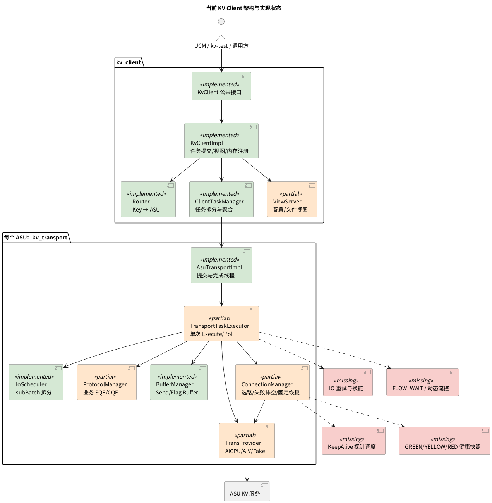
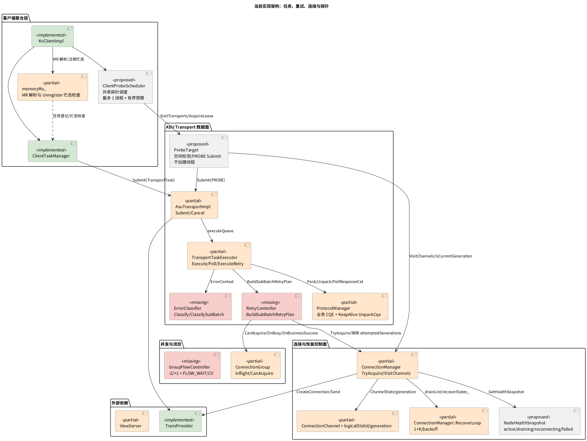
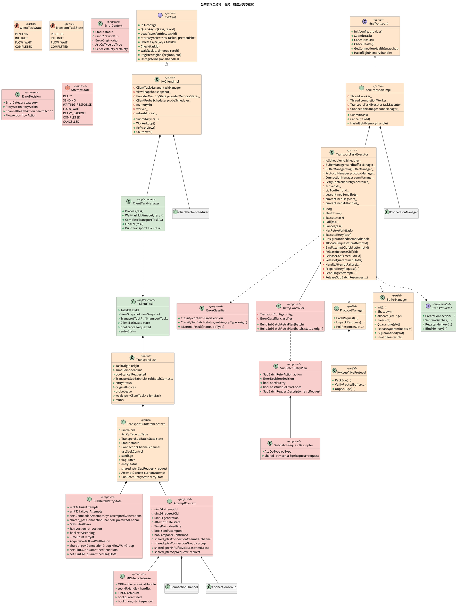
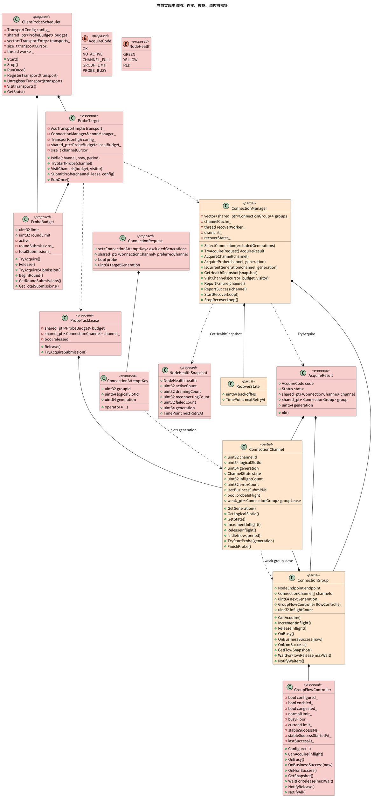
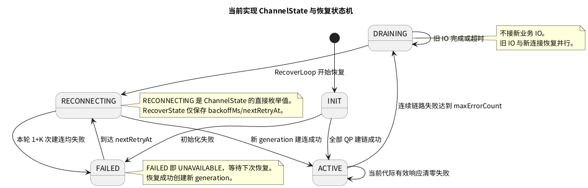
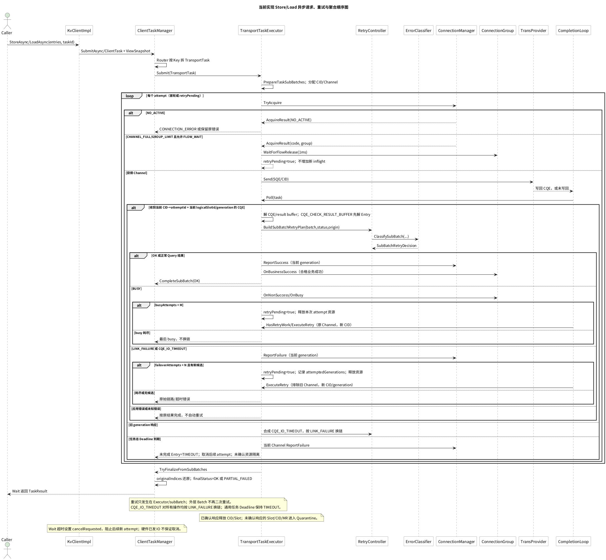
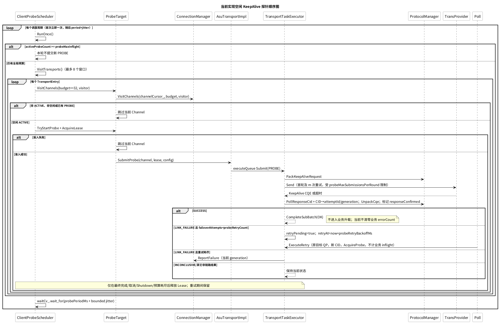
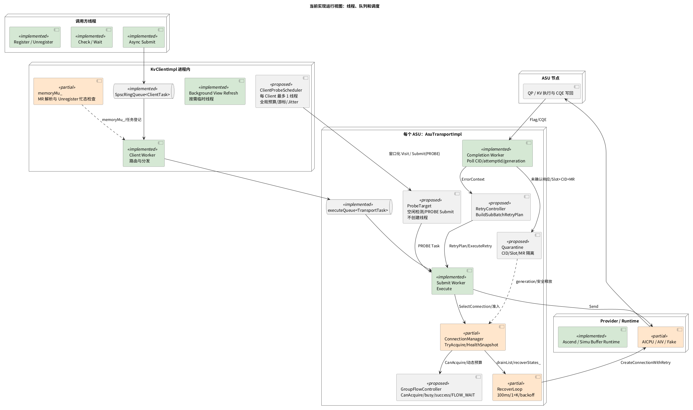

# SR20261025425863 KV Client 连接可靠性、重试与流控设计

> 文档状态：**范围与设计决策已确认，待实现**  
> 版本：v0.4.5
> 日期：2026-11-17
> 原始需求：[SR20261025425863.md](SR20261025425863.md)  
> 代码基线：[kv_semantics/include](../include)、[kv_semantics/src](../src) 当前实现  
> 说明：本文覆盖原 SR 的全部交付范围，不将动态流控、节点三色状态、Batch 处理等能力默认移出范围。v0.4.0 新增探针资源硬约束：`ClientProbeScheduler` 每 Client 最多一个共享线程，`ProbeTarget` 不创建线程；扫描、提交、在途任务和独立探针超时均必须有界。当前实现已迁移为该共享模型，默认 `probeEnabled=false` 保留兼容策略，显式开启时每 Client 仅一个共享探针线程。v0.4.1 移除公共 UNKNOWN 及按操作类型的超时 veto，所有操作超时统一按 LINK_FAILURE 换链，评估材料单独保存。v0.4.2 按当前实现重绘类图、运行视图、状态机、业务顺序/活动图和 KeepAlive 顺序图；未实现的独立目标类不再出现在当前实现图中。v0.4.3 按方案 D 补齐 FLOW_WAIT、健康快照、逻辑 Slot、CID/attempt 映射、MR/Slot Quarantine 和 Wait 取消，新增 16 项目标能力测试，当前全量 478/478 通过。v0.4.4 增加 CID 耗尽时的打包前拒绝，新增 `CidExhaustionRejectsRequestBeforePacking`，当前全量 479/479 通过。v0.4.5 接入 `probeRetryCount/probeRetryBackoffMs` 的轮内重试与 `retryAt` 退避，新增 3 个 PROBE 重试用例和 2 个退避用例，当前全量 484/484 通过。

## 1. 文档目的与阅读约定

本文用于：

1. 描述当前代码架构和已实现能力。
2. 给出满足原 SR 所需的目标架构、模块变更点和关键流程。
3. 标出不同能力之间的依赖与设计冲突。
4. 汇总影响设计和实现的设计决策，作为实施和后续演进依据。
5. 为开发拆分、测试设计和验收提供统一基线。

### 1.1 实现状态标记

| 标记 | 含义 |
|---|---|
| **[已实现]** | 原始代码基线中已有相对完整的实现路径。 |
| **[部分实现]** | 原始代码基线中已有可复用骨架或部分逻辑，但尚不满足目标闭环。 |
| **[未实现]** | 原始代码基线中未形成目标能力，需要新增或实质改造。 |
| **[待确认]** | 预留标记：后续如出现新的设计冲突或外部契约变化，需重新评审后确定。 |
| **[已确认]** | 设计决策已由需求方明确，可据此开展详细设计和实现。 |
| **[设计约束]** | 为保证正确性或安全性，建议直接固化的规则。 |

> 状态标记仅用于对比原始代码基线，表示原实现能力，不表示本次变更类型或最新实现进度；最新实现证据单独见《实现与验证记录》。状态标记本身不表示已通过真实 AICPU/AIV、UB/RoCE 或 ASU 硬件环境验证。
>
> PlantUML 图例：绿色 `implemented`=已实现，橙色 `partial`=部分实现，红色 `missing/proposed`=未实现/新增建议，黄色 `pending`=待确认。

### 1.2 设计约束

- 延续现有 `KvClientImpl → AsuTransportImpl → TransProvider` 分层，不新增平行传输链路。
- 重试在 `TransportTaskExecutor/subBatch` 层完成，不上移至 `ClientTaskManager`，避免重复调度其他 ASU 或已成功 subBatch。
- 保持现有 `TaskId、Check、Wait、TaskResult、entryStatus` 的基本聚合方式；公共行为变化统一在第 12 章和第 14 章记录。
- 原 SR 的“实时统计 IO 流量先不要考虑”解释为：本期不实现字节带宽、IOPS 统计与限速；inflight 并发统计和动态并发阈值仍在交付范围内。
- 探针采用 `KvClientImpl → ClientProbeScheduler → ProbeTarget → AsuTransportImpl` 的共享模型：每 Client 最多一个探针线程，禁止每 ASUTransport 一个探针线程；`VisitTransports/VisitChannels` 使用有界游标窗口，禁止每轮全量快照；`activeProbeCount`、每轮提交和独立 `probeTimeoutMs` 均为硬上限。

## 2. 交付范围

### 2.1 本期能力

- **[部分实现]** QP 连接管理、轮询和最小负载选路。
- **[部分实现]** 根据业务 IO 结果更新连接状态。
- **[未实现]** 按错误类型执行原链重试、换链重试和重试退避。
- **[未实现]** 空闲 KeepAlive 探针及探针结果驱动的连接状态更新。
- **[部分实现]** 异常连接的后台恢复、失败退避和恢复上线。
- **[部分实现]** 单 QP inflight 并发限制。
- **[已实现（按配置启用）]** FLOW_WAIT、busy 动态阈值、Endpoint 联动和动态解除。
- **[部分实现]** Batch 拆分和结果汇总。
- **[未实现]** Batch 按失败 Entry 的错误码种类进行 subBatch 级重试与重复执行结果汇总。
- **[已实现]** GREEN/YELLOW/RED 节点连接健康快照。
- **[部分实现]** 日志和指标基础设施，需补充新事件与指标口径。
- **[已确认]** Wait 超时、重试、MR 注销和 Buffer 释放的生命周期契约。

### 2.2 非目标

- 不实现通用字节带宽或 IOPS 限速。
- 不通过重试将 Key 默认重新路由到其他 ASU；跨 ASU 数据迁移不属于普通连接换链。
- 不改变现有 Router 的数据所有权语义。

## 3. 当前实现架构

### 3.1 当前代码分层



### 3.2 已实现的核心调用链

**[已实现]**

```text
Query/Load/Store/Delete Async
  → KvClientImpl::SubmitAsync
  → ClientTask
  → ClientTaskManager::Process
  → Router 按 Key 拆分 TransportTask
  → AsuTransportImpl::Submit
  → TransportTaskExecutor::Execute
  → IoScheduler 拆 subBatch
  → ProtocolManager 打包 SQE
  → ConnectionManager 选择 Channel
  → TransProvider::Send
  → CompletionLoop 轮询 Flag Buffer
  → CQE/Entry 状态解析
  → ClientTaskManager 按 originalIndices 聚合
  → Check/Wait
```

当前路径是**单次实际发送**，不包含 SR 所需的原链/换链重试。

## 4. 目标架构



### 4.1 核心依赖关系

```text
ErrorClassifier
  ├─ 输出 ErrorCategory/RetryAction/ChannelHealthAction/FlowAction
  ├─ 对 subBatch 统计失败错误码并生成 needsRetry/hasMultipleErrorCodes
  └─ 不直接修改连接状态或创建线程

RetryController
  ├─ 当前仅构造 SubBatchRetryPlan，不负责独立调度线程
  ├─ 保存 opType 和原始 SqeRequest 描述
  └─ 由 TransportTaskExecutor 调用并驱动后续 ExecuteRetry

TransportTaskExecutor
  ├─ 负责 Execute/Poll/HasRetryWork/ExecuteRetry
  ├─ 每次发送重新经过 SelectConnection/AcquireChannel
  ├─ busy 原链 M 次，LINK_FAILURE/CQE_IO_TIMEOUT 换链 N 次
  └─ 任务总 Deadline 到期时直接完成 TIMEOUT

ConnectionManager
  ├─ 通过 SelectConnection/AcquireChannel 完成选路和 inflight 准入
  ├─ 通过 `TryAcquire` 返回详细准入原因并提供 `GetHealthSnapshot`
  ├─ 维护 `logicalSlotId`、generation、drainList 和 recoverStates_
  ├─ 通过 `RecoverLoop` 执行 1+K 建连和退避
  └─ `CheckHealth()` 继续只表示 Worker 存活；健康快照不改变 GlobalView

ClientProbeScheduler
  ├─ 每 Client 最多一个共享探针线程，按游标窗口访问 Transport
  ├─ 维护全局 activeProbeCount、扫描/提交预算和独立 probeTimeoutMs
  └─ 通过 ProbeTarget 复用目标 QP 与 TransportTask 数据面，不参与业务动态升载

ProbeTarget
  ├─ 只探测 ACTIVE 且空闲连接，按游标窗口访问 Channel
  ├─ 不创建线程，不负责 Transport 注册和全局预算
  └─ 终态通过 ProbeTaskLease 幂等释放在途计数和 probeInFlight
```

## 5. 模块变更点

| 模块/文件 | 当前实现 | 目标变更 | 状态 |
|---|---|---|---|
| [kv_types.h](../include/kv_types.h) | 有基础配置和状态码 | 增加重试、探针、恢复、流控配置；`CQE_IO_TIMEOUT` 沿用协议原值并按链路故障换链，不新增公共结果状态 | **[已确认]** |
| [kv_client.h](../include/kv_client.h) | 异步 IO、Check/Wait、MR 注册 | 保留 Wait 超时消费语义；inflight MR 返回 `RESOURCE_BUSY`；Transport 侧新增健康快照；首版不新增 Drain | **[已确认]** |
| [task_context.h](../src/common/utils/task_context.h) | ClientTask、TransportTask、subBatch 上下文 | 增加 BUSINESS/PROBE、attempt、generation、重试状态、目标 Channel、统一 Deadline | **[未实现]** |
| [client/task](../src/client/task) | 多 ASU 任务拆分和原顺序聚合 | 保持职责，不增加换链；处理最终应用/协议结果和超时取消语义 | **[部分实现]** |
| [client](../src/client) | Wait、Shutdown、MR 注册、视图刷新 | 保留 Wait 超时消费并取消后续新 attempt；inflight MR 返回 `RESOURCE_BUSY`；未确认 Slot/CID/MR 进入 Quarantine；RED 与视图解耦；持有每 Client 最多一个 `ClientProbeScheduler` 共享探针线程和全局预算 | **[已确认]** |
| `src/client/probe_scheduler.*` | 无 | 新增 `ClientProbeScheduler`：每 Client 最多一个共享线程，负责 Transport 注册、游标、扫描/提交/在途预算和独立 probeTimeoutMs；`ProbeTarget` 仅保留无线程目标适配 | **[未实现]** |
| [connection_internal.h](../src/trans/conn/connection_internal.h) | ACTIVE/DRAINING/FAILED、inflight、errorCount | `SelectConnection/AcquireChannel`、generation、恢复状态、Group 流控状态 | **[部分实现]** |
| [trans/conn](../src/trans/conn) | 两种选路、失败排空、固定周期恢复 | 等待唤醒、K 次恢复、指数退避、健康快照、动态预算 | **[部分实现]** |
| [trans/task](../src/trans/task) | 单次 Execute/Poll、超时和 CQE 处理 | ErrorClassifier、attempt 重试、FLOW_WAIT、无线程 ProbeTarget、响应代际检查 | **[部分实现]** |
| [kv_submit_flow.cc](../src/trans/task/kv_submit_flow.cc) | 单次 SQE 构建和 Send | 每次 attempt 重建 CID/响应上下文、重试集合和退避调度 | **[部分实现]** |
| [io_scheduler.cc](../src/trans/task/io_scheduler.cc) | 按协议上限拆批 | 支持按失败 Entry 集合重建重试 subBatch | **[部分实现]** |
| [trans/proto](../src/trans/proto) | 业务 SQE/CQE、KeepAlive Pack/Verify | 补 KeepAlive UnpackCqe | **[未实现]** |
| [kv_transport_impl.cc](../src/trans/kv_transport_impl.cc) | Submit Worker、Completion Worker | 仅提供 PROBE Submit、目标 Channel 和健康查询；不得创建 ProbeScheduler 或探针线程；Retry/FLOW_WAIT 仍由既有调度路径执行 | **[部分实现]** |
| [trans/buffer](../src/trans/buffer) | Send/Flag Slot 池 | 超时 Slot 隔离、迟到 CQE 防护、重试 Slot 生命周期 | **[已确认]** |
| [trans_provider](../src/trans_provider) | CreateConnection/Send/MR | 保持接口；补充错误码语义，不将重试下沉到 Provider | **[部分实现]** |
| [view_server.cc](../src/client/view/view_server.cc) | 错误触发后台刷新 | 区分本地 RED 与全局成员变更，避免瞬时故障误删节点 | **[已确认]** |
| [parser_common.cc](../src/common/utils/parser_common.cc) | 基础配置解析 | 新增策略、重试、探针、恢复和流控参数解析与范围校验 | **[未实现]** |
| [common/logger](../src/common/logger)、[metrics](../metrics) | 日志和基础指标 | 增加 attempt/task 两级指标、状态转换及流控事件 | **[部分实现]** |

## 6. 类图

> 本图按当前代码结构绘制；`implemented/partial/proposed/pending` 仍只表示原始代码基线，不表示当前实现进度。`ConnectionAttemptKey`、`ConnectionRequest/AcquireResult`、`NodeHealthSnapshot`、FLOW_WAIT、`logicalSlotId`、CID/attempt 映射和 Quarantine 已纳入当前实现图。`LifecycleCoordinator`、独立 `RecoveryController`、`GroupFlowState` 和 `channelMu` 仍不作为独立实现类存在。`MRLifecycleLease` 已记录 MR 句柄集合，未知资源由 Executor 级 Quarantine 注册表保持到 Shutdown。





## 7. 核心设计

### 7.1 统一错误决策

**[未实现]** 新增 `ErrorClassifier`，由业务 IO、Batch、探针和连接恢复共同使用，避免同一错误在不同模块产生不同解释。

| 错误类别 | 请求动作 | 连接健康动作 | 流控动作 | 状态 |
|---|---|---|---|---|
| 应用错误 | 不重试，返回 Entry 结果 | 有效响应可证明链路可用，不记失败 | 默认不升载、不降载 | **[已确认 Q2/Q24]** |
| Query miss | 作为正常查询结果 | 不记失败 | 按正常查询完成计入升载（Q24） | **[已确认 Q24]** |
| busy | 原链重试，额外最多 M 次 | 不记链路失败 | busy 降载，进入 Group 联动 | **[已确认 Q3/Q4/Q23]** |
| 明确链路故障 | 换其他 ACTIVE 连接，额外最多 N 次 | 记录失败，达到 X 后 DRAINING | 不按 busy 处理 | **[已确认 Q1/Q3/Q11]** |
| 超时 | 换其他 ACTIVE 连接，额外最多 N 次 | 记录失败，达到 X 后 DRAINING | 不升载 | **[已确认 Q3/Q11]** |
| 探针结果不可信 | 不改变业务任务 | 状态不变 | 不处理 | **[已确认 Q14]** |
| 未知错误 | 默认不重试 | 有合法响应时不记链路失败；只有明确说明为传输链路故障时才按 LINK_FAILURE 处理 | 默认不处理 | **[已确认 Q2]** |

**[设计约束]** 业务成功与链路成功必须分离；应用错误不能直接等同链路故障，合法响应也不能直接等同业务成功。

### 7.2 连接状态机



`FLOW_WAIT` 不是 `ChannelState`，而是 `ClientTaskState`、`TransportTaskState` 和 `AttemptState` 中的等待状态：ACTIVE Channel 满负载且 `flow_wait` 开启时，任务进入 `FLOW_WAIT`，由 Group 条件变量唤醒后重新 `TryAcquire`；无 ACTIVE、Deadline 到期或取消时离开等待，不得把 Channel 画成 FLOW_WAIT。

#### 原子准入

当前实现提供 `ConnectionManager::TryAcquire(ConnectionRequest)`，返回 `AcquireResult`，区分 `NO_ACTIVE`、`CHANNEL_FULL`、`GROUP_LIMIT` 和 `PROBE_BUSY`。`SelectConnection/AcquireChannel` 保留兼容包装；成功后同时增加 QP/Group inflight，`AssignSubBatchConnections` 随后调用 `MarkBusinessSubmit`。资源释放由 `TransportTaskExecutor::ReleaseSubBatchResources` 完成。

```text
检查 ACTIVE 与 logicalSlotId+generation
→ 检查 QP 硬上限
→ 检查 Group 动态预算（flowControlEnabled 时）
→ 增加 QP/Group businessInflight
```

当 `flowControlEnabled=true` 且 `channelFullPolicy=flow_wait` 时，`CHANNEL_FULL/GROUP_LIMIT` 进入有界 `FLOW_WAIT`，通过 `GroupFlowController::WaitForRelease` 等待 inflight 释放、恢复变化或短周期超时；`NO_ACTIVE` 立即返回 `CONNECTION_ERROR`，不与满负载等待混用。默认 `flowControlEnabled=false`、`channelFullPolicy=fail_fast`，保持兼容行为。

PROBE 走独立互斥准入：通过 `TryStartProbe` 检查 ACTIVE/generation 并设置 `probeInFlight`，不增加业务 QP/Group inflight，不更新 `lastBusinessSubmit`，也不进入业务 FLOW_WAIT。

状态变化与获取连接的线性化规则：

- 先 DRAINING，则后续请求不得获取。
- 先成功获取，则该请求属于旧 inflight，可继续完成。
- Release 使用 AttemptContext 中保存的原 Channel/Group lease，避免误减新 generation 的负载。

### 7.3 重试与响应隔离

#### 重试边界

- **[已确认 Q1]** 换链默认限定在同一 ASU 内；不得直接跨 ASU 改变 Key 所属节点。
- **[已确认 Q3]** busy 原链重试；明确链路故障和超时均按 LINK_FAILURE 换链重试。
- **[已确认 Q8]** M/N/K/m 均定义为首次尝试后的额外次数，即 busy、换链、单轮建连和单轮探测的最大实际尝试次数分别为 `1+M`、`1+N`、`1+K`、`1+m`。
- **[已确认 Q28]** 换链排除本请求已尝试的 Channel 代际，候选连接不足时提前返回，不循环选择已失败连接。
- **[已确认 Q29]** 排队、FLOW_WAIT、退避和全部重试共享任务总 Deadline；Poll 到期完成 TIMEOUT；Wait 超时同时取消后续新 attempt，但硬件已发 IO 不保证停止。

#### 超时重试

| 操作 | 超时后的处理 | 状态 |
|---|---|---|
| Query/Load/Delete/Store/BATCH_STORE | 统一按 LINK_FAILURE 记录当前 Channel 失败，并换其他 ACTIVE 连接，额外最多 N 次；不再按操作类型设置超时重试 veto | **[已确认 Q3/Q5]** |

#### 响应安全

**[已实现]** 每次实际发送使用新的 `attemptId/requestCid`。SQE 构建阶段的 CID 通过 `BindAttemptCid` 绑定 attemptId，重试通过 `AllocateRequestCid(attemptId)` 分配；Poll 校验 `CID→attemptId` 和当前 `logicalSlotId+generation`，合法解包后 `ReleaseConfirmedCid`，未确认响应的 CID 保持隔离。

- 旧 attempt 或旧 generation 的迟到 CQE 不得完成当前 attempt。
- 超时的 Flag Slot 不得立即复用；安全隔离期或 Provider 确认机制见 Q10。
- Wait 到期后不得再启动新 attempt，但已发硬件 IO 不宣称已取消。

### 7.4 Batch 处理

**[部分实现]** 当前已有 subBatch 拆分、逐 Entry 解析和原顺序聚合。

目标采用 **subBatch 级错误码判定与重试**：

1. 先解析 CQE 和 result buffer，统计失败 Entry 的错误码种类；`OK`、Query 的正常存在/不存在结果不计入错误种类。
2. **仅一种失败错误码**：按单条异常的处理策略处理整个 subBatch：
   - 应用错误：不重试，直接返回。
   - busy：原连接短退避重试，额外最多 M 次；最终仍 busy 则返回，不换链。
   - 明确链路故障：换其他 ACTIVE 连接，额外最多 N 次。
   - 超时：按 LINK_FAILURE 换其他 ACTIVE 连接，额外最多 N 次。
   - 未知错误：默认不自动重试。
3. **多种失败错误码**：只要存在至少一种需要重试的错误码，就以**整个原始 subBatch**为最小单位换链重试，额外最多 N 次；只有全部错误均无需重试时才直接返回。应用错误、成功 Entry 也可随整体重试再次执行，不拆分为可重试 Entry 子集。
4. 含超时的 subBatch 与明确链路故障一致，按单错误/多错误码规则处理，不另设按操作类型的超时 veto。
5. 外层 Batch/ClientTask 只汇总最终结果，不执行第二轮自动重试或第二次错误处理。
6. 重试以完整原始 subBatch 为单位，采用 **at-least-once** 语义：成功 Entry 和应用错误 Entry 均可能随整体重试再次执行；每次响应后重新判断是否仍需重试，最终按最终有效 subBatch 响应和 originalIndices 回写一次，不使用 Entry 子集或首次结果缓存替代整体重试。

**[已确认 Q7]** 采用 subBatch 级处理：单一失败错误码按单条异常策略处理；多种失败错误码时，只有全部无需重试才不重试，只要存在需要重试的错误码，就将完整原始 subBatch 换链重试 N 次；外层 Batch 只汇总，不进行二次处理。

> subBatch 换链的未决确认点、整体换链准入和后续评审记录统一见 [SR20261025425863-subBatch扩展合理性分析.md](SR20261025425863-subBatch扩展合理性分析.md)。

### 7.5 业务 IO 活动流程图

```plantuml
@startuml
title 当前实现业务 subBatch 执行活动图
skinparam activity {
  BackgroundColor #FFFFFF
  BorderColor #666666
  DiamondBackgroundColor #FFF2CC
}
skinparam defaultFontName "Noto Sans CJK SC"
start
:PrepareTaskSubBatches；
:AssignSubBatchConnections / TryAcquire；
if (CHANNEL_FULL/GROUP_LIMIT 且允许 FLOW_WAIT?) then (是)
  :currentAttempt=FLOW_WAIT；记录 flowWaitGroup；
else (否)
  :Provider::Send；
endif
while (TransportTask 尚未最终完成)
  if (任务总 Deadline 到期?) then (是)
    :未完成 Entry=TIMEOUT；
    :当前 Channel ReportFailure；
    :CompleteSubBatch 并释放资源；
  else (否)
    if (存在 retryPending?) then (是)
      :CompletionLoop 调用 ExecuteRetry；
      if (仍 CHANNEL_FULL/GROUP_LIMIT?) then (是)
        :currentAttempt=FLOW_WAIT；Group WaitForRelease(有界)；
      else (否)
        :重新选择原 Channel 或排除 attemptedGenerations，分配新 CID/generation；
        :PrepareRetryRequest + SendSingleAttempt；
      endif
    else (否)
      :Poll(task)；
      if (AnySending、响应 Slot 为空或 CID 未就绪/不匹配?) then (是)
        :保留任务，等待后续 Completion；
      else (否)
        if (旧 generation 响应?) then (是)
          :合成 CQE_IO_TIMEOUT，进入 LINK_FAILURE 处理；
        else (否)
          :解 CQE/result buffer；
        endif
        if (OK 或正常 Query 结果?) then (是)
          :ReportSuccess + 合格业务 OnBusinessSuccess；
          :CompleteSubBatch(OK)；
        else (否)
          :HandleAttemptFailure；
          if (busy 且 busyAttempts<M?) then (是)
            :retryPending=true，释放 attempt 资源，原 Channel 重试；
          elseif (LINK_FAILURE/CQE_IO_TIMEOUT 且 failoverAttempts<N 且有候选?) then (是)
            :ReportFailure，retryPending=true，释放资源，换链重试；
          else (否)
            :保留原始错误，CompleteSubBatch；
          endif
        endif
      endif
    endif
  endif
endwhile
:TryFinalizeFromSubBatches；
:按 originalIndices 聚合为 OK 或 PARTIAL_FAILED；
stop
@enduml
```

已确认响应走 `ReleaseConfirmedCid + Free`；已发送但未确认响应的 Send/Flag Slot、CID 和 MR 句柄进入 Quarantine，直到 Shutdown 安全清理，不能用“释放资源”掩盖未确认内存的提前复用。

> 首轮必须先执行一次 `Provider::Send`；只有收到首个响应或发生超时后，才统计失败错误码并构建 RetryPlan，禁止因首轮错误码集合为空而直接 `COMPLETE`。

### 7.6 业务 IO 顺序图



### 7.7 KeepAlive 探针

#### 目标规则

- **[未实现]** 只探测 ACTIVE 且空闲的 Channel。
- **[已确认 Q15]** 空闲定义为：`businessInflight == 0` 且最近一个周期无业务提交。
- **[未实现]** 使用原 QP 和目标 generation，不能由普通选路换到其他 QP。
- **[未实现]** BUSINESS 与 PROBE 任务分离；探针不参与业务动态升载。
- **[已实现]** 每个调度周期每个目标最多 1+m 次 PROBE（首轮及额外 m 次重试）；`probeRetryCount/probeRetryBackoffMs` 已接入，`retryAt` 未到期不发起新 attempt。
- **[已确认 Q14]** KeepAlive 超时或明确网络错误按 `LINK_FAILURE` 处理；本地未发出、资源不足、内部异常或未知响应按 `INCONCLUSIVE` 处理，状态不变。
- **[部分实现]** KeepAlive SQE 已存在，`KvKeepAliveProtocol::UnpackCqe` 已实现；PROBE 成功不参与业务升载，当前不清零业务 errorCount。
- **[新增资源约束]** `ClientProbeScheduler` 每个 `KvClientImpl` 最多一个共享线程，`ProbeTarget` 不创建线程；独立使用 `AsuTransportImpl` 时由调用方提供共享调度器，禁止隐式创建 Transport 专属探针线程。
- **[新增资源约束]** 每 Client 在途 PROBE 不超过 `probeMaxInflight=64`，每轮实际 attempt（含首轮和 m 次重试）不超过 `probeMaxSubmissionsPerRound=16`；每轮 Transport 扫描不超过 8，每个被选 Transport 的 Channel 扫描不超过 32。
- **[新增资源约束]** 调度必须使用 `VisitTransports/VisitChannels` 游标窗口，禁止每轮复制全量 Transport/Channel 快照；游标与有界 jitter 保证多轮覆盖并抑制突发。
- **[新增资源约束]** `probeTimeoutMs=1000` 且必须大于 0，独立于业务 `timeoutMs`，覆盖当前 PROBE Task 及 m 次重试；`AsuTransportImpl::Submit` 不得覆盖已设置的 PROBE Deadline。
- **[新增资源约束]** Client 全局 `activeProbeCount` 包含排队、退避和等待响应的 PROBE Task；完成、超时、取消、Shutdown 和提交失败均通过 `ProbeTaskLease` 幂等释放在途计数与 `probeInFlight`。



### 7.8 后台恢复与节点健康

**[已实现]** 当前 RecoverLoop 每 100ms 对每个到期 DRAINING/FAILED Channel 调用 `CreateConnectionWithRetry`，成功后移除旧 Channel 并以原 logicalSlotId 和新 generation 创建替代 Channel。

目标补充：

- **[已实现]** 每轮首次建连后额外 K 次。
- **[已实现]** 每轮失败进入 FAILED，设置 `nextRetryAt`；`UNAVAILABLE` 仅作为 FAILED 的文档别名。
- **[已实现]** `RECONNECTING` 作为 `ChannelState` 的直接枚举值表示恢复阶段；`RecoverState` 仅保存 `backoffMs/nextRetryAt`，不另设 IDLE/RECONNECTING 独立状态类。
- **[已实现]** 指数退避、最大间隔和恢复成功重置。
- **[已确认 Q13]** 旧 IO 排空与新连接恢复并行，旧代际结果不得影响新代际健康状态。
- **[部分实现]** 分轮/公平恢复，当前按 drainList 顺序处理并限制单轮 1+K 次，跨 Channel 的严格公平调度仍需继续验证。
- **[已实现]** 新 generation 上线，旧回调不得影响新健康状态。
- **[已实现]** 节点健康快照：`ConnectionManager::GetHealthSnapshot` 和 `AsuTransportImpl::GetConnectionHealth` 返回 active/draining/reconnecting/failed 数量、当前最大 generation 和最早 nextRetryAt；StubTransport 默认返回 UNSUPPORTED。

```text
GREEN：activeCount == configuredChannelCount
YELLOW：0 < activeCount < configuredChannelCount
RED：activeCount == 0
```

**[已确认 Q18/Q19]** `activeCount==0` 时立即判定 RED，并在健康快照中保留 `nextRetryAt`；部分恢复为 YELLOW，全部恢复为 GREEN。Transport 侧新增只读健康快照，现有 `CheckHealth()` 的线程存活语义不变。RED 不直接删除 GlobalView 成员，成员变更由外部视图决定，避免瞬时故障造成路由震荡。

### 7.9 静态与动态流控

#### 基础准入

**[已实现（按配置启用）]** 当前有 QP 静态 inflight 上限、Group 动态预算和可选 FLOW_WAIT；`fail_fast` 保持满负载返回错误，`flow_wait` 在满负载时等待 Group 容量释放。

目标区分：

| 情况 | 已确认行为 | 状态 |
|---|---|---|
| ACTIVE 且容量充足 | 正常下发 | **[已实现]** |
| 有 ACTIVE 但达到当前阈值 | `flowControlEnabled=true` 且 `channelFullPolicy=flow_wait` 时进入 FLOW_WAIT，容量释放后继续；否则 CONNECTION_ERROR | **[已实现（按配置启用）]** |
| 无 ACTIVE | 立即返回 CONNECTION_ERROR（Q20） | **[已实现]** |
| FLOW_WAIT 超过总 Deadline | TIMEOUT，不再发送 | **[已实现]** |
| Transport 提交队列满 | RESOURCE_BUSY | **[已实现]** |

#### 动态预算

**[已确认 Q21]** 采用“单 QP 硬上限 + Group 共享动态预算”：

```text
channelInflight < maxInflightPerChannel
并且 groupInflight < groupCurrentLimit
```

如果 T 为单 QP 忙时下限：

```text
groupNormalLimit = Σ min(config.maxInflightPerChannel, server.ioQueueDepth)
groupBusyFloor   = Σ T
```

**[已确认 Q22]** 为修复原文公式失效，采用以下动态调整规则：

```text
busy：
    groupCurrentLimit = max(groupBusyFloor, groupCurrentLimit - 2)

非探针业务成功 subBatch：
    groupCurrentLimit = min(groupNormalLimit, groupCurrentLimit + 1)
```

首次 busy 不直接把当前值固定为 busyFloor，否则后续 `-2` 永远失效。

准入统一为：

```text
actualInflight >= currentLimit：暂停
actualInflight < currentLimit：允许
```

#### busy 重试与动态解除

- **[已确认 Q23]** busy 响应先释放上一次 attempt 的 inflight；每次重试重新经过连接状态、QP 硬上限和 Group 动态预算准入；退避期间不持有业务 inflight，实际发送后重新计入。
- **[已确认 Q24]** 仅完整成功的业务 subBatch 可将动态预算 `+1`；Query miss 按正常查询完成计入。应用错误、部分失败、busy、链路故障、超时以及探针响应均不计入升载。
- **[已确认 Q25]** busy 或其他非成功响应重置稳定计时；相邻成功响应间隔超过 `stableSuccessMs` 也重置，因此空闲不能解除限流。动态预算恢复到常态上限，或在 `stableSuccessMs` 内持续满足成功响应规则，均可解除限流。
- **[设计约束]** 探针成功不参与动态升载，也不用于证明下游已经恢复业务处理能力。

### 7.10 Wait、MR 与 Buffer 生命周期

**[已确认 Q6/Q9/Q10]** 保留 Wait 的现有任务消费方式，通过到期停止新 attempt、MR 忙态校验和响应代际隔离保证资源安全。

**当前实现更新：** `ClientTaskManager::Wait` 超时仍消费 ClientTask，并同时设置 ClientTask 与已拆分 TransportTask 的 `cancelRequested`；Process/Dispatch、`HasRetryWork/ExecuteRetry` 和 Poll 均阻止新的 attempt。已经发出的硬件 IO 不保证被取消，未确认响应的 Send/Flag Slot、CID 和 MR 句柄进入 Executor 级 Quarantine，直到 Shutdown 安全清理；运行期 Slot/CID 耗尽返回 `RESOURCE_BUSY`，避免不安全复用。

当前公共行为：

- `Wait` 超时也会消费 ClientTask。
- `UnregisterRegions` 不等待引用内存的任务完成。
- Transport Cancel 不保证中断底层 UB/RoCE IO。

引入重试后必须防止：

```text
Wait 超时并失去 TaskId
→ 底层仍在退避/换链/FLOW_WAIT
→ 调用方注销 MR 或释放 Buffer
→ 后续 attempt 继续使用旧地址和 mrKey
```

已确认的处理规则：

1. **保留 Wait 超时消费 ClientTask 的现有契约**，Wait 超时和任务总 Deadline 到期后均设置取消标记，不再启动新的 attempt、换链或 FLOW_WAIT。
2. Wait 超时不代表底层 IO 已完成，也不代表硬件已取消；已发 IO 按超时处理，迟到响应只允许完成原 attempt，不得影响新 attempt 或新 generation。
3. 已发送但无法确认服务端是否执行的 IO 仍按 `CQE_IO_TIMEOUT/TIMEOUT` 及既定 failover 策略处理；重试成功返回最终有效响应，重试耗尽或无候选 Channel 时保留原始错误，不新增公共结果状态。
4. 对仍存在 queued、retrying、FLOW_WAIT 或 inflight 引用的 MR，`UnregisterRegions` 返回 `RESOURCE_BUSY`，不得执行物理注销。调用方可稍后重试，或在 Shutdown 确认资源停止后释放。
5. 首版不新增 Drain API，以 `RESOURCE_BUSY` 阻止不安全注销；主动 Drain 能力不属于本期交付范围。
6. 超时或未确认 attempt 的 Send/Flag Slot、CID 和 MR 句柄进入隔离；当前 Provider 没有 drain-proof API，因此运行期不提前复用，Shutdown 统一清理，Slot/CID 耗尽返回 `RESOURCE_BUSY`。
7. 上述行为属于公共兼容性和安全性变更，需在实现说明和调用方迁移说明中明确记录。

## 8. 运行视图：线程、队列与调度



### 8.1 运行约束

- **[设计约束]** busy/探针退避和 FLOW_WAIT 不得通过长时间 sleep 阻塞 Submit Worker 或 Completion Worker。
- **[已确认 Q16]** 单个 Channel 的 K 次建连不得长期阻塞其他 Channel 的恢复，需分轮或公平调度。
- **[设计约束]** Completion 处理必须校验 CID→attemptId 映射和当前 `logicalSlotId+generation`；协议线上没有独立 attemptId 字段，attemptId 由 Executor 的 CID 映射本地校验。
- **[已确认 Q27]** attempt 级与 task 级耗时分别统计，避免现有 Send/Completion 指标在重试后失真。

### 8.2 探针资源硬预算

| 资源项 | 目标约束 | 验收要求 |
| --- | --- | --- |
| 线程 | `probeEnabled=true` 时每 Client 最多 1 个 `ClientProbeScheduler` 线程，禁用为 0；Transport/QP 不得创建探针线程 | 大数量 Transport 注册表只产生一个探针线程 |
| 在途任务 | 每 Client 全局 `activeProbeCount <= probeMaxInflight=64`，包含排队、退避和等待响应 | 无 CQE 时达到上限即停止接受新 PROBE，终态释放后才能继续 |
| 每轮提交 | 首轮和 m 次重试合计不超过 `probeMaxSubmissionsPerRound=16` | 每轮 Submit/Send 计数不越界，重试也计入预算 |
| 每轮扫描 | Transport 窗口 <=8，每个 Transport 的 Channel 窗口 <=32；游标推进覆盖全部目标 | 大数量注册表窗口正确，禁止全量快照和全量遍历 |
| 临时内存 | 任务对象/Lease 为 O(64)，弱引用注册表为 O(Transport+Channel)，不随周期累计 | 长周期无 CQE、完成、取消、Shutdown 后检查计数和对象数量 |
| Slot | 每个活跃 attempt 最多 1 个 Send Slot 和 1 个 Flag Slot，释放路径覆盖所有终态 | 小容量 BufferPool 无越界，超时/取消后槽位可回收 |
| 探针超时 | `probeTimeoutMs=1000` 且必须大于 0，独立于业务 `timeoutMs`，覆盖当前 PROBE Task 及 m 次重试 | 0 值拒绝；超时后 activeProbeCount 和 probeInFlight 均释放 |
| 公平与突发 | Transport/Channel 游标推进，并加入有界 jitter | 多轮覆盖所有目标，单轮不超预算 |

共享调度器的生命周期由 `KvClientImpl` 管理：先停止 `ClientProbeScheduler`，再注销和销毁 Transport。`ProbeTarget` 只保存目标适配和游标，不拥有线程；独立使用 `AsuTransportImpl` 时由调用方提供共享调度器，不得隐式创建 Transport 专属线程。

### 8.3 运行时线程模型（当前实现）

本节描述当前实现的线程职责和生命周期，与原始基线的 `implemented/partial/missing/proposed` 图例分开；图例不用于表示本次线程新增或修改。

| 组件 | 实例数量 | 启动/停止 | 空闲与调度行为 |
| --- | --- | --- | --- |
| `KvClientImpl::worker_` | 每 Client 1 个 | ClientTask 队列建立后启动，Shutdown 设置 `stopWorker_` 后 join | 空队列时在条件变量上等待，不周期轮询业务任务 |
| `KvClientImpl::refreshThread_` | 每 Client 0 或 1 个临时线程 | RequestBackgroundRefresh 创建，下一次刷新前 join 旧线程，Shutdown 收尾 | 只在视图刷新期间存在，不是常驻线程；同一 Client 同时最多一个 |
| `ClientProbeScheduler::worker_` | 每 Client 0 或 1 个 | Transport 注册完成、`probeEnabled=true` 且配置合法后，在 Snapshot 初始化完成后启动；Shutdown 在销毁 Transport 前停止 | 首次立即 RunOnce，之后按 `probePeriodMs` 加有界 jitter 等待；不创建 per-Transport/per-QP 线程 |
| `AsuTransportImpl::worker_` | 每真实 AsuTransportImpl 1 个 | Buffer/Queue 初始化完成后启动，Shutdown 停止提交后 join | `executeQueue_.ConsumerLoop` 等待新任务，空队列时不周期忙轮询 |
| `AsuTransportImpl::completionWorker_` | 每真实 AsuTransportImpl 1 个 | 与 Submit Worker 同期启动，Shutdown 停止 CompletionLoop 后 join | 空任务每 50µs 轮询一次；有任务时执行 HasRetryWork/ExecuteRetry/Poll，连续无完成达到 completionPollSpinLimit 后 yield |
| `ConnectionManager::recoverWorker_` | 每真实 AsuTransportImpl 1 个 | AsuTransportImpl::Init 在 TaskExecutor 初始化前启动，ConnectionManager::Shutdown 停止并 join | 每 100ms 检查 drainList；同一 Channel 的 1+K 次建连在该线程内串行执行，不创建 K 个线程 |
| `ProbeTarget`、`ProbeBudget`、`ProbeTaskLease` | 0 个线程 | 随共享调度器/PROBE Task 创建和释放 | 仅保存目标、预算和 Lease；PROBE 复用所属 Transport 的 Submit/Completion Worker |
| `ErrorClassifier`、`RetryController`、`GroupFlowController` | 0 个线程 | 随 Transport/ConnectionGroup 创建 | 同步错误分类、重试计划和流控处理；`RetryController` 仅构造计划，FLOW_WAIT 使用 Group 条件变量有界等待，不创建独立调度线程 |
| Provider 内部线程 | 由 Provider 决定 | 由 AICPU/AIV/Fake Provider 实现和配置决定 | 不计入以下公式，需按具体 Provider 单独评估 |

`T` 表示仍存活的真实 `AsuTransportImpl` 数量，包含 `retiredTransports_` 中尚未 Shutdown 的对象，不包括 Stub/NoopTransport。设 `P∈{0,1}` 表示共享 Probe 是否启用，`R∈{0,1}` 表示当前是否存在临时视图刷新线程，则单个 KvClientImpl 的线程数约为：

```text
1（Client Worker） + 3T（Submit/Completion/Recover） + P（共享 Probe） + R（临时 Refresh）
= 1 + 3T + P + R
```

另加 Provider 内部线程。T=1000 时，禁用探针为 `3001 + Provider 内部线程`，启用共享探针为 `3002 + Provider 内部线程`。`probeEnabled=false` 只关闭共享 Probe 线程，不会关闭 Submit/Completion/Recover 三类 Transport 线程；当前代码在探针关闭时仍可能创建 ClientProbeScheduler、ProbeTarget 和 local ProbeBudget 对象，这属于对象开销而不是线程开销。

#### 重试、PROBE 与恢复

- busy 的 M 次额外尝试、failover 的 N 次额外尝试以及恢复的 K 次额外建连都在既有 Worker/Completion/Recover 线程内串行执行，不创建 per-attempt、per-subBatch 或 per-Channel 线程。
- PROBE 的 m 次额外尝试也在既有 Completion Worker 中执行；`retryAt` 到期后才发送，所有首轮和重试都计入共享/本地 `ProbeBudget`。
- `TransportTaskExecutor` 不拥有独立工作线程，Execute/Poll/ExecuteRetry 由所属 AsuTransportImpl 的 Worker/Completion 调用。
- `ClientProbeScheduler::RunOnce` 每轮最多访问 8 个 Transport、每个 Transport 最多 32 个 Channel、最多提交 16 个 attempt，Client 全局在途 PROBE 不超过 `probeMaxInflight=64`；这些是任务/CPU 上限，不是线程上限。
- `ProbeTarget::RunOnce` 是被动接口，不创建线程。独立使用 AsuTransportImpl 时由调用方提供调度线程；直接对每个 ProbeTarget 手动 RunOnce 使用各自 localBudget，并不自动享有 ClientProbeScheduler 的全局 64 个在途上限，不能据此认为全局资源已受控。

#### 生命周期顺序

1. **初始化**：每个 AsuTransportImpl 先启动 RecoverLoop，再初始化 TaskExecutor/Buffer，最后启动 Submit/Completion Worker。KvClientImpl 完成 Snapshot 后创建并注册 ClientProbeScheduler，再启动 Client Worker、发布 `initialized_`，最后启动共享 Probe 线程。
2. **视图刷新**：`refreshThread_` 只在刷新期间存在且前一个线程先 join；未变化 Transport 复用，新增 Transport 注册到共享 ProbeScheduler，移除 Transport 注销 ProbeTarget 并进入 `retiredTransports_`。移除对象不再产生新 PROBE，但其 Submit/Completion/Recover 线程保留到 Client Shutdown，因此 `T` 不能只按当前视图 ASU 数计算。
3. **关闭**：先将 `initialized_` 置为 false 并停止接收新任务，join 视图刷新线程和 Client Worker；随后停止共享 ProbeScheduler，再排空任务并关闭 active/retired Transport。每个 Transport 停止 Submit/Completion/Recover、取消剩余任务并释放 Buffer/MR，最后 reset ClientProbeScheduler、清理 Provider 和 Snapshot。
4. **PROBE 释放**：`ProbeTaskLease` 在 `TransportTask::TryFinalizeFromSubBatches`、`TransportTaskManager::NotifyCompletion` 和 `TransportTaskExecutor::Cancel` 的终态释放，保证共享 Probe 线程停止后，已有 PROBE 仍能安全完成或被取消。

#### 锁与线程协作

- `producerMu_` 保护 Transport 的停止接收标记和 executeQueue 提交；`TransportTask::mutex` 协调 Execute/Poll/Retry/Cancel。
- `ConnectionManager::structureMu_` 保护 Group/Channel 结构和 generation 校验；`channelCacheMu_` 保护选路缓存；`GroupFlowController::mu_` 保护动态预算，不引入额外线程。
- `ClientProbeScheduler::registryMu_` 保护 Transport 注册表和 transportCursor；`runMu_` 串行化共享 `RunOnce`；`waitMu_/waitCv_` 负责共享线程停止与唤醒。
- `ConnectionManager::VisitChannels` 仅在捕获有限 Channel 窗口时持有 `structureMu_`，Visitor 和 Submit 在锁外执行，避免在结构锁内调用 Provider。
- `KvClientImpl::memoryMu_` 串行化 MR 注册、MR 解析/提交与 UnregisterRegions；`ClientTask::waitMu` 保护 ClientTask Entry/Result 更新，防止注销与任务拆分并发造成悬空引用。

## 9. 配置变更

| 配置组 | 参数项 | 当前状态 | 备注 |
|---|---|---|---|
| 连接 | `qpNum`、`selectionPolicy`、`maxInflightPerChannel` | **[部分实现]** | 默认 `ROUND_ROBIN`（Q26） |
| 健康 | `maxErrorCount X` | **[已实现]** | 当前代码默认 2，目标默认 `X=1`（Q11/Q26） |
| 任务超时 | `taskTimeoutMs`、`attemptTimeoutMs` | **[已确认]** | 全部重试共享任务总 Deadline，单次 attempt 不超过剩余时间（Q29） |
| 建连 | `connectTimeoutMs`、`connectRetryPerRound K` | **[未实现]** | 每轮首次建连后的额外次数（Q8/Q16） |
| busy 重试 | `busyRetryCount M`、`busyRetryBackoffMs` | **[未实现]** | 首次后的额外次数（Q8） |
| 换链 | `failoverRetryCount N` | **[未实现]** | 同 ASU 内换链，排除已尝试代际（Q1/Q28） |
| 恢复 | `recoverInitialBackoffMs`、`recoverMaxBackoffMs` | **[未实现]** | 有上限的指数退避，成功重置（Q16） |
| 探针 | `probeEnabled`、`probePeriodMs`、`probeRetryCount m`、`probeRetryBackoffMs` | **[已实现]** | 默认 `probeEnabled=true`（Q26），但只能由 Client 级共享调度器启动；轮内 m 次重试和退避已接入 |
| 探针资源 | `probeMaxInflight`、`probeMaxSubmissionsPerRound`、`probeTransportScanBudget`、`probeChannelScanBudgetPerTransport`、`probeTimeoutMs` | **[新增资源约束]** | 分别默认 64、16、8、32、1000；每 Client 在途/提交/扫描均有限，超时必须大于 0；每 Client 固定最多 1 个探针线程 |
| 流控 | `flowControlEnabled`、`busyFloor T`、`stableSuccessMs` | **[已确认]** | 默认开启；Group 共享预算（Q21/Q26） |
| 兼容 | `channelFullPolicy=FAIL_FAST/FLOW_WAIT` | **[已确认 Q26]** | 默认 `FLOW_WAIT`（Q20/Q26） |

**[已确认 Q8]** `busyRetryCount M`、`failoverRetryCount N`、`connectRetryPerRound K`、`probeRetryCount m` 均表示首次尝试后的额外次数；取值为 0 表示不执行额外重试。

**[设计约束]** `maxInflightTasks`、单 QP inflight、Group 动态预算、`defaultWaitTimeoutMs`、`taskTimeoutMs` 和 `attemptTimeoutMs` 是不同概念，不得复用同一字段。`probeMaxInflight`、`probeMaxSubmissionsPerRound`、`probeTransportScanBudget`、`probeChannelScanBudgetPerTransport` 和 `probeTimeoutMs` 也必须使用有限合法值；`probeTimeoutMs=0` 在启用探针时直接拒绝。每 Client 探针线程数固定为最多 1 个，不开放按 Transport 扩张的配置项。

## 10. 日志、指标与可观测性

### 10.1 必记事件

- **[部分实现]** 当前已有基础错误日志和任务耗时指标。
- **[未实现]** IO 重试、换链、连接状态转换、探针结果、恢复结果、FLOW_WAIT、动态阈值变化和节点健康变化。

统一公共字段：

```text
taskId、subBatchId、attemptId、requestCid
nodeId、groupId、channelId、generation
errorCode、errorCategory、retryIndex、retryLimit
inflight、currentLimit、nextRetryAt、durationMs
```

### 10.2 指标口径

**[已确认 Q27]**

- attempt 级：单次 Send、单次响应、错误类别。
- task 级：排队、FLOW_WAIT、退避、全部重试后的端到端结果。
- 连接级：inflight、失败计数、状态转换、代际。
- Group 级：动态预算、busy、成功升载、解除限流。
- 节点级：active/draining/reconnecting/failed 数量和 RED 转换。

高频 busy 和探针日志必须限流；不得记录业务 Payload，Key、地址和 Token 的输出遵循安全规范。

## 11. 实现能力与交付拆分

### 阶段 A：公共基础与安全边界

- ErrorClassifier 和错误码映射。
- `SelectConnection/AcquireChannel` 与 `ReleaseSubBatchResources`。
- 统一任务总 Deadline。
- Connection generation 与迟到响应隔离。
- Wait/MR 生命周期契约确认及基础实现。

### 阶段 B：重试、Batch 和静态流控

- busy 原链 M 次、链路故障换链 N 次。
- 按失败错误码种类进行 subBatch 级重试与原顺序聚合。
- FLOW_WAIT、容量释放唤醒、到期停止新 attempt。
- 重试退避不阻塞 Worker。

### 阶段 C：探针、恢复与节点健康

- KeepAlive CQE 解包与指定 QP 探测。
- `ClientProbeScheduler` 共享线程、`ProbeTarget` 空闲调度、游标窗口和全局在途预算；禁止每 ASUTransport 一个探针线程。
- 大量 Transport 注册表下验证扫描/提交/在途上限、游标公平覆盖、独立 probeTimeoutMs 和终态释放。
- 每轮 K 次、指数退避、公平恢复。
- GREEN/YELLOW/RED 健康快照与视图联动边界。

### 阶段 D：动态流控与联动验收

- Group 动态预算、busy 降载、成功升载。
- FLOW_WAIT 与 busy 重试联合准入。
- 常态上限恢复，或满足 `stableSuccessMs` 的持续成功响应后解除。
- 全链路并发、迟到响应、重连和视图联动测试。

> 阶段拆分是实施顺序，不代表将原 SR 的任何能力移出交付范围。

## 12. 设计决策清单（全部已确认）

> 用户已于 2026-11-11 确认 Q1～Q29 按第 12 章决策执行。以下内容为设计和实现的正式基线；后续如需变更，必须重新评审并记录版本。

### 12.1 数据正确性与重试契约

| 编号 | 决策项 | 已确认结论 | 影响 |
|---|---|---|---|
| **Q1** | 换链范围 | 限定在同一 ASU 内，优先同 ConnectionGroup 换 QP；只有等价 Endpoint 才允许跨 Group；默认禁止跨 ASU | 数据所有权、重试位置、流控 |
| **Q2** | 错误码与未知错误 | 建立显式错误码映射；未知错误默认不自动重试；有合法响应不记链路失败；未明确语义的 Provider Send 错误默认 UNKNOWN，只有明确链路故障才换链 | ErrorClassifier、全链路 |
| **Q3** | 原链或换链顺序 | busy 在原连接重试；明确链路故障和超时均按 LINK_FAILURE 换链重试 | 重试状态机、时延 |
| **Q4** | busy 最终失败 | 原链额外重试 M 次后仍 busy，返回最后的 busy，不再换链 | 下游压力、连接健康 |
| **Q5** | Store/Delete 超时重试 | Query/Load/Delete/Store/BATCH_STORE 均按 LINK_FAILURE 换链，额外最多 N 次；不再按操作幂等性区分超时重试，接受非幂等写可能重复执行的风险 | 数据一致性、重试行为 |
| **Q6** | 超时状态 | 不新增公共结果状态；沿用 `CQE_IO_TIMEOUT/TIMEOUT` 和既有聚合语义，重试耗尽或无候选 Channel 时保留原始错误 | 公共 API、兼容性 |
| **Q7** | Batch 重试粒度 | 以失败 Entry 的错误码种类为准：仅一种失败错误码时按单条异常策略处理 subBatch；多种失败错误码时，只有全部无需重试才不重试，只要存在需要重试的错误码，就以完整原始 subBatch 为最小单位换链重试 N 次。成功 Entry 和应用错误 Entry 均可随整体重试再次执行；每次响应后重新判断，最终按最终有效响应和 originalIndices 回写一次；外层 Batch 只汇总 | Batch、SQE 重建、重复执行语义 |
| **Q8** | 次数定义 | M/N/K/m 均为首次尝试后的额外次数，最大实际尝试次数为 `1+M/N/K/m`；0 表示不执行额外重试 | 配置、调度、验收 |
| **Q9** | Wait 超时 | 保留现有 Wait 超时消费 ClientTask 的契约；同时取消 ClientTask/TransportTask 后续新 attempt，硬件已发 IO 不保证停止；未确认 Slot/CID/MR 进入 Quarantine，Shutdown 清理 | 公共契约、资源安全 |
| **Q10** | MR 与 Flag Slot | 对仍有 inflight 引用的 MR，`UnregisterRegions` 返回 `RESOURCE_BUSY`，不得直接物理注销；超时的 Flag Slot 隔离到旧代际安全退出或 Provider 确认可复用 | MR/Buffer 生命周期 |
| **Q28** | 换链候选 | 排除本请求已尝试的 Channel 代际；候选不足时提前返回，不循环选择已失败连接 | 换链候选、重试次数 |
| **Q29** | 任务总 Deadline | 排队、FLOW_WAIT、退避和全部重试共享任务总 Deadline；Poll 到期完成 TIMEOUT；Wait 超时同时取消后续新 attempt，但硬件已发 IO 不保证停止 | 超时模型、任务调度 |

### 12.2 连接状态、探针与恢复

| 编号 | 决策项 | 已确认结论 | 影响 |
|---|---|---|---|
| **Q11** | 连接隔离条件 | 连续链路失败达到 `X` 即隔离，统一为 `>=X`，默认 `X=1`；探针与业务 IO 使用同一失败阈值 | 状态机、故障灵敏度 |
| **Q12** | 状态与代际 | 主状态语义复用 `ACTIVE/DRAINING/FAILED`，`UNAVAILABLE` 仅作为 `FAILED` 的文档别名；`RECONNECTING` 作为 `ChannelState` 的直接枚举值表示恢复阶段，`RecoverState` 仅保存退避和 `nextRetryAt`。恢复成功创建新 generation，旧结果不得影响新代际 | 状态机、响应隔离 |
| **Q13** | 排空与恢复 | 旧 IO 排空与新连接恢复并行；旧对象在引用和 inflight 全部释放后销毁 | 恢复时间、旧连接销毁 |
| **Q14** | 探针结果 | KeepAlive 超时或明确网络错误为 LINK_FAILURE；本地未发出、资源不足、内部异常或未知响应为 INCONCLUSIVE，状态不变 | 探针处理、误判控制 |
| **Q15** | 空闲定义 | `businessInflight==0` 且最近一个探测周期无业务提交；业务优先，单 Channel 同时最多一个探针，禁止跨周期重叠 | 探针调度、业务干扰 |
| **Q16** | 恢复次数与退避 | K 为每轮首次建连后的额外次数；采用有上限的指数退避；成功后重置；分轮公平恢复，抖动作为实现优化 | 恢复速度、下游压力 |
| **Q17** | 初始化 | 要求全部 QP 建链成功，否则初始化失败并回滚；GREEN 的分母为配置 QP 数 | Init、节点初始状态 |
| **Q18** | RED 判定 | `activeCount==0` 立即判定 RED，并在快照中保留 `nextRetryAt`；部分恢复为 YELLOW，全部恢复为 GREEN | 故障暴露、健康状态 |
| **Q19** | 健康接口与视图 | 在 Transport 侧新增只读健康快照，保持现有 `CheckHealth()` 线程存活语义；RED 不直接删除 GlobalView 成员，成员变更由外部视图决定 | 公共 API、视图稳定性 |

### 12.3 流控与动态解除

| 编号 | 决策项 | 已确认结论 | 影响 |
|---|---|---|---|
| **Q20** | 满负载与无 ACTIVE | 有 ACTIVE 但达到阈值时进入 FLOW_WAIT；无 ACTIVE 时立即返回 CONNECTION_ERROR；等待超过任务总 Deadline 返回 TIMEOUT；提交队列满返回 RESOURCE_BUSY | 等待队列、错误语义 |
| **Q21** | 动态阈值作用域 | 采用单 QP 硬上限与 Group 共享动态预算两级准入；`groupNormalLimit=Σ min(config.maxInflightPerChannel, server.ioQueueDepth)`，`groupBusyFloor=ΣT` | Group 状态、原子准入 |
| **Q22** | 动态公式与边界 | 首次 busy 不直接固定为 T；busy 时 `C=max(busyFloor,C-2)`，成功时 `C=min(normalLimit,C+1)`；`actualInflight>=C` 暂停 | 快降慢升、公式有效性 |
| **Q23** | busy 重试与流控 | 每次 busy 重试均重新经过连接状态与动态预算准入；退避期间不持有业务 inflight，实际发送后重新计入 | 防止绕过流控 |
| **Q24** | 成功升载口径 | 仅完整成功的业务 subBatch 可 `+1`；Query miss 按正常查询完成计入；应用错误、部分失败、busy、链路故障、超时及探针均不计入 | 升载速度、恢复准确性 |
| **Q25** | 持续成功与解除 | busy 或非成功响应重置稳定计时；相邻成功响应间隔超过 `stableSuccessMs` 也重置，空闲不能解除；达到常态上限或连续满足 `stableSuccessMs` 成功响应均可解除 | 动态解除、空闲恢复 |

### 12.4 兼容性与验收

| 编号 | 决策项 | 已确认结论 | 影响 |
|---|---|---|---|
| **Q26** | 默认行为 | 默认 `channelFullPolicy=FLOW_WAIT`、`flowControlEnabled=true`、`probeEnabled=true`、`selectionPolicy=ROUND_ROBIN`、`X=1`；所有操作超时均按 Q3/Q5 换链重试，其余重试按对应错误策略执行 | 现有行为、时延、流量 |
| **Q27** | 日志与指标 | 采用 attempt/task 两级指标；保留重试、换链、探针、恢复、状态转换和流控事件；高频 busy 和探针日志限流 | 可观测性、验收 |
| **Q30** | 探针资源模型 | `ClientProbeScheduler` 每 KvClientImpl 最多一个共享线程，`ProbeTarget` 不创建线程；`probeMaxInflight=64`、`probeMaxSubmissionsPerRound=16`、Transport 扫描=8、Channel 扫描=32、`probeTimeoutMs=1000` 且必须大于 0；使用游标窗口和有界 jitter，禁止全量快照；所有终态通过 ProbeTaskLease 幂等释放在途计数和 probeInFlight | 大量 ASUTransport 场景的线程、CPU、内存、Slot 和 Shutdown 资源上限 |

## 13. 验收所需的关键联动场景

以下场景均需形成测试用例，不能只做单功能验证：

1. busy → Group 降载 → 原链重试仍受动态预算限制。
2. 连续 busy → 阈值到 busyFloor，不出现 `-2` 失效。
3. 成功业务响应 → 缓慢升载 → 达到常态上限后解除。
4. 探针成功 → 不推动动态升载。
5. 应用错误 → 不重试、不损伤连接，且不误升动态阈值。
6. Store 超时 → 按既定 N 次策略换链重试，旧 CQE 不污染新请求；最终按有效响应和既有聚合规则返回。
7. Batch 部分成功 → 单一错误类型按单条异常策略处理；多种错误类型时，只有全部无需重试才不重试，只要存在需要重试的错误码，就将完整原始 subBatch 换链重试，结果按最终有效响应和原始顺序返回。
8. 换链 → 不跨 ASU 改变数据所有权。
9. 重连 → 旧 generation 回调不影响新 generation。
10. Wait 超时 → 消费 ClientTask 并取消后续新 attempt；未确认 Slot/CID/MR 保持隔离，Shutdown 前不得被不安全复用。
11. 无 ACTIVE 与 ACTIVE 满负载 → 分别返回/等待，行为符合 Q20。
12. 全部 QP 失效 → RED；部分恢复 → YELLOW；全部恢复 → GREEN。
13. RED/恢复期间 → GlobalView 不发生非预期成员删除。
14. 单 Channel 多轮恢复 → 不阻塞其他 Channel 的恢复。
15. Wait/Shutdown/Cancel 与在途硬件 IO 并发 → 无 Flag Slot 污染和 MR 提前释放。

## 14. 决策记录与后续更新规则

### 14.1 决策记录

| 编号 | 最终决定 | 确认人 | 日期 | 影响章节/代码 | 备注 |
|---|---|---|---|---|---|
| Q1～Q29 | 全部按第 12 章“设计决策清单”执行 | 用户确认 | 2026-11-11 | 全文 | v0.3 决策确认；v0.3.1 增加附录 A；v0.3.2 统一 FAILED 主状态与 RECONNECTING 恢复子状态；v0.3.3 将 Q7 调整为 subBatch 级错误码处理；v0.3.4 统一未知 Send 语义、Group 上限、Q7 整体换链准入及流程/类图一致性；v0.3.5 按最新结论明确多错误码时存在重试需求即完整原始 subBatch 换链 |
| Q30 | 探针资源模型按第 12.4 节执行：Client 级共享线程、全局在途/扫描/提交预算、独立有限 probeTimeoutMs、游标窗口和 ProbeTaskLease 终态释放 | 用户确认 | 2026-11-14 | 探针架构、运行视图、配置、性能和验收 | v0.4.0；禁止每 ASUTransport 一个探针线程及无界探针资源增长 |
| Q5/Q6 | 超时策略调整为：所有操作超时均按 LINK_FAILURE 换链，不新增公共结果状态；原 UNKNOWN 及按操作类型的 veto 移入独立评估文档，后续评审后确认 | 用户确认 | 2026-11-16 | 错误分类、重试、两层聚合、公共状态码和测试 | v0.4.1；接受非幂等 STORE 可能重复执行并产生 KEY_EXIST 的风险 |
| 图文档一致性 | 按当前实现重绘类图、运行视图、状态机、业务顺序/活动图和 KeepAlive 顺序图；未实现独立目标类不再出现在当前实现图中 | 用户确认 | 2026-11-16 | 第 4、6、7、8 章及 Story 对应图和接口说明 | v0.4.2；原始基线图例保持不变，图内容以当前代码为准 |
| D 全量目标能力 | 按用户选择 D 实现 FLOW_WAIT、健康快照、logicalSlotId+generation、CID/attempt 映射、MR/Slot Quarantine、Wait 取消及 PROBE 轮内重试/退避；默认兼容开关不强制切换，未确认资源采用 Shutdown 前保守隔离；CID 耗尽时打包前返回 RESOURCE_BUSY | 用户确认 | 2026-11-17 | `src/trans/conn/*`、`src/trans/task/*`、`src/trans/buffer/*`、`src/client/task/*`、`src/client/probe_scheduler.*`、类图/流程图、测试 | v0.4.5；新增 22 项目标能力测试，当前全量 484/484 通过 |

### 14.2 后续更新规则

1. 本文当前作为**已确认的设计与实现基线**，Q1～Q29 不再作为开放问题。
2. 后续实施过程中，将功能状态从 **[未实现]/[部分实现]** 更新为实际落地状态，并补充代码链接、测试证据和硬件验证环境。
3. 对 `CQE_IO_TIMEOUT`、`FLOW_WAIT`、Wait/MR 行为、默认配置及 GlobalView 相关行为，在实施说明中保留兼容性影响分析。
4. 如范围或任一决策需要变化，必须重新评审，并在第 12 章和本节同步记录变更原因、确认人、日期、影响范围和版本。
5. 新增实现状态或测试证据时，不得仅修改状态标签，必须同步更新对应类图、流程图和验收结果。

---

# 附录 A：SR 核心功能模型

原 SR 的核心可以概括为：**以 IO 错误码和主动探针为两类健康感知输入，以重试、断链排空、换链和后台重连保障可靠性，并通过并发与 busy 流控避免持续压垮下游。**

## A.1 基于 IO 错误码的被动健康感知

业务 IO 返回结果不仅决定请求是否成功，也驱动连接健康和流控处理：

| IO 结果 | 请求处理 | 连接与流控处理 |
|---|---|---|
| 应用/数据错误 | 直接返回对应 Entry 结果，不重试 | 不损伤连接；不计入成功升载 |
| busy | 原连接短退避重试，额外最多 M 次；最终仍 busy 则返回 | 不直接判定链路故障；触发 Group 动态降载 |
| 明确网络、盘或链路故障 | 排除已尝试连接，换链重发，额外最多 N 次 | 记录链路失败，达到 X 后进入 DRAINING，并接入后台恢复 |
| 超时 | 所有操作均按 LINK_FAILURE 换链重试，额外最多 N 次；耗尽后保留原始错误 | 记录当前 Channel 失败，旧响应不得影响新代际 |
| 未知错误 | 默认不自动重试 | 有合法响应时不记链路失败；未明确语义的 Provider Send 错误默认 UNKNOWN，只有明确链路故障才换链 |

核心闭环为：

```text
IO 错误码
  → ErrorClassifier 错误分类
  → 原链重试 / 换链重发 / 直接返错 / 返回超时
  → 更新连接失败计数和动态流控状态
  → 达到阈值后排空连接
  → 后台重连并产生新 generation
  → 后续请求在新连接上执行
```

## A.2 基于 KeepAlive 的主动链路探测

在连接空闲时复用原业务 QP 发送 KeepAlive，用于验证业务链路的实际通信能力，而不是仅检查进程或工作线程是否存活：

```text
周期性检查 ACTIVE 且空闲的 Channel
  → 原 QP 发送 KeepAlive（每目标最多 1+m 次，使用 probeRetryBackoffMs 退避）
  → 成功：保持 ACTIVE
  → 超时或明确网络错误：按 LINK_FAILURE 处理并接入恢复
  → 本地未发出、资源不足、内部异常或未知响应：按 INCONCLUSIVE 处理，状态不变
```

探针遵循以下约束：

- 仅探测 `businessInflight == 0` 且最近一个周期无业务提交的连接。
- 使用原 Channel 和目标 generation，不通过独立连接代替业务链路探测。
- 业务 IO 优先，单 Channel 同时最多一个探针，禁止跨周期重叠。
- 探针不参与业务动态升载，也不能单独证明下游业务处理能力已经恢复。
- 现有 `CheckHealth()` 的线程存活检查与节点连接健康判定保持分离。
- `ClientProbeScheduler` 每 Client 最多一个共享探针线程，`ProbeTarget` 不创建线程；每轮扫描和提交均使用有界游标窗口，禁止每 ASUTransport 一个探针线程和全量快照。
- 每 Client 在途 PROBE 最多 64 个，实际提交每轮最多 16 个，Transport 扫描最多 8 个、每个 Transport 的 Channel 扫描最多 32 个；`probeTimeoutMs` 必须大于 0，所有终态通过 `ProbeTaskLease` 幂等释放。

## A.3 并发与 busy 驱动的流控

流控同时利用本地 inflight 和下游 busy 反馈：

```text
QP/Group 并发达到阈值，或下游返回 busy
  → 降低允许下发的动态并发预算
  → 新 IO 进入 FLOW_WAIT 或按规则返回
  → 符合规则的业务成功响应驱动缓慢升载
  → 达到常态上限，或满足 stableSuccessMs 的持续成功条件后解除限流
```

核心约束：

- 单 QP 硬上限与 Group 共享动态预算共同生效。
- busy 时 `C=max(busyFloor,C-2)`，符合规则的成功 subBatch 时 `C=min(normalLimit,C+1)`。
- busy 重试也必须重新经过连接状态和动态预算准入。
- 无 ACTIVE 连接立即返回 `CONNECTION_ERROR`；有 ACTIVE 但达到阈值时才进入 `FLOW_WAIT`。
- 探针、应用错误、部分失败、链路故障和超时响应不计入成功升载；Query miss 按正常查询完成处理。
- 空闲不能解除限流，FLOW_WAIT、退避和全部重试共享任务总 Deadline。

## A.4 核心能力定位

SR 的目标不是单纯实现“失败重发”，而是建立以下可靠性闭环：

> **错误码与主动探针共同判断连接健康，通过原链/换链重试处理可恢复失败，通过排空、断连和后台重连隔离并恢复异常连接，再以动态并发控制防止重试和新增 IO 进一步放大下游故障。**

该描述是目标架构的核心能力模型，不表示当前代码已全部实现。当前代码已落地分类重试、共享探针、FLOW_WAIT、健康快照、逻辑 Slot、CID/attempt 映射、Quarantine 和 PROBE 轮内重试/退避；默认兼容开关、严格公平恢复和真实硬件验证仍需分别评估或补充，不能以 Fake/软件测试替代生产级验收。
