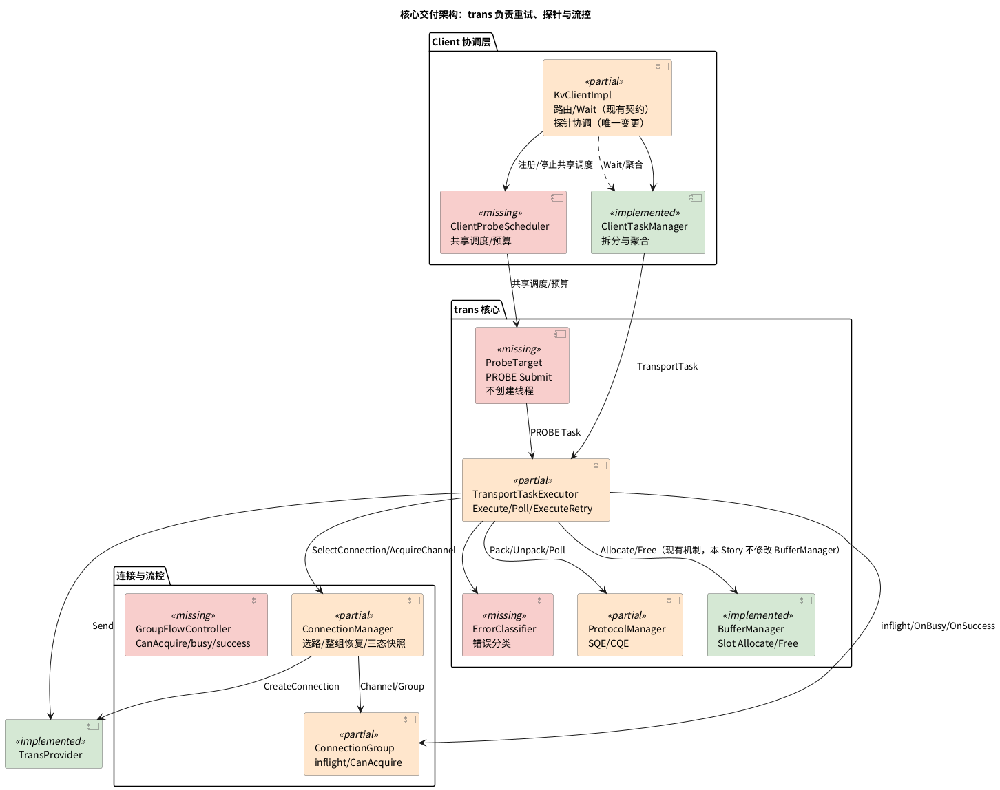
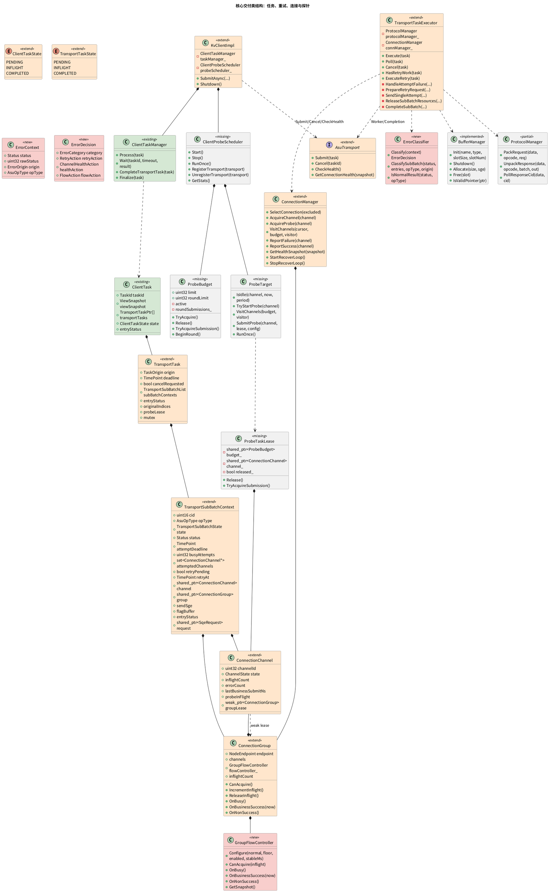
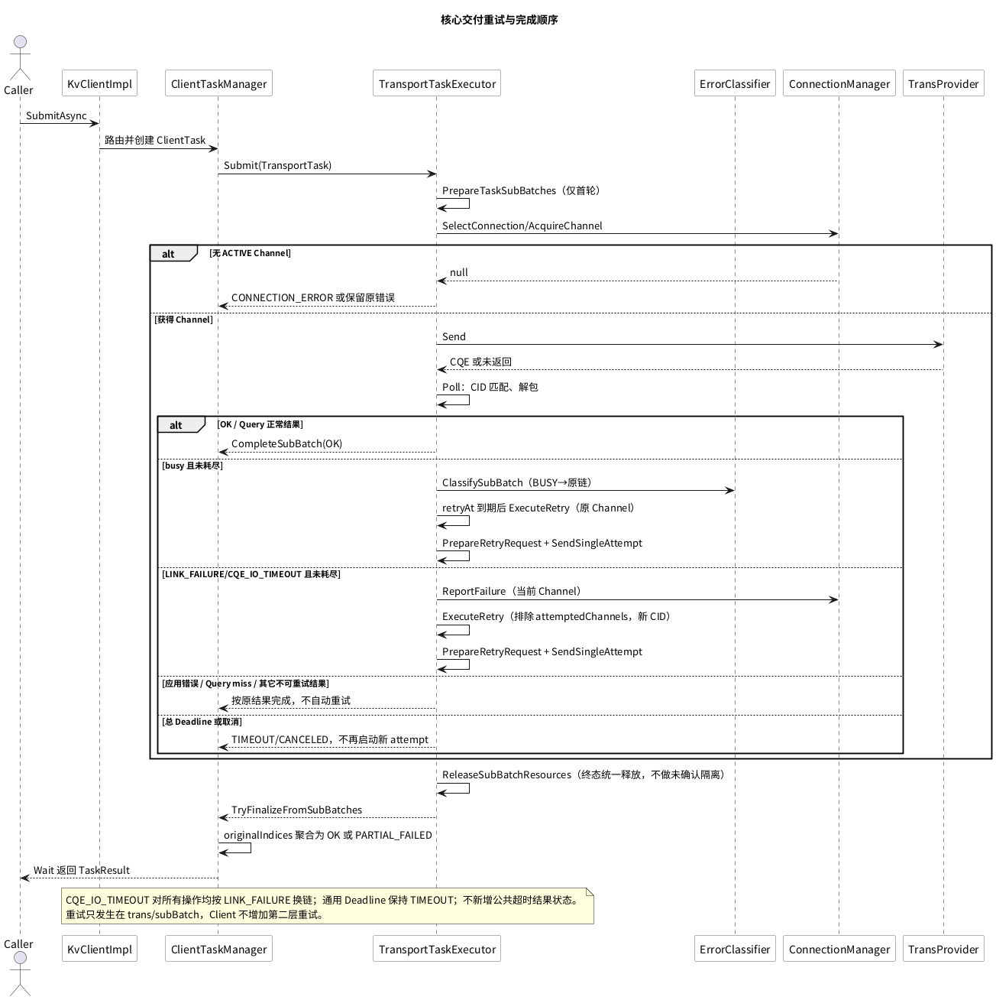
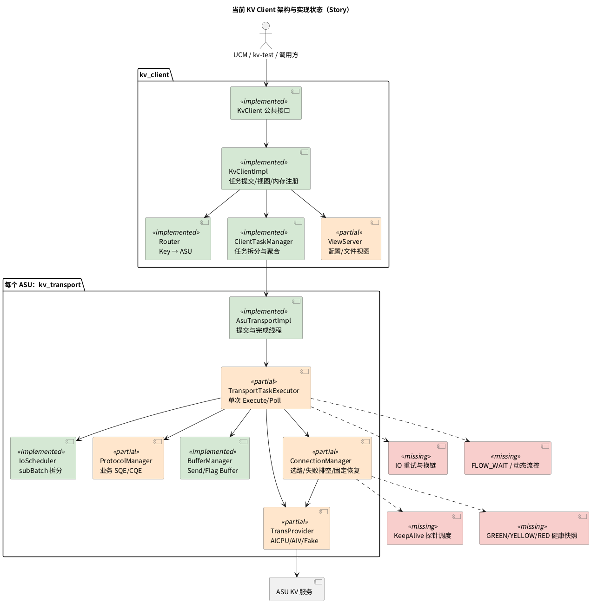
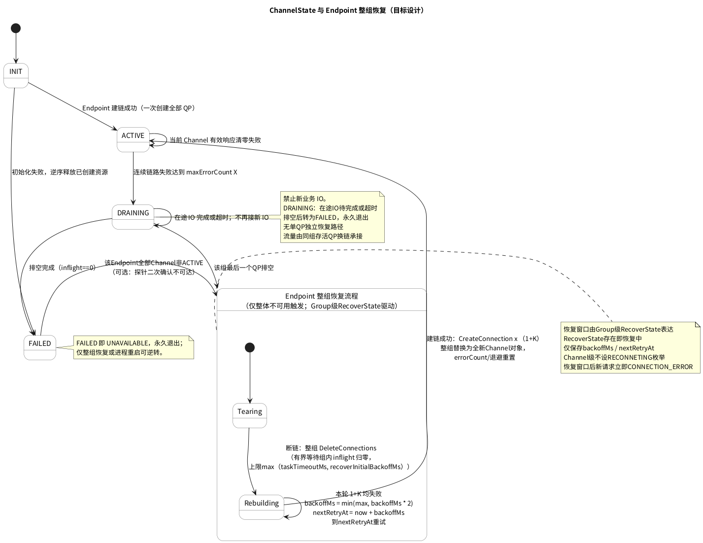
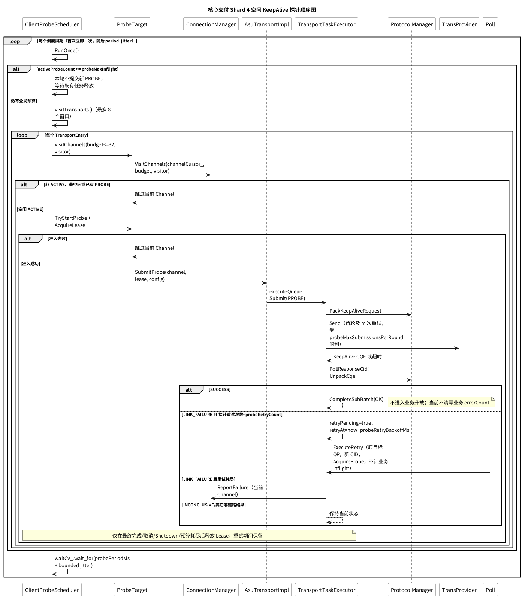

# SR20261025425863 KV Client 连接可靠性、重试与流控软件 Story 设计说明书

> 文档状态：**设计已确认，用于指导开发**  
> 版本：v1.0.29
> 日期：2026-11-18
> 原始需求：[SR20261025425863.md](SR20261025425863.md)  
> 已确认设计基线：[SR20261025425863-design.md](SR20261025425863-design.md)  
> 模板参考：[XXXX软件Story设计说明书.md](XXXX软件Story设计说明书.md)  
> 实现说明：本文所有目标行为、接口、默认值、重试边界和测试要求均为已确认的开发基线；“待实现/新增/扩展”仅表示当前代码尚未落地，不表示设计未确认。本文不包含待评审方案或未决选项；后续变更必须重新评审并升版。v1.0.8 将探针改为 Client 级共享调度器，增加全局线程、扫描、提交和在途预算及独立有限探针超时；当前实现已迁移为 `ClientProbeScheduler + ProbeTarget`，默认 `probeEnabled=false` 保留兼容策略，显式开启时每 Client 仅一个共享探针线程。v1.0.9 移除公共超时未知状态及按操作类型的超时 veto，所有操作超时统一按 LINK_FAILURE 换链，评估材料单独保存。v1.0.10 按当前实现重绘类图、运行视图、状态机、业务顺序/活动图和 KeepAlive 顺序图；未实现的独立目标类不再出现在当前实现图中。v1.0.11 按方案 D 补齐 FLOW_WAIT、健康快照、逻辑 Slot、CID/attempt 映射、MR/Slot Quarantine 和 Wait 取消，新增 16 项目标能力测试，当前全量 478/478 通过。v1.0.12 增加 CID 耗尽时的打包前拒绝，新增 `CidExhaustionRejectsRequestBeforePacking`，当前全量 479/479 通过。v1.0.13 接入 `probeRetryCount/probeRetryBackoffMs` 的轮内重试与 `retryAt` 退避，新增 3 个 PROBE 重试用例和 2 个退避用例，当前全量 484/484 通过。v1.0.14 按 trans 核心收敛交付范围：核心仅保留错误码处理、重试、探针、动态流控和最小资源保护；健康快照、逻辑 Slot、完整生命周期租约、ClientTask FLOW_WAIT 和全量 CID 映射等扩展降为参考，不再作为核心验收要求。v1.0.15 恢复模型改为 Endpoint 级“先断链、再建链”：仅当该 Endpoint 全部 Channel 非 ACTIVE 时触发整组重建，单 QP 故障只排空换链、不独立恢复；错误处理同步（X 排空即永久退出、恢复窗口 CONNECTION_ERROR、探针可触发整组恢复）；存量描述回归原始 HEAD 基线（原始 ChannelState 仅 ACTIVE/DRAINING/FAILED，RecoverLoop 为 100ms 固定周期单 QP 重建，无退避/K/RECONNECTING）。v1.0.16 移除全部“扩展参考”章节（旧扩展架构、整体/分解类图、运行图、业务顺序图与活动图），文档只保留范围收敛后的核心内容；扩展能力的评估材料另行单独保存，不在本文维护。v1.0.17 不实现 Quarantine（任何形式，含最小隔离集合）：任务终态即释放 Slot 并解除 MR 忙态，迟到 CQE 写已复用资源的风险显式声明为已知限制；MR inflight 登记与忙态判断明确由 Trans 层提供（`HasInflightMemory`，任务受理至终态），Client 仅保留注册表、公共 API 与 `memoryMu_` 竞态闭合。v1.0.18 节点三态（GREEN/YELLOW/RED）纳入第一期核心交付：新增 `NodeHealth/NodeHealthSnapshot` 与 `AsuTransport::GetConnectionHealth` 只读快照；RED（activeCount==0）与 Endpoint 级整组恢复触发条件统一；快照不修改 GlobalView（Q19）。v1.0.19 移除 MR/WAIT 生命周期类功能设计（RegisterRegions/UnregisterRegions 契约、MR 忙态、memoryMu_ 竞态闭合、Quarantine/已知限制声明）：理由——非连接管理职责；上层调用方与底层 Provider 共同保证不存在 CQE 使用已销毁 MR 的场景；如需专项分析由其他设计文档跟踪。本文只保留 IO 错误码处理、流控、探针、连接恢复与节点三态等核心能力。v1.0.20 移除 Wait 超时自动取消：Wait 仅保留基线契约（超时消费 ClientTask，不干预底层任务），TransportTask 由自身总 Deadline 终结（Q29）；显式取消仍可用基线 API `AsuTransport::Cancel`。v1.0.21 明确模块修改边界：`trans/buffer` **本 Story 不做任何修改**（重试的 Slot 复用走既有 Allocate/Free，清理 ResourceGuard 残留标注）；`client` 层**唯一功能变更为共享探针**（`ClientProbeScheduler` 及其 Init/Shutdown 接线），路由、聚合、Wait/Check 全部沿用现有契约。v1.0.22 删除 Shard 6（Wait 超时与端到端）整章：该 Shard 无自有交付物（Wait/Cancel/Shutdown 均为基线契约不修改，三态/连接清理属 Shard 2），DT 用例与全局测试设计重复；其独有的 Shutdown 重入幂等、Execute/Cancel 发布竞态两个健壮性用例折入全局自验证用例（SV-014/SV-015）保留覆盖。v1.0.23 彻底移除 generation 机制：整组断链重建架构下“旧 CQE 污染新 Channel”场景不成立——正确性由四支柱承担（响应 CID 匹配、整组重建创建全新 Channel 对象以对象身份隔离健康计数、ACTIVE 准入、`DeleteConnections` 排空契约已显式写入 TransProvider 契约：断链后旧在途请求不再产生写回）；`NodeHealthSnapshot/AttemptContext/ConnectionChannel` 删除 generation 字段，移除 `IsCurrentGeneration`，全部相关用例改为 CID/对象身份口径。v1.0.24 移除 AttemptContext 独立对象：重试为线性循环（失败→换链→重发），每个 subBatch 同时最多一个活跃 attempt，当前 attempt 状态（CID、attemptState、attemptDeadline、sendAttempted/responseConfirmed、Channel/Group shared_ptr）内联进 `TransportSubBatchContext`；删除 attemptId（非匹配键，日志以 taskId/subBatchId/重试次数替代）与重复持有的请求副本；Group lease 安全释放由持有 shared_ptr 保证，与持有者是独立对象还是内联字段无关。v1.0.25 移除 AttemptState 枚举与 SubBatchRetryState 结构体，并删除 sendAttempted/responseConfirmed 持久标志位：attempt 位置全部由现有字段派生（在途与否/retryPending/任务终态），响应确认在 Poll 单轮内联完成（移除 Quarantine 后无行为差异）；真实状态仅 5 个内联字段（busyAttempts、attemptedChannels、retryPending、retryAt、attemptDeadline），failoverAttempts 由 attemptedChannels 数量派生、retryAction 由挂起错误类别推导、preferredChannel 由 channel 承载（busy 重试不重置）、lastError 由 status 承载；attemptId 即 subBatch 的尝试计数（v1.0.24 已删，序号由 busyAttempts+attemptedChannels 数量派生）。v1.0.26 删除 RetryController、SubBatchRetryPlan、SubBatchRequestDescriptor 与 SubBatchRetryAction：BuildSubBatchRetryPlan 为纯拷贝函数（计划字段全部拷自 decision 或 batch），计划对象零信息增量——needsRetry≡retryAction≠RETURN_RESULT、hasMultipleErrorCodes≡category==MIXED、action 是被否决的按 Entry 重试设计残留（收敛后重试单位恒为完整原始 subBatch）、retryRequest 是 context 已有指针的拷贝；重试限额（busyAttempts<M、attemptedChannels<N）与退避计算内联进 TransportTaskExecutor 响应处理，重试决策保留“ErrorClassifier 输出 ErrorDecision → Executor 直接消费”两段式。ProbeBudget 保留：它是 trans 层访问 Client 全局预算的跨层共享句柄，删除将导致 trans→client 反向依赖。v1.0.27 清理v1.0.23-v1.0.26移除机制后的文档遗留 v1.0.28 精简EndPoint整组恢复建模 v1.0.29 反转换链优先级： 同ASU，优先同Group替换为同ASu优先跨Group，无可用再回退到同Group
> 图例说明：`implemented/partial/missing/proposed` 仅用于对比原始代码基线，不表示本次变更类型或最新实现进度；当前实现证据单独见《实现与验证记录》。

## 初步设计

### 需求理解

#### 需求描述

本 Story 在现有 KV Client 异步 KV 数据面上，补齐 QP 级连接的可靠性控制能力：

1. 根据业务 IO 错误码区分应用错误、busy、明确链路故障、超时及未知错误。
2. 支持 busy 原连接重试，以及明确链路故障和超时的换链重试。
3. 根据失败计数和主动 KeepAlive 探测结果，对连接执行排空与不可用管理；恢复按 Endpoint（IP:port）整体执行“先断链、再建链”，仅在该 Endpoint 整体不可用（全部 Channel 非 ACTIVE）时触发，单 QP 故障不独立恢复。
4. 支持 QP 硬并发上限和 ConnectionGroup 动态预算，满负载可 fail-fast。
5. 支持按失败 Entry 错误码种类进行 subBatch 级重试：单一错误类型按单条异常策略处理，混合错误类型整体换链，外层 Batch 只汇总。
6. 提供节点三态（GREEN/YELLOW/RED）健康快照、日志和 attempt/task 两级指标。
7. 不在本 Story 内设计 MR/Buffer 生命周期管理：上层调用方与底层 Provider 共同保证不存在 CQE 使用已销毁 MR 的场景，如需专项分析由其他设计文档跟踪。

#### 用户痛点

- 单次网络抖动或 QP 故障会导致整个 TransportTask 失败，缺少自动恢复路径。
- 当前只有失败排空和固定周期重连，没有错误分类、原链/换链重试和空闲探针闭环。
- 当前 Channel 满负载后直接失败，无法通过等待和动态降载缓解下游压力。
- Batch 需要按失败 Entry 的错误码种类决定“单条异常策略”还是“整个 subBatch 换链”，并处理整体重试带来的 at-least-once 重复执行风险。
- Store 超时并不能说明服务端没有执行，盲目重发可能破坏数据一致性。

#### 预期收益

- 降低瞬时链路故障造成的业务失败率。
- 在下游过载时通过快降慢升控制请求压力，避免重试风暴。
- 通过主动探针提前发现空闲 QP 故障，减少新请求失败。
- 在保持现有异步任务模型和公共路由语义的前提下，提高系统可恢复性和可观测性。
- 通过 subBatch 级重试（每次实际发送为一个attempt，内联在subBatch上下文中），以 CID 匹配隔离旧响应并明确整体重试边界。

### 范围界定

#### 本 Story 做什么

- 新增统一错误分类与处理决策。
- 新增业务 IO 的原链/换链重试、退避、候选排除和总 Deadline。
- 新增 `ACTIVE/DRAINING/FAILED` 主状态、`RECONNECTING` 整组恢复窗口；单 QP 排空即永久退出，恢复仅按 Endpoint 整组“断链→建链”执行。整组恢复窗口由Group级`RecoverState`表达，不新增Channel级`RECONNECTING`枚举
- 新增空闲 KeepAlive 探针、三态结果和恢复联动。
- 新增 Endpoint 级整组恢复：先断链再建链，每轮 K 次建连和指数退避，仅整体不可用触发；新增节点三态只读快照（RED 与整组恢复触发条件一致，不修改 GlobalView）。
- 新增单 QP 硬上限、Group 动态预算和动态解除，满负载可 fail-fast。
- 新增按错误码种类驱动的 subBatch 级重试、at-least-once 语义及原始错误聚合。
- 保留日志、指标和联动测试；不实现 Slot/MR 隔离；MR/内存生命周期管理不在本 Story 范围（由调用方与底层保证）。

#### 本 Story 不做什么

- 不实现字节带宽、IOPS 等实时流量统计或限速。
- 不通过普通连接重试将 Key 默认改投其他 ASU。
- 不重构现有 `KvClient/AsuTransport/TransProvider` 分层及 Router 数据所有权模型。
- 不改变现有 Wait 超时消费 ClientTask 的行为，不在本期新增 Drain API。
- 不在本期实现服务端请求去重；超时统一按链路故障换链，非幂等 STORE 可能随完整 subBatch 重发并产生 KEY_EXIST，调用方接受该重复执行风险。
- 不新增公共结果状态；`CQE_IO_TIMEOUT` 沿用协议原值，Client Wait 仍使用既有 `TIMEOUT` 语义。
- 不把探针成功直接视为下游业务处理能力恢复，也不把 RED 直接等同于从 GlobalView 删除节点。
- 不设计 MR/内存生命周期管理（注册/注销、Wait-MR 契约、Quarantine/隔离）：上层调用方与底层 Provider 共同保证不存在 CQE 使用已销毁 MR 的场景，如需专项分析由其他设计文档跟踪；不实现 `logicalSlotId`、`activeCids` 全量映射或 ClientTask FLOW_WAIT；节点三态只作只读观测，不用作自动跨 ASU 改投或 GlobalView 成员删除依据。
- 不在 Client 中嵌入重试、Slot/CID 管理，不引入 `TransportTask::clientTask` 反向依赖。
- 不把完整 `AcquireResult`、`ConnectionAttemptKey` 或 `SendCertainty` 作为核心接口；错误来源和错误类别按本版收敛集合处理。
- 不提供单 QP 的独立建链/断链；QP 生命周期操作仅支持 Endpoint（IP:port）粒度——建链一次创建该 Endpoint 全部 QP，断链整组释放，重建必须先断链。单 QP 排空后的容量损失持续到整组恢复或进程重启。

#### 前置依赖

- 现有 `ConnectionManager/ConnectionGroup/ConnectionChannel`。
- 现有 `TransportTaskExecutor/TransportTask/TransportSubBatchContext`。
- 现有 `ProtocolManager` 和 KeepAlive SQE 构造。
- 现有 Send/Flag BufferManager、SPSC 队列和 CompletionLoop。
- AICPU/AIV/Fake Provider 的连接、Send 和 MR 接口。
- 现有测试 Transport/Provider 工厂及 Fake Backend。
- 调用方遵守已注册内存和 KVBuffer 生命周期约定。

### 核心方案

技术路线：**保留现有异步数据面，在 `TransportTaskExecutor/subBatch` 层增加重试控制，在 `ConnectionManager` 内完善连接状态和恢复，以独立探针和 Group 流控模块完成主动感知与动态反压。**

| 序号 | 决策点 | 选择 | 未采用方案（已否决） | 理由 |
| --- | --- | --- | --- | --- |
| 1 | 重试所在层级 | `TransportTaskExecutor/subBatch` | `ClientTaskManager` 或 Provider | 避免重复调度其他 ASU 和已成功 subBatch，保持 Provider 简单 |
| 2 | 换链范围 | 同 ASU，优先跨Group（不同IP：PORT）；其他所有Group均无可用Channel时才回退同Group（同IP：port不同QP | 直接跨 ASU；旧设计优先同Group，仅等价Endpoint跨Group | 不改变 Key 数据所有权；优先换IP可绕开单IP级故障（网卡/HCA/交换机路径），同IP下不同QP通常共享同一条物理路径，作为兜底而非首选 |
| 3 | 错误处理入口 | 统一 `ErrorClassifier` | 各模块分别判断 | 保证重试、健康和流控规则一致 |
| 4 | busy 处理 | 原链额外重试 M 次，最终仍 busy 则返回，不换链 | 最终继续换链 | 避免把下游过载扩散到其他 QP |
| 5 | 明确链路故障 | 记录失败并直接换链，额外最多 N 次 | 先在故障 QP 上反复重试 | 快速绕开故障链路 |
| 6 | 超时处理 | Query/Load/Delete/Store/BATCH_STORE 均按 LINK_FAILURE 换链，额外最多 N 次 | 按操作幂等性决定是否换链 | 与原 SR 超时换链策略一致，接受非幂等写重复执行风险 |
| 7 | 超时状态 | 不新增公共结果状态；沿用 `CQE_IO_TIMEOUT/TIMEOUT` 和既有聚合 | 新增独立公共结果码 | 保持公共 API 与原始错误语义，重试耗尽后返回原始错误 |
| 8 | 次数口径 | M/N/K/m 均为首次后的额外次数，最大尝试为 1+M/N/K/m | 包含首次 | 统一配置和验收口径 |
| 9 | 连接状态 | Channel 级 `ACTIVE/DRAINING/FAILED`：DRAINING/FAILED 即该 QP 永久退出（无独立恢复）；整组恢复窗口由Group级`RecoverState`表达，不新增Channel级`RECONNECTING`枚举（派生状态） | 仅 ACTIVE/DRAINING；UNAVAILABLE 单独作为主状态；per-QP 独立恢复 | Provider 仅支持 Endpoint 粒度断链/建链，单 QP 重建需牺牲同组健康 QP，故排空即永久退出 |
| 10 | 探针 | 仅 ACTIVE 且空闲 QP；`ClientProbeScheduler` 每 Client 固定最多 1 个共享线程；当前每目标最多 1+m 次，使用 `probeRetryBackoffMs` 退避 | 每 ASUTransport 一个探针线程、所有 QP 周期探测或独立连接 | 线程数与 Transport/QP 数解耦，减少业务干扰并保证探测对象真实 |
| 11 | 恢复策略 | Endpoint 级“先断链、再建链”：仅当该 Endpoint 全部 Channel 非 ACTIVE 时触发；整组断链后 `CreateConnection(endpoint, qpNum)` 每轮 1+K 次、指数退避；单 QP 故障只排空换链、不恢复 | IO 线程同步重连、固定高频重连或 per-QP 独立重建 | 对已连接 Endpoint 重复建链不被支持，必须先断链；重建单 QP 需断整组、牺牲健康 QP，故仅整体不可用才触发；避免阻塞 IO 和恢复风暴 |
| 12 | 并发控制 | QP 硬上限 + Group 共享动态预算 | 仅 QP 固定上限或仅 Group 上限 | 同时保证单 QP 安全和 Endpoint 整体降载 |
| 13 | 动态公式 | busy `C=max(floor,C-2)`；成功 `C=min(normal,C+1)` | 首次 busy 直接固定为 floor | 避免后续 `-2` 永远失效 |
| 14 | Batch 重试 | 单一失败错误码按单条异常策略处理；多种失败错误码时，只有全部无需重试才不重试，只要存在需要重试的错误码，就将完整原始 subBatch 换链 N 次 | 当前无自动重试，失败 subBatch 标记完成并聚合 | 应用错误和成功 Entry 也可随整体重试再次执行；超时也按 LINK_FAILURE 换链；确认点见 [subBatch扩展合理性分析.md](SR20261025425863-subBatch扩展合理性分析.md) |
| 15 | Wait 超时 | Wait 保留超时消费（基线契约不变），**不自动取消底层 TransportTask**——任务由自身总 Deadline 终结（Q29），不再启动新 attempt；显式取消仍可用基线 API `AsuTransport::Cancel`；MR/内存生命周期不在本 Story 范围 | Wait 超时自动取消底层任务（生命周期协调策略，原动机 MR 安全已由调用方与底层保证）；超时即认为 IO 完成 | 与基线 Wait 契约一致，消除 Client→Trans 取消联动；Deadline 是唯一终结权威 |
| 16 | 默认行为 | 核心默认 fail-fast；动态流控和探针可配置启用；节点三态快照纳入第一期交付（只读）；FLOW_WAIT、逻辑 Slot 和完整生命周期扩展不纳入核心验收 | 默认把 FLOW_WAIT、完整生命周期框架或基于健康的自动改投作为核心前置条件 | 先保证 trans 核心可交付；三态为低成本只读派生，不引入生命周期框架 |
| 17 | 探针资源预算 | 每 Client 在途 PROBE 最多 64；每轮提交最多 16；每轮 Transport 扫描最多 8；每个被选 Transport 的 Channel 扫描最多 32；`probeTimeoutMs=1000` 且必须大于 0 | 全量快照、无界任务、每 Transport 一个线程或无限探针超时 | 即使 ASUTransport/QP 很多，线程、CPU、任务和 Slot 仍有硬上限 |

### 本版范围收敛

**本版优先保证 trans 核心的可维护交付，不再把完整生命周期框架作为重试、探针和流控的前置条件。**

核心交付只包含：

1. 基于错误码的分类、busy 原链重试、LINK_FAILURE/CQE_IO_TIMEOUT 换链和完整原始 subBatch 重试。
2. 空闲 KeepAlive 探针、共享调度、简单 `ProbeTaskLease` 和共享提交预算。
3. QP/Group inflight 与 `GroupFlowController` 的 `-2/+1` 动态预算。
4. `retryAt` 退避、任务总 Deadline、原始错误保留和 `originalIndices` 聚合。
5. `PrepareRetryRequest`、当前 CID 响应校验，以及最小 Channel/Group 资源生命周期保护。

**范围边界（生命周期，显式声明）**：MR/Buffer 生命周期管理（注册/注销忙态、Wait-MR 契约、Quarantine/Slot 隔离、memoryMu_ 竞态闭合等任何形式）**不属于本 Story 的功能设计**——上层调用方与底层 Provider 共同保证不存在 CQE 使用已销毁 MR 的场景；如需专项分析，由其他设计文档跟踪，本 Story 不做该项保证。节点三态（GREEN/YELLOW/RED）快照**纳入**第一期核心交付，但仅限只读派生：由 Channel 状态聚合，RED=activeCount==0（与 Endpoint 整组恢复触发条件一致），不修改 GlobalView、不驱动自动改投。

以下技术项同样不纳入核心：`logicalSlotId`、完整 `ConnectionAttemptKey`、`activeCids/cidToAttemptId` 全量映射、`ClientTaskState::FLOW_WAIT`、`TransportTask::clientTask`、独立 `LifecycleCoordinator/RecoveryController`、完整 `AcquireResult` 枚举体系。

#### 核心交付职责边界

| 层级 | 必须承担的职责 | 明确不承担 |
| --- | --- | --- |
| `trans/conn` | `ConnectionManager` 选路、Channel/Group、Endpoint 级整组“断链→建链”恢复；`GroupFlowController` 动态预算；节点三态只读快照（`GetHealthSnapshot`） | 逻辑 Slot 生命周期框架、单 QP 独立恢复、基于三态的自动跨 ASU 改投 |
| `trans/task` | `ErrorClassifier` 分类、`TransportTaskExecutor` 执行（内联限额与退避计算）、响应匹配和资源释放 | ClientTask 二次重试、Client 状态回写、MR/内存生命周期管理 |
| `trans/task/probe` | `ProbeTarget` 指定 QP 的 PROBE 提交、结果处理和 `ProbeTaskLease` 释放 | ClientTask/MR 业务生命周期 |
| `client` | **本 Story 唯一功能变更为共享探针**（`ClientProbeScheduler` 注册/停止/共享预算及 Init/Shutdown 接线）；路由、ClientTask 聚合、Wait/Check 消费均沿用现有契约不修改 | 重试状态机、Slot/CID 管理、独立生命周期协调器、MR/内存生命周期管理、Wait 超时联动取消 |
| `trans/buffer` | **不修改**：沿用现有 `Init/Shutdown/Allocate/Free/IsValidPointer`；重试的 Slot 复用走既有 Allocate/Free 机制 | Quarantine/隔离、Slot 生命周期扩展、任何 BufferManager 变更 |

#### 核心交付架构（收敛版）



`KvClientImpl` 不实现重试状态机，**Client 层本 Story 的唯一功能变更是共享探针**（`ClientProbeScheduler` 及其接线）；`ClientTaskManager` 只负责路由、聚合和 Wait 消费（均为现有契约）；Wait 超时不联动取消底层任务（由任务自身总 Deadline 终结）；显式取消仍走基线 API `AsuTransport::Cancel`，trans 自己处理后续 attempt 和资源释放。`ClientProbeScheduler` 只负责共享调度，不把探针执行生命周期扩散到 ClientTask。

#### 核心交付类图（收敛版）



`BufferManager` 为现有模块，**本 Story 不做任何修改**：仅使用既有 `Init/Shutdown/Allocate/Free/IsValidPointer`，重试的 Slot 复用走既有 Allocate/Free；不实现 Quarantine/隔离。MR/Buffer 生命周期安全由上层调用方与底层 Provider 保证（见“范围收敛”章节）。

`TransportSubBatchContext` 单层内联全部 attempt/重试字段（不引入独立 `AttemptContext` 与 `SubBatchRetryState`——重试为线性循环，独立对象/结构只带来双层状态与生命周期管理开销）。attempt 状态不持久化枚举：READY=无在途且 retryPending=false；SENDING=Provider::Send 调用内瞬时态；WAITING_RESPONSE=Send 已返回 OK 未裁决；RETRY_BACKOFF=retryPending；终态=任务完成。派生规则：failoverAttempts=attemptedChannels 数量；retryAction 由挂起错误类别推导（BUSY→原链，LINK_FAILURE/超时→换链）；preferredChannel=channel 字段（busy 重试不重置）；lastError=status 字段。`TransportTask` 不反向引用 `ClientTask`，ClientTask 不暴露 FLOW_WAIT 主状态。`ErrorContext` 不再以未实际赋值的 `SendCertainty` 作为核心输入；发送确定性由 `ErrorOrigin`（调用位点）与在途状态派生。

#### 核心交付重试与完成顺序（收敛版）



`retryAt` 只表示下一次 attempt 的到期时间，不创建独立调度线程。`PrepareRetryRequest` 必须更新 SQE CID 和响应 Buffer/MR，不能只修改 `subBatchContext.cid`。任务到达终态即释放 Send/Flag Slot；不做未确认资源隔离，MR/内存生命周期安全由调用方与底层保证（不在本 Story 范围）。

### 存量变更摘要

| 变更点 | 变更类型 | 涉及存量模块 | 改动说明 |
| --- | --- | --- | --- |
| 公共任务契约 | 保持并澄清 | [kv_client.h](../include/kv_client.h) | Wait 保留超时消费；补充“超时非底层完成”语义 |
| 配置结构 | 扩展 | [kv_types.h](../include/kv_types.h)、[parser_common.cc](../src/common/utils/parser_common.cc) | 增加重试、探针、恢复、流控、选路参数及范围校验 |
| 任务上下文 | 扩展 | [task_context.h](../src/common/utils/task_context.h) | 增加任务来源、内联 attempt 字段、重试状态和目标 Channel；不增加 `TransportTask::clientTask` 反向引用 |
| 连接对象 | 扩展 | [connection_internal.h](../src/trans/conn/connection_internal.h) | 增加业务活动时间和探针互斥；不强制引入 logicalSlotId |
| 连接管理 | 扩展 | [connection_manager.h](../src/trans/conn/connection_manager.h)、[connection_manager.cc](../src/trans/conn/connection_manager.cc) | 选路与 Group 动态流控；RecoverLoop 由原始 100ms 固定周期单 QP 重建（无退避、无 K、无 RECONNECTING/FAILED 状态机）改造为 Endpoint 级“断链→建链”整组恢复，仅整体不可用触发；Group级`RecoverState（backoffMs，nextRetryAt）记录恢复窗口，Channel级不新增`RECONNECTING`枚举；新增节点三态只读快照；FLOW_WAIT 仅作可选扩展 |
| 执行器 | 扩展 | [trans_task_executor.h](../src/trans/task/trans_task_executor.h)、[trans_task_executor.cc](../src/trans/task/trans_task_executor.cc) | 接入错误分类、重试、退避、探针和 CID 响应校验 |
| 提交流程 | 扩展 | [kv_submit_flow.cc](../src/trans/task/kv_submit_flow.cc) | 从单次 Send 扩展为受 Deadline 约束的 attempt 调度 |
| 协议 | 扩展 | [kv_protocol.h](../src/trans/proto/kv_protocol.h)、[kv_protocol.cc](../src/trans/proto/kv_protocol.cc) | 补 KeepAlive CQE 解包和 attempt/CID 校验 |
| 运行时协调 | 扩展 | [kv_transport_impl.h](../src/trans/kv_transport_impl.h)、[kv_transport_impl.cc](../src/trans/kv_transport_impl.cc) | 仅提供 PROBE Submit、目标 Channel 和健康查询；不得创建 ProbeScheduler 或探针线程 |
| 错误分类 | 新增 | `src/trans/task/error_classifier.h/.cc` | 统一错误类别、重试、健康和流控动作 |
| 重试控制 | 内联扩展 | [kv_task_executor.h](../src/trans/kv_task_executor.h)、[kv_task_executor.cc](../src/trans/kv_task_executor.cc) | 退避、候选排除、Deadline 和结果聚合内联进`TransportTaskExecutor`；不设独立`RetryController`/`SubBatchRetryPlan` |
| Client 探针调度 | 新增 | `src/client/probe_scheduler.h/.cc` | `ClientProbeScheduler`：每 KvClientImpl 最多一个共享线程，负责注册表、游标、全局在途预算、扫描/提交限流和独立探针超时 |
| Transport 探针目标 | 新增/改造 | `src/trans/task/probe_scheduler.h/.cc` | 改为无线程 `ProbeTarget`，仅提供空闲检测、指定 QP 的 PROBE Submit 和三态结果处理，不创建线程 |
| Group 流控 | 新增 | `src/trans/conn/group_flow_controller.h/.cc` | 动态预算、快降慢升和解除；FLOW_WAIT 仅作可选扩展 |
| 节点健康 | 新增 | `src/trans/kv_transport.h`、`src/trans/conn/connection_manager.*` | 新增 `NodeHealth/NodeHealthSnapshot` 与 `AsuTransport::GetConnectionHealth` 只读三态快照（GREEN/YELLOW/RED 由 Channel 状态聚合派生）；RED=activeCount==0，与整组恢复触发条件一致；不修改 GlobalView、不驱动自动改投 |
| 测试 | 新增/扩展 | `tests/transport`、`tests/client`、`kv_test/scripts` | 增加单元、集成、E2E、并发及反向探针用例 |

### 当前架构与实现状态



当前路径已有选路、失败排空、固定周期恢复、静态 inflight 上限和单次 IO 完成链路；分类重试、主动探针、动态流控和节点三态快照是本 Story 的目标交付，完整生命周期保护仍属扩展评估。

## 外部接口分析

### 全局异常清单

异常处理必须同时读取 `ErrorOrigin` 和 `StatusCode`，不得仅按枚举数值推断链路状态。

`ErrorOrigin` 本版收敛为：`LOCAL`、`PROVIDER_IO`、`CQE`、`ATTEMPT_TIMEOUT`。`LOCAL/LOCAL` 统一归入 LOCAL，`PROVIDER_IO/PROVIDER_IO` 统一归入 PROVIDER_IO，PROBE 由 `TaskOrigin::PROBE` 或 `opType=KEEP_ALIVE` 推导，不再为核心增加 `LOCAL（PROBE）` 枚举。

| 异常编号/类别 | 来源接口 | 异常场景 | 严重级别 | 处理策略 | 影响范围 |
| --- | --- | --- | --- | --- | --- |
| `INVALID_ARGUMENT` | 全部公共接口 | 空指针、非法配置、非 512B 对齐、超协议上限、非法状态调用 | 低 | 不同步返回，不重试，不改变连接 | 当前调用 |
| `NOT_INITIALIZED` | Init/Submit/Wait/MR | Client 或 Transport 未初始化/已 Shutdown | 中 | 返回错误，不进入重试；FLOW_WAIT 不属于本版核心 | 当前调用 |
| `RESOURCE_BUSY` | `SubmitAsync/Submit/BufferManager` | 本地任务队列或 Slot 满 | 中 | 同步返回 RESOURCE_BUSY；不记链路失败，不触发远端 busy 降载 | 当前任务 |
| `CQE_RESOURCE_BUSY` | 远端 CQE | 下游明确返回忙 | 中 | 原链额外重试 M 次并动态降载；最终仍 busy 返回，不换链 | 当前 QP + ConnectionGroup |
| `CONNECTION_ERROR` | CreateConnection/SelectConnection/Provider Send | 无 ACTIVE（含 Endpoint 整组恢复窗口）、建链失败或明确连接故障 | 高 | 有候选时换链最多 N 次；当前 Channel 记失败并按 X 排空（排空即该 QP 永久退出）；恢复窗口内立即 fail-fast | Channel/节点 |
| `IO_ERROR` | Provider/CQE | 需结合来源判断；未映射的合法响应默认 OTHER | 中/高 | Provider 明确传输故障才按 LINK_FAILURE；合法但未识别响应不自动重试 | 当前 attempt |
| `TIMEOUT` | Wait/attempt/probe/connect | 等待、单次 IO、探测或建连超时 | 高 | 通用任务 Deadline 到期返回 TIMEOUT，不再启动新 attempt；Wait 超时只消费 ClientTask，不干预底层任务 | 当前任务/Channel |
| `CQE_IO_TIMEOUT` | Store/Load/Delete attempt | 已发送但无法确认服务端是否执行 | 高 | 统一按 LINK_FAILURE 换链；耗尽后保留原始错误，不新增公共状态 | 当前 Entry/Channel |
| `BUFFER_NOT_REGISTERED` | SQE 构建/MR | Buffer 未注册或 Handle 失效 | 中 | 返回错误，不重试，不记链路失败 | 当前 Entry |
| `BUFFER_NOT_SUPPORTED` | Provider/MR | 内存类型或绑定方式不支持 | 中 | 返回错误，不重试 | 当前 Entry |
| `TASK_NOT_FOUND` | Wait/Cancel | TaskId 不存在或已被 Wait 消费 | 低 | 直接返回，不重试 | 当前调用 |
| `UNSUPPORTED` | Provider/Protocol | Provider 不支持能力、未知 Opcode | 中 | 直接返回，不重试 | 当前调用 |
| `INTERNAL_ERROR` | Provider/本地执行 | 内部异常或未预期错误 | 高 | 默认 OTHER；只有明确传输故障时按 LINK_FAILURE | 当前 attempt |
| `CQE_INVALID_COMMAND_OPCODE/FIELD` | 合法 CQE | 服务端拒绝非法命令 | 中 | 按 APPLICATION 返回，不重试，不记链路失败 | 当前 Entry |
| `CQE_INTERNAL_ERROR` | 合法 CQE | 服务端内部错误 | 高 | 按 LINK_FAILURE 换链并记链路失败 | Channel |
| `CQE_WRITE_FAULT` | 合法 CQE | 写故障 | 高 | 按 LINK_FAILURE 换链并记链路失败 | Channel/Entry |
| `CQE_UNRECOVERED_READ_ERROR` | 合法 CQE | 不可恢复读错误 | 高 | 按 LINK_FAILURE 换链并记链路失败 | Channel/Entry |
| `CQE_IO_TIMEOUT` | 合法 CQE | 服务端 IO 超时 | 高 | 所有操作均按 LINK_FAILURE 换链 | 当前 Entry |
| `CQE_KEY_NOT_EXIST` | 合法 CQE | Load/Store 查询数据不存在 | 低/中 | Load 按 APPLICATION；Query 按 QUERY_MISS；不重试 | 当前 Entry，链路不记失败 |
| `CQE_KEY_ALREADY_EXISTED` | 合法 CQE | Create 类型 Key 已存在 | 中 | 按 APPLICATION 返回，不重试，不自动转成成功 | 当前 Entry |
| `CQE_OUT_OF_CREATE_SIZE` | 合法 CQE | 超出创建长度 | 中 | 按 APPLICATION 返回，不重试 | 当前 Entry |
| `CQE_CHECK_RESULT_BUFFER` | 合法 Batch CQE | 需要读取逐 Entry 结果 | 中 | 先解结果位图，再逐 Entry 分类，不能直接作为链路失败 | 当前 subBatch |
| `ENTRY_RETRY_ADVISED` | Batch result buffer | 服务端建议重试，但不是 busy 或明确链路故障 | 中 | 本 Story 固定按 OTHER 处理：不自动重试、不记链路失败、不触发 busy 降载 | 当前 Entry |
| `ENTRY_NO_RETRY_ADVISED` | Batch result buffer | 服务端不建议重试 | 中 | 按 APPLICATION 返回，不重试 | 当前 Entry |
| `ENTRY_KEY_NOT_FOUND` | Batch result buffer | Key 未找到 | 低/中 | 按 APPLICATION 返回，不重试 | 当前 Entry |
| `ENTRY_DATA_NOT_EXIST` | Batch result buffer | 数据不存在 | 低/中 | 按 APPLICATION 返回，不重试 | 当前 Entry |
| `ENTRY_DELETE_FAILED` | Batch result buffer | 删除失败，但不能仅凭该结果证明链路故障 | 中 | 按 APPLICATION 返回，不重试、不记链路失败 | 当前 Entry |
| `ENTRY_KEY_NOT_EXIST` | Exist result buffer | Query Key 不存在 | 低 | 按 QUERY_MISS 正常返回，不重试 | 当前 Entry |
| `ENTRY_KEY_EXIST` | Exist result buffer | Query Key 存在 | 低 | 正常成功结果，可按成功规则处理 | 当前 Entry |

### 接口 `KvClient::Init/Shutdown`

#### 能力概述

| 项目 | 说明 |
| ---- | --- |
| 来源 | [kv_client.h](../include/kv_client.h) |
| 用途 | 创建视图、Provider、Transport、内部 Buffer、Client Worker；停止接收任务并释放资源 |
| 调用频率 | 进程/实例生命周期内各一次，Shutdown 可由析构重复触发 |

#### 调用契约

| 项目 | 说明 |
| ---- | --- |
| 签名 | `Status Init(const KvClientConfig& config)`；`Status Shutdown()` |
| 正常返回 | `StatusCode::OK`；Init 发布 ViewSnapshot 并启动 Worker |
| 异常返回 | `INVALID_ARGUMENT`、`NOT_FOUND`、`CONNECTION_ERROR`、`BUFFER_NOT_SUPPORTED`、`INTERNAL_ERROR` |
| 超时 | 单次建连受 `connectTimeoutMs` 限制；初始化和每轮恢复均允许额外 K 次 |
| 并发安全 | 同一实例不允许并发 Init；Shutdown 与提交通过 initialized/stopWorker 协调 |
| 资源占用 | 每 ASU 一套 Transport/Provider/队列/Worker；每 Transport 两套内部 Buffer Pool；`ClientProbeScheduler` 仅每 KvClientImpl 最多一个共享探针线程，与 ASU 数量无关 |

**入参说明**

| 参数名 | 类型 | 说明 | 必填 | 默认值 |
| --- | --- | --- | --- | --- |
| `config` | `const KvClientConfig&` | Client、视图、Transport、重试、探针、恢复和流控配置 | 是 | 无 |
| `config.transportConfigs` | `vector<TransportConfig>` | 至少一个 ASU 配置；NodeId 必须能映射到视图成员 | 是 | 无 |
| `config.maxInflightTasks` | `uint32_t` | Client 提交队列容量，不等于单 QP inflight | 否 | 1024 |
| `config.defaultWaitTimeoutMs` | `uint64_t` | Wait 默认等待时间，不直接等于 Transport 总 Deadline | 否 | 100 |
| `config.sharedProviderMode` | `SharedProviderMode` | 独立或共享 Provider | 否 | INDEPENDENT |

#### 异常模式

| 异常场景 | 触发条件 | 检测方法 | 严重级别 | 处理策略 | 影响范围 |
| --- | --- | --- | --- | --- | --- |
| 异常场景 | 触发条件 | 检测方法 | 严重级别 | 处理策略 | 影响范围 |
| 配置非法 | QP 数量为 0、并发上限为 0、超时/退避值非法或枚举值非法；重试次数 M/N/K/m=0 不视为非法 | 启动参数校验 | 中 | 返回 INVALID_ARGUMENT，不创建半成品快照 | 当前实例 |
| 首轮建连失败 | 完成 1+K 次后仍失败 | CreateConnection 返回错误 | 高 | 逆序释放已建资源并返回错误 | 当前实例 |
| 内部 Buffer 注册失败 | Send/Flag MR 或 Token 获取失败 | Provider 返回错误 | 高 | Shutdown 已创建资源，禁止启动 Worker | 当前 Transport |
| Shutdown 仍有 inflight | 任务或未知 IO 未结束 | 任务/资源状态检查 | 高 | 停止新 attempt，再按既定顺序清理；MR/内存生命周期安全由调用方与底层保证（不在本 Story 范围） | 全部任务 |

#### 桩策略

| 项目 | 说明 |
| ------ | --- |
| 打桩对象 | `TransportFactory`、`TransProviderFactory`、`ViewServerFactory` |
| 策略 | 复用现有工厂注入；新增脚本化建连结果序列，不 mock 被测 KvClientImpl |
| 替换方式 | `CreateKvClient(transportFactory, providerFactory)`；自定义 ViewServer 时直接构造 KvClientImpl |
| 桩行为-正常 | 返回 StubTransport/Provider，Init 成功并发布测试视图 |
| 桩行为-异常 | 第 N 次 CreateConnection 失败、MR 注册失败、Token 不匹配、Endpoint 缺失 |
| 桩行为-超时 | CreateConnection 超过 connectTimeoutMs；用于验证 K 次及回滚 |
| 原因 | 无需真实 ASU 即可验证初始化、失败回滚和视图刷新 |

#### 风险点

- Init 与 Shutdown 重入、失败后重复 Shutdown，必须保持资源释放幂等。
- K 次初始化重试不得复用已失败连接对象，也不得泄漏已注册 MR。
- 配置校验失败不得覆盖一个已正常运行的旧快照。

### 接口 `QueryAsync/LoadAsync/StoreAsync/DeleteAsync`

#### 能力概述

| 项目 | 说明 |
| ---- | --- |
| 来源 | [kv_client.h](../include/kv_client.h) |
| 用途 | 提交异步存在性查询、读取、写入和删除；返回 ClientTaskId |
| 调用频率 | 业务高频；每次调用形成一个 ClientTask，并按 Router 形成一个或多个 TransportTask |

#### 调用契约

| 项目 | 说明 |
| ---- | --- |
| 签名 | `QueryAsync(const vector<CacheKey>&, TaskId&)`；`LoadAsync(const vector<KVBuffer>&, TaskId&)`；`StoreAsync(const vector<KVBuffer>&, TaskId&, prerequisite={})`；`DeleteAsync(const vector<CacheKey>&, TaskId&)` |
| 正常返回 | 同步返回 OK 且 taskId 非 0，仅表示已接受并入队，不表示 IO 已完成 |
| 异常返回 | 同步返回 INVALID_ARGUMENT、NOT_INITIALIZED、RESOURCE_BUSY 等；taskId 置 0 |
| 超时 | Transport 内部执行受任务总 Deadline；调用方等待由 Wait 的 timeoutMs/defaultWaitTimeoutMs 决定 |
| 并发安全 | 多生产者经 producerMu 串行入队；每个 ClientTask 持有固定 ViewSnapshot |
| 资源占用 | 每 subBatch 同时最多一个活跃 attempt；重试不复制业务 Payload |

**入参说明**

| 参数名 | 类型 | 说明 | 必填 | 默认值 |
| --- | --- | --- | --- | --- |
| `keys` | `const vector<CacheKey>&` | Query/Delete 的 8B Key 列表；顺序决定结果下标 | 是，可为空 | 空任务可直接完成 |
| `entries` | `const vector<KVBuffer>&` | Load/Store 的 Key、Buffer、offset、MRHandle | 是，可为空 | 空任务可直接完成 |
| `taskId` | `TaskId&` | 输出 ClientTaskId；同步失败时为 `kInvalidTaskId` | 是 | 0 |
| `prerequisite` | `std::function<Status()>` | Store 发送前回调，在 Client Worker 中执行 | 否 | 空 |

#### 异常模式

| 异常场景 | 触发条件 | 检测方法 | 严重级别 | 处理策略 | 影响范围 |
| --- | --- | --- | --- | --- | --- |
| 本地队列满 | Client/Transport 队列无法 TryPush | 同步提交路径 | 中 | 返回 RESOURCE_BUSY，taskId=0，不记链路失败 | 当前请求 |
| Buffer 未注册 | 缺少 mrKey 或 MRHandle 已失效 | SQE 构建前 | 中 | Entry 返回 BUFFER_NOT_REGISTERED，不记链路失败 | 当前 Entry |
| busy | 远端 CQE/Entry 明确 busy | CompletionLoop/ErrorClassifier | 中 | 原链 M 次，Group 降载；最终 busy 不换链 | QP/Group |
| 明确链路故障 | Provider/CQE 明确连接或系统故障 | ErrorClassifier | 高 | 当前 Channel 记失败，换其他 ACTIVE Channel 最多 N 次 | Channel/节点 |
| 超时 | 已发送但响应未返回 | Attempt Deadline | 高 | 所有操作均按 LINK_FAILURE 换链；耗尽后保留原始错误 | 当前 Entry/Flag Slot |
| 无 ACTIVE | 所有 Channel 均不可用 | `SelectConnection/AcquireChannel` | 高 | 返回 CONNECTION_ERROR，不进入 FLOW_WAIT | 当前 TransportTask |
| 满负载 | 有 ACTIVE 但达到 QP/Group 阈值 | `SelectConnection/AcquireChannel` | 中 | 当前无候选返回 CONNECTION_ERROR；FLOW_WAIT 仅作可选扩展，不作为本版核心 | 当前任务/Group |

#### 桩策略

| 项目 | 说明 |
| ------ | --- |
| 打桩对象 | `AsuTransport`、`TransProvider`、远端 CQE/网络时序 |
| 策略 | 现有 StubTransport 用于 Client 聚合测试；Fake Provider 用于真实 SQE/CQE 数据面；新增 ScriptedProvider 用于精确错误序列 |
| 替换方式 | 工厂注入；Fake Backend 通过文件目录、延迟和 WorkerPool 模拟真实完成 |
| 桩行为-正常 | Store/Load/Delete/Query 返回成功 CQE，数据写入本地 Fake Backend 可回读校验 |
| 桩行为-异常 | 按调用序号返回 busy、CONNECTION_ERROR、CQE_WRITE_FAULT、未知 raw、Entry 混合结果 |
| 桩行为-超时 | 不写 Flag Buffer或延迟超过 attemptTimeoutMs；支持旧 CID 迟到响应 |
| 原因 | 精确验证错误来源、重试次数、换链和迟到响应，无需硬件故障注入 |

#### 风险点

- 同步 OK 只表示入队，调用方仍必须 Wait 获取最终状态。
- `entryStatus` 才包含具体 Entry 错误，顶层 `PARTIAL_FAILED` 不能替代错误分类。
- `CQE_IO_TIMEOUT` 按链路故障换链；最终响应必须来自有效 CQE 或原始错误，不能按普通成功处理。

### 接口 `KvClient::Check/Wait`

#### 能力概述

| 项目 | 说明 |
| ---- | --- |
| 来源 | [kv_client.h](../include/kv_client.h) |
| 用途 | 非阻塞检查完成状态，或等待并消费一个 ClientTask 的结果 |
| 调用频率 | 每个提交任务可多次 Check；Wait 对同一 TaskId 只允许成功调用一次 |

#### 调用契约

| 项目 | 说明 |
| ---- | --- |
| 签名 | `bool Check(TaskId taskId)`；`Status Wait(TaskId taskId, uint64_t timeoutMs, TaskResult& result)` |
| 正常返回 | Check：未知 ID 或已完成均返回 true；Wait：返回结果并移除 ClientTask |
| 异常返回 | `TASK_NOT_FOUND`、`TIMEOUT`、`PARTIAL_FAILED` 及底层具体状态 |
| 超时 | 入参为 0 使用 defaultWaitTimeoutMs；Wait 超时也消费任务，但不表示底层 IO 已结束 |
| 并发安全 | ClientTask.waitMu/cv 保护；完成回调与 Wait 互斥；Remove 后再次 Wait 返回 TASK_NOT_FOUND |
| 资源占用 | Wait 只消费 ClientTask，不额外占用 IO 资源 |

**入参说明**

| 参数名 | 类型 | 说明 | 必填 | 默认值 |
| --- | --- | --- | --- | --- |
| `taskId` | `TaskId` | Submit 返回的 ClientTaskId | 是 | 无 |
| `timeoutMs` | `uint64_t` | 本次等待时间 | 是 | 0 使用默认 |
| `result` | `TaskResult&` | 输出 status、entryStatus、可选 queryResult | 是 | 由实现填充 |

#### 异常模式

| 异常场景 | 触发条件 | 检测方法 | 严重级别 | 处理策略 | 影响范围 |
| --- | --- | --- | --- | --- | --- |
| TaskId 不存在 | 已消费或非法 ID | TaskManager.Get 为空 | 低 | 返回 TASK_NOT_FOUND | 当前调用 |
| 等待超时 | 到 deadline 仍未 COMPLETED | condition_variable wait_for | 中 | 返回 TIMEOUT 并消费；不自动取消底层任务，由其自身总 Deadline 终结 | 当前任务 |
| 部分失败 | 至少一个 TransportTask 失败 | ClientTaskManager.Finalize | 高 | 返回 PARTIAL_FAILED，并保留逐 Entry 具体错误 | 当前 ClientTask |
| 超时 | 已发送但无法确认执行结果 | ErrorClassifier | 高 | 所有操作均按 LINK_FAILURE 换链；耗尽后保留原始错误 | 当前 Entry |

#### 桩策略

| 项目 | 说明 |
| ------ | --- |
| 打桩对象 | TransportTask 完成回调、超时和结果顺序 |
| 策略 | 使用可延迟完成/手动触发的 StubTransport，不 mock ClientTaskManager 本身 |
| 替换方式 | 保存 onComplete 回调，由测试在指定时刻返回结果或保持不返回 |
| 桩行为-正常 | 多 ASU 乱序完成，断言 originalIndices 和一次性消费 |
| 桩行为-异常 | 一个 TransportTask 失败、QueryResult 缺失/长度错误、未知 TaskId |
| 桩行为-超时 | 永不触发回调，断言 Wait 超时消费；任务随后由自身 Deadline 以 TIMEOUT 终结 |
| 原因 | 验证公共等待契约，而不依赖实际网络时序 |

#### 风险点

- Wait 超时后调用方不能再用该 TaskId 查询底层状态；MR/内存生命周期安全由调用方与底层保证，不在本 Story 范围。
- Check 返回 true 也可能是未知 TaskId，不能据此证明任务曾成功。

### 接口 `AsuTransport::Submit/Cancel/CheckHealth/GetConnectionHealth`

#### 能力概述

| 项目 | 说明 |
| ---- | --- |
| 来源 | [kv_transport.h](../src/trans/kv_transport.h)、[kv_transport_impl.h](../src/trans/kv_transport_impl.h) |
| 用途 | 向单 ASU 提交 TransportTask、best-effort 取消、检查 Worker 存活和读取节点三态快照 |
| 调用频率 | Submit 高频；Cancel 低频；CheckHealth/GetConnectionHealth 由监控或运维按需调用 |

#### 调用契约

| 项目 | 说明 |
| ---- | --- |
| 签名 | `Submit(const TransportTaskPtr&)`；`Cancel(TaskId)`；`CheckHealth()`；`GetConnectionHealth(NodeHealthSnapshot&)` |
| 正常返回 | Submit OK 表示已入 Transport 队列；Cancel 不保证中断 UB/RoCE IO；CheckHealth 仅表示 Worker 是否存活；GetConnectionHealth 返回三态快照（GREEN=全部 ACTIVE、YELLOW=部分永久退出、RED=activeCount==0 含整组恢复窗口） |
| 异常返回 | `NOT_INITIALIZED`、`RESOURCE_BUSY`、`TASK_NOT_FOUND`、`CONNECTION_ERROR` |
| 超时 | Submit 时设置任务总 Deadline；Cancel 到期只阻止新 attempt，不宣称硬件取消 |
| 并发安全 | producerMu 保护提交；CompletionLoop 与 Worker 通过 task.mutex 协调 |
| 资源占用 | 每 ASU 一个 executeQueue、Submit Worker、Completion Worker、RecoverLoop；`ClientProbeScheduler` 仅每 KvClientImpl 最多一个共享探针线程，`AsuTransportImpl` 不创建探针线程 |

**接口兼容要求：** `AsuTransport` 新增 `virtual Status GetConnectionHealth(NodeHealthSnapshot&)`，默认返回 `UNSUPPORTED`，由 `AsuTransportImpl` 覆盖返回三态只读快照，既有 StubTransport 无需实现。`CheckHealth()` 继续只表示 Worker 存活，与 QP 三态快照分离；快照只读，不修改 GlobalView、不驱动自动改投。

**入参说明**

| 参数名 | 类型 | 说明 | 必填 | 默认值 |
| --- | --- | --- | --- | --- |
| `task` | `TransportTaskPtr` | 包含 NodeId、OpType、entries/keys、原始下标、origin、Deadline | 是 | 非空 |
| `taskId` | `TaskId` | Transport 内部任务 ID，与 ClientTaskId 不共用命名空间 | 是 | 无 |

#### 异常模式

| 异常场景 | 触发条件 | 检测方法 | 严重级别 | 处理策略 | 影响范围 |
| --- | --- | --- | --- | --- | --- |
| Transport 未启动/正在关闭 | stopWorker 或 Worker 不存在 | Submit 检查 | 中 | 返回 NOT_INITIALIZED，不接收任务 | 当前 Transport |
| 队列满 | executeQueue TryPush 失败 | SubmitTask | 中 | 返回 RESOURCE_BUSY，taskId=0 | 当前任务 |
| 取消时仍有硬件 IO | 底层不可中断 | Cancel 检查 | 高 | 停止后续 attempt；已发请求按超时或既定规则处理 | 当前 attempt/Flag Slot |
| 全 QP 故障/整组恢复窗口 | `SelectConnection` 无可用 ACTIVE Channel（含整组断链重建期间） | 高 | 三态快照 RED；新请求立即 CONNECTION_ERROR；RecoverLoop 按整组断链重建继续恢复；CheckHealth 仍只检查 Worker | 当前 ASU |

#### 桩策略

| 项目 | 说明 |
| ------ | --- |
| 打桩对象 | TransportTaskExecutor/ConnectionManager 和 Provider 调用时序 |
| 策略 | 使用真实 AsuTransportImpl + ScriptedProvider；Client 测试则继续用 StubTransport |
| 替换方式 | 直接构造 TransportImpl，注入 Provider；健康状态通过故障序列驱动 |
| 桩行为-正常 | 多 QP 提交/完成、取消等待任务、Channel 状态和三态快照正确变化 |
| 桩行为-异常 | 队列满、无 ACTIVE、Cancel 在途请求、恢复失败、TaskId 不存在 |
| 桩行为-超时 | attempt/CQE 超时、Recover 超时、Shutdown 时仍有未完成响应 |
| 原因 | 覆盖 Transport 内部线程、队列和健康状态，不需要真实 Provider 网络 |

#### 风险点

- ClientTaskId 与 TransportTaskId 是不同 ID 域，日志必须同时记录，禁止混淆。
- `CheckHealth()` 继续只表示 Worker 存活，不代表 QP 健康；QP 健康使用 `GetConnectionHealth()` 三态快照（StubTransport 默认返回 `UNSUPPORTED`），两者语义不得混用。

### 接口 `TransProvider::CreateConnection/Send/RegisterMemory/BindMemory`

#### 能力概述

| 项目 | 说明 |
| ---- | --- |
| 来源 | [trans_provider.h](../src/trans_provider/trans_provider.h) |
| 用途 | 创建/删除 QP 连接、发送 SQE、注册/绑定 Host 或 Device 内存 |
| 调用频率 | 建连与恢复时调用；Send 高频；MR 在内存池或 Provider 变化时调用 |

#### 调用契约

| 项目 | 说明 |
| ---- | --- |
| 签名 | 见 [TransProvider 接口](../src/trans_provider/trans_provider.h)；本 Story 不修改这些签名 |
| 正常返回 | CreateConnection 返回 qpNum 个 Handle；Send 返回与 ioBatches 等长 Status；MR 返回有效 Handle/Token |
| 异常返回 | 连接/IO/BUFFER 类 Status；DeleteConnections/UnregisterMemory 返回逐项状态 |
| 超时 | CreateConnection 使用 connectTimeoutMs；Send 响应由 attemptTimeoutMs 和总 Deadline 共同限制 |
| 并发安全 | 每 Connection 的发送按现有 sendMu 串行；结构锁和 task.mutex 不得覆盖 Provider 调用 |
| 排空语义（显式契约） | `DeleteConnections` 删除该 Endpoint 全部连接后，旧在途请求不再产生写回（排空）。整组重建的正确性依赖该契约：新 Channel 上不存在旧 CQE 的物理到达路径 |
| 资源占用 | QP/Thread/Endpoint/MR 由 Provider 管理；删除前保证旧引用和 inflight 已释放 |

**入参说明**

| 参数名 | 类型 | 说明 | 必填 | 默认值 |
| --- | --- | --- | --- | --- |
| `localIp/remoteIp/port` | 字符串/整数 | 本地与远端通信地址 | 是 | 配置提供 |
| `qpNum` | `uint32_t` | 单 Endpoint 创建 QP 数 | 是 | 1 |
| `ioBatches` | `vector<SendIoBatch>` | connectionHandle、sendBuffer、flagBuffer、len | 是 | 非空时可为空批 |
| `memoryDescs` | Register/BindMemoryDesc | 地址、大小、MemType、localAddr 或 tokenId | 是 | 非空时注册/绑定 |

#### 异常模式

| 异常场景 | 触发条件 | 检测方法 | 严重级别 | 处理策略 | 影响范围 |
| --- | --- | --- | --- | --- | --- |
| 建连失败/超时 | Provider 返回错误或 Handle 为空 | CreateConnection 返回 | 高 | 每轮额外 K 次；最终失败保持 FAILED并退避 | Channel/节点 |
| Send 返回数量异常 | status 数量不等于 ioBatches 数量 | Executor 校验 | 高 | 全部相关 subBatch 失败，按 OTHER 返回，不自动重试 | 当前 attempt |
| Send 明确失败 | Provider 返回连接/系统错误 | ErrorOrigin=PROVIDER_IO | 高 | 只有明确链路故障才换链；未知错误默认不重试 | 当前 Channel |
| MR 注册/绑定失败 | 地址非法、类型不支持、Token 不一致 | Provider/MR 检查 | 高 | 回滚本批 MR；不向 SQE 填 mrKey | 当前内存区域 |

#### 桩策略

| 项目 | 说明 |
| ------ | --- |
| 打桩对象 | 真实外部 Provider/ASU/网络与设备写回 |
| 策略 | `FakeTransProvider` 保留正常数据面；新增 `ScriptedTransProvider` 按调用序号和 Channel 注入结果及延迟 |
| 替换方式 | `CreateTransProvider` 测试工厂或直接向 AsuTransportImpl 注入 |
| 桩行为-正常 | 占位 QP Handle、MR/Token、异步写 CQE；文件保存 KV 以验证一致性 |
| 桩行为-异常 | 建连失败、Send 失败、非法状态数、CQE 错误、未知错误码、迟到旧 CQE |
| 桩行为-超时 | 指定 attempt 不写 Flag、CreateConnection 延迟、旧 CQE 在整组重建后到达 |
| 原因 | 不修改被测 Executor/ConnectionManager，仅替换外部依赖，精确控制时序和错误来源 |

#### 风险点

- AICPU 与 AIV 的真实错误码语义可能存在差异，ErrorOrigin 必须保留 Provider 来源，不能用同一枚举值强行等同所有故障。
- Fake Provider 只证明客户端/Transport 逻辑，不证明真实 RDMA、MR rkey/lkey 或设备 CQE 写回行为。

## 详细设计

### 功能设计

#### 核心数据结构

##### 枚举与状态

| 数据结构 | 描述 | 字段/取值 | 说明 |
| --- | --- | --- | --- |
| `StatusCode` | 协议/公共结果码 | `CQE_IO_TIMEOUT=0x10716` | 沿用协议原始值；不新增公共结果状态，重试耗尽后保留原始错误 |
| `TaskOrigin` | 任务来源 | `BUSINESS=0`、`PROBE=1` | PROBE 不参与业务 inflight 和成功升载 |
| `ChannelState` | 连接状态 | `ACTIVE`、`DRAINING`、`FAILED` | ACTIVE 才可接新 IO；DRAINING/FAILED 即该 QP 永久退出（无独立恢复路径）；整组恢复窗口由Group级`RecoverState`表达，不在Channel新增`RECONNECTING`枚举 仅表示 Endpoint 。原始基线仅含 ACTIVE/DRAINING/FAILED |
| `NodeHealth` | 节点三态 | `GREEN`、`YELLOW`、`RED` | GREEN=该 Endpoint 全部 Channel ACTIVE；YELLOW=部分 Channel 永久退出；RED=activeCount==0（含整组恢复窗口），与 Endpoint 恢复触发条件一致 |
| `NodeHealthSnapshot` | 节点健康快照 | `health`、`activeCount`、`drainingCount`、`failedCount`、`recovering(bool, 由`RecoverState`存在性派生)`、`nextRetryAt` | 只读派生：由 Channel 状态聚合，不修改 GlobalView（Q19）；`AsuTransport::GetConnectionHealth` 输出，StubTransport 默认 UNSUPPORTED |
| `ConnectionManager::RecoverState` | 恢复调度记录 | `backoffMs`、`nextRetryAt` | Group 级恢复退避记录（原始基线无此结构，为目标设计新增），`RecoverState`存在即表示该Endpoint处于整组恢复窗口，Channel级不另设 RECONNECTING 枚举 |
| `ErrorCategory` | 统一错误类别 | `SUCCESS`、`APPLICATION`、`QUERY_MISS`、`LOCAL_BUSY`、`BUSY`、`LINK_FAILURE`、`TIMEOUT`、`OTHER` | `MIXED` 由 `hasMultipleErrorCodes` 派生；`INCONCLUSIVE/UNKNOWN` 合并为 `OTHER`，不再新增内部重复分类 |
| `ErrorOrigin` | 错误来源 | `LOCAL`、`PROVIDER_IO`、`CQE`、`ATTEMPT_TIMEOUT` | 保留来源语义，用于区分本地错误、Provider 错误、CQE 和任务超时 |
| `RetryAction` | 请求动作 | `RETURN_RESULT`、`RETRY_SAME_CHANNEL`、`FAILOVER` | 由 ErrorClassifier 输出 |
| `ChannelHealthAction` | 连接健康动作 | `RECORD_SUCCESS`、`RECORD_FAILURE`、`NO_CHANGE` | 迟到响应只允许 NO_CHANGE/释放资源 |
| `FlowAction` | 流控动作 | `ON_BUSY`、`ON_BUSINESS_SUCCESS`、`NO_CHANGE` | Probe 固定 NO_CHANGE |
| `TransportTaskState` | TransportTask 主状态 | `PENDING`、`INFLIGHT`、`COMPLETED` | FLOW_WAIT 不上升为 TransportTask 主状态 |
| `ClientTaskState` | ClientTask 主状态 | `PENDING`、`INFLIGHT`、`COMPLETED` | Client 不承载 trans 的 FLOW_WAIT 内部状态 |

本版核心只保留上述最小状态集合；`logicalSlotId`、完整 `ConnectionAttemptKey`、全量 `activeCids/cidToAttemptId` 和 ClientTask FLOW_WAIT 不纳入核心（节点三态已纳入第一期交付；MR/内存生命周期完全不在本 Story 范围）。`ErrorCategory::MIXED` 由错误码集合派生，`INCONCLUSIVE/UNKNOWN` 合并为 `OTHER`；`SendCertainty` 不作为核心分类字段，也不持久化 `sendAttempted/responseConfirmed` 标志位：发送确定性由 `ErrorOrigin`（调用位点）与 subBatch 在途状态派生——超时裁决时按在途与否区分“已实际 Send”与本地未发出；响应确认在 Poll 单轮内联完成。

##### 新增配置结构

| 数据结构 | 字段 | 类型 | 目标默认值* | 合法范围/说明 |
| --- | --- | --- | --- | --- |
| `RetryConfig` | `busyRetryCount` | `uint32_t` | 2 | 即 M，0..16；最终 busy 不换链 |
|  | `failoverRetryCount` | `uint32_t` | 2 | 即 N，0..16；排除已尝试 Channel |
|  | `busyRetryBackoffMs` | `uint64_t` | 1 | 0..1000，计入总 Deadline |
|  | `taskTimeoutMs` | `uint64_t` | 100 | >0；整个 TransportTask 总 Deadline |
|  | `attemptTimeoutMs` | `uint64_t` | 100 | >0；单次发送不超过剩余时间 |
| `RecoveryConfig` | `connectTimeoutMs` | `uint32_t` | 5000 | >0；与现有 Provider 默认建连超时一致 |
|  | `connectRetryPerRound` | `uint32_t` | 2 | 即 K，0..16；初始化和运行期共用状态机 |
|  | `recoverInitialBackoffMs` | `uint64_t` | 100 | >0；首轮失败后使用 |
|  | `recoverMaxBackoffMs` | `uint64_t` | 5000 | >=初始退避；成功后重置为初始值 |
| `ProbeConfig` | `probeEnabled` | `bool` | true | 是否启用主动探测 |
|  | `probePeriodMs` | `uint64_t` | 1000 | >0；超时则跳过下一周期 |
|  | `probeRetryCount` | `uint32_t` | 目标 1；当前默认 0 | 已接入轮内 m 次重试 |
|  | `probeRetryBackoffMs` | `uint64_t` | 5 | 0..1000，计入单轮 Deadline |
|  | `probeMaxInflight` | `uint32_t` | 64 | 1..1024；Client 全局在途 PROBE Task 上限，包含排队、退避和等待响应 |
|  | `probeMaxSubmissionsPerRound` | `uint32_t` | 16 | 当前每轮实际提交上限，包含首轮和 m 次重试 |
|  | `probeTransportScanBudget` | `uint32_t` | 8 | 1..1024；每轮最多访问 Transport 数，按游标公平推进 |
|  | `probeChannelScanBudgetPerTransport` | `uint32_t` | 32 | 1..4096；每个被选 Transport 每轮最多访问 Channel 数，按游标推进 |
|  | `probeTimeoutMs` | `uint64_t` | 1000 | >0；独立 PROBE 总 Deadline，覆盖当前 PROBE Task 及 m 次重试；禁止复用业务 `timeoutMs=0` |
| `FlowControlConfig` | `flowControlEnabled` | `bool` | 可配置启用 | 动态预算可配置启用；当前默认 false 保持兼容，启用后按 `-2/+1` 调整 |
|  | `channelFullPolicy` | `enum` | `FAIL_FAST` | 核心默认 fail-fast；`FLOW_WAIT` 仅作为可选扩展，不作为本版默认或核心验收要求 |
|  | `maxInflightPerChannel` | `uint32_t` | 256 | >0，并被服务端 `ioQueueDepth` 收紧 |
|  | `busyFloor` | `uint32_t` | 32 | 即单 QP 忙时下限 T，满足 `0<T<maxInflightPerChannel` |
|  | `stableSuccessMs` | `uint64_t` | 60000 | >0；持续成功解除时间，同时作为最大成功响应间隔 |
| `ConnectionConfig` | `selectionPolicy` | `RoutingPolicy` | `ROUND_ROBIN` | 兼容 `LEAST_LOADED` |
|  | `maxErrorCount` | `uint32_t` | 1 | 即 X，`>=X` 进入 DRAINING |

> *目标默认值用于实现和测试，已作为本 Story 的设计基线。部署时必须显式配置并执行范围校验；非法值返回 `INVALID_ARGUMENT`，不得静默回退到另一套语义。若需改变默认值，必须重新评审并升版。
>
> 兼容性说明：当前代码 `maxErrorCount=2`，本 Story 将目标默认调整为 `X=1`，需要在发布说明和迁移测试中显式记录。`busyFloor` 还必须小于服务端实际 `ioQueueDepth`，若服务端能力低于目标默认值，应在 Init 返回 `INVALID_ARGUMENT`，而不是静默改变流控语义。`ClientProbeScheduler` 线程数固定为每 Client 最多 1 个（`probeEnabled=false` 时为 0），不是随 Transport 扩展的配置项；扫描、提交、在途任务和探针超时必须使用上述有界配置。

##### 运行时上下文

| 数据结构 | 关键字段 | 说明 |
| --- | --- | --- |
| `TransportTask` | `origin`、`deadline`、`cancelRequested`、`subBatchContexts`、`entryStatus`、`originalIndices`、`probeLease`、`mutex` | BUSINESS/PROBE 共用执行路径；持有最终 Entry 结果和 subBatch 列表 |
| `TransportSubBatchContext` | `cid`、`opType`、`state`、`status`、`attemptDeadline`、`busyAttempts`、`attemptedChannels`、`retryPending`、`retryAt`、`channel`、`group`、`useSeekControl`、`sendSge`、`flagBuffer`、`entryStatus`、`request` | 单层状态：原始请求 + 在途 attempt 字段（attempt 状态由现有字段派生，不持久化枚举）+ 真实重试字段（busyAttempts/attemptedChannels/retryPending/retryAt）；failoverAttempts/retryAction/preferredChannel/lastError 均为派生位；Channel/Group 使用 shared_ptr 延长旧对象释放所需 lifetime；退避和容量等待使用 `retryAt/retryPending`，不新增 FLOW_WAIT 枚举；不保存 failedErrorCodes 或 flowWaitReason |
| `ClientProbeScheduler` | `config_`、`budget_`、`transports_`、`transportCursor_`、`worker_`、`registryMu_`、`runMu_` | 统一访问多个 Transport；窗口化扫描、提交限流和全局在途计数，不随 Transport 增加线程 |
| `ProbeTarget` | `transport_`、`connManager_`、`config_`、`localBudget_`、`channelCursor_` | 仅提供目标 Channel 和 PROBE Submit；不拥有 `std::thread`，直接 RunOnce 使用 localBudget_ |
| `ProbeBudget` | `limit`、`roundLimit`、`active`、`roundSubmissions_` | trans 层（PROBE 重试提交、`ProbeTaskLease` 释放）访问 Client 全局预算的跨层共享句柄——删除将导致 trans→client 反向依赖，故保留；CAS 计数，按轮重置归调度器 |
| `ProbeTaskLease` | `budget_`、`channel_`、`released_` | 完成、超时、取消和提交失败时幂等释放在途计数与 `probeInFlight`；`TryAcquireSubmission` 为首轮和 m 次重试统一扣除提交预算 |
| `ConnectionGroup` | `endpoint`、`channels`、`flowController_`、`inflightCount` | Group 共享预算和负载管理；当前没有独立 flowState 对象 |
| `GroupFlowController::Snapshot` | `configured`、`enabled`、`congested`、`normalLimit`、`busyFloor`、`currentLimit`、`stableSuccessStartedAt`、`lastSuccessAt` | 当前实际流控快照类型 |
| `ErrorDecision` | `category`、`retryAction`、`healthAction`、`flowAction` | 所有错误处理的统一输出 |
| `ErrorContext` | `status`、`rawStatus`、`origin`、`opType` | 仅用于 Transport 内部分类；不重复携带 channel 或未实际赋值的 SendCertainty |

#### 功能模块设计

| 模块 | 职责 | 交互关系 |
| --- | --- | --- |
| `ErrorClassifier` | 提供 `Classify/ClassifySubBatch/IsNormalResult`，输出错误类别、重试动作、健康动作和流控动作 | 被 Executor 调用；自身不修改连接状态、不创建线程 |
| `ConnectionManager` | `SelectConnection`、`AcquireChannel`、`VisitChannels`、`ReportFailure/ReportSuccess`、`RecoverLoop`、`GetHealthSnapshot` | 管理 Group/Channel、drainList；RecoverLoop 按 Endpoint 整组触发“断链→建链”恢复（触发条件：该组全部 Channel 非 ACTIVE），不提供单 QP 独立恢复；三态快照由 Channel 状态只读聚合 |
| `ConnectionChannel` | 保存 `channelId`、`state`、`inflightCount`、`errorCount`、`lastBusinessSubmitNs`、`probeInFlight` 和 weak Group lease | 由 `TransportSubBatchContext` 以 shared_ptr 持有，PROBE 通过 `TryStartProbe/FinishProbe` 互斥 |
| `GroupFlowController` | `CanAcquire`、`OnBusy`、`OnBusinessSuccess`、`OnNonSuccess`、`GetSnapshot` | 负责 Group 动态预算和稳定成功计时；当前不包含 FLOW_WAIT、等待队列或 ResumeWaiters |
| `ClientProbeScheduler` | `Start/Stop/RunOnce/RegisterTransport/UnregisterTransport/VisitTransports/GetStats` | 每 Client 最多一个共享线程；按游标选择有限 Transport/Channel，执行全局提交和在途预算 |
| `ProbeTarget` | `IsIdle`、`TryStartProbe`、`VisitChannels`、`SubmitProbe`、`RunOnce` | 仅提供无线程目标适配；结果由 `TransportTaskExecutor::Poll` 处理，不创建 `OnProbeResult` 线程 |
| `TransportTaskExecutor` | `Execute/Poll/Cancel/HasRetryWork/ExecuteRetry`，负责 SQE、CQE、重试和资源释放 | 组合上述模块；仍是业务数据面入口 |
| `ProtocolManager` | 业务与 KeepAlive SQE/CQE 编解码和校验 | 不感知连接状态与重试；`KvKeepAliveProtocol::UnpackCqe` 已实现 |
| `BufferManager` | `Init/Shutdown/Allocate/Free/IsValidPointer` | **现有模块，本 Story 不修改**；重试的 Slot 复用走既有机制，任务终态释放后允许复用 |
| `KvClientImpl` | 提交任务、Wait、视图刷新和 Shutdown | 路由与 ClientTask 聚合；不感知单次 attempt；不承担 MR/内存生命周期管理（由调用方与底层保证） |

#### 连接状态



状态更新必须满足：

1. `SelectConnection/AcquireChannel` 与状态变更协同，DRAINING/FAILED 后不再接入新 IO；响应用 CID 匹配校验。
2. 单 QP 达到 X 后 DRAINING，排空后转为FAILED ，**不存在单 QP 独立恢复路径**；仅当该 Endpoint（Group）全部 Channel 非 ACTIVE 时，RecoverLoop 才触发整组“断链→建链”。
3. 整组重建成功必须一次性创建全新 Channel 对象（计数器从零开始）；不得复用旧 Channel 对象的健康计数。
4. Executor 只对 CID 匹配的响应执行健康处理，作用对象为 attempt 持有的 Channel 对象；迟到响应按 CID 忽略；整组重建创建全新对象，旧 Channel 不重复加入 drainList。
5. `UNAVAILABLE` 仅作为 `FAILED` 的文档别名；整组恢复窗口由Group级`RecoverState`存在性表达（存在即恢复中），Channel级不设`RECONNECTING`枚举；`RecoverState` 仅保存`backoffMs`和 `nextRetryAt`。
6. 整组恢复期间（断链→建链→退避）该 Endpoint 不可用，新请求按 Q20 立即返回 `CONNECTION_ERROR`，不等待、不缓冲。

#### 核心算法

##### 原子选路与准入

```cpp
// ConnectionManager::SelectConnection：按 ROUND_ROBIN 或 LEAST_LOADED 选路。
auto channel = connManager_->SelectConnection();
// 成功时 ConnectionManager 同时增加 Channel 和 Group 的 inflight。
// TransportTaskExecutor::AssignSubBatchConnections 随后调用 MarkBusinessSubmit。

// busy 原链重试使用 AcquireChannel(channel)（busy 重试不重置 channel 字段），再次检查 ACTIVE、QP 上限和 Group 预算；
// failover 使用 SelectConnection(excludedChannels)，按连接优先级选路:
//   1) 跨Group优先：在attemptedChannels所属Group之外，按ROUND_ROBIN/LEAST_LOADED选可用Channel
//   2）同Group兜底：所有其他Group均无可用Channel时，回退到当前Group内未尝试过的Channel；
// excludedChannels始终排除已尝试的ConnectionChannel *（对象身份去重）
// 满负载且无候选时 fail-fast；本版不把 FLOW_WAIT 作为核心状态。

// TransportTaskExecutor::ReleaseSubBatchResources：
//   已确认响应：Free Send/Flag Slot，释放 Channel/Group inflight；
//   未确认响应：随任务终态直接释放（不做隔离）；
//   最后重绑定 cid/attemptDeadline：busy 重试保留 channel，failover 重绑 channel/group；
//   busyAttempts/attemptedChannels 跨 attempt 累计保留，超限即拒绝重试。
// 不为 FLOW_WAIT 创建 ClientTask 状态或独立调度线程。
```

`ConnectionManager::VisitChannels` 只在捕获有限窗口时持有 `structureMu_`，Visitor/Submit 在锁外执行。`TransportSubBatchContext` 持有当前 Channel/Group 的 shared_ptr，旧 subBatch 的资源释放不依赖新 Group 的裸指针。

##### 业务 attempt 状态派生

attempt 不持久化枚举，位置由现有字段派生：READY=无在途且 retryPending=false；SENDING=Provider::Send 调用内瞬时态；WAITING_RESPONSE=Send 已返回 OK 且未裁决（超时裁决按此区分“已实际 Send”与本地未发出）；RETRY_BACKOFF=retryPending=true；COMPLETED/CANCELLED=任务终态。以下为派生状态的流转描述，非持久化枚举

```text
READY
  → SelectConnection/AcquireChannel
  ├─ 无 ACTIVE Channel → CONNECTION_ERROR 或保留原错误
  └─ 成功 → SENDING → Provider::Send → WAITING_RESPONSE

WAITING_RESPONSE：
  响应 Slot 为空、AnySending、CID 未就绪或不匹配 → 保留任务，等待后续 Completion
  Channel 已排空/已替换时到达的响应 → 合成 CQE_IO_TIMEOUT，按 LINK_FAILURE 处理
  OK/正常 Query → CompleteSubBatch(OK)
  BUSY → retryPending=true，retryAt=now+busyRetryBackoffMs
  LINK_FAILURE/CQE_IO_TIMEOUT → retryPending=true，FAILOVER；耗尽后保留原始错误
  应用错误/其它不可重试错误 → 直接完成，不自动重试

RETRY_BACKOFF：
  retryAt 到期后由 CompletionLoop::HasRetryWork/ExecuteRetry
  → 原 Channel 或排除 attemptedChannels 后重新 SENDING
  → PrepareRetryRequest + SendSingleAttempt
  → 无候选时保留最后错误

任务总 Deadline（或显式 Cancel）：
  未完成 Entry=TIMEOUT 或 CANCELED，不再启动新 attempt
  Wait 超时不触发本分支：Wait 只消费 ClientTask，任务按自身 Deadline 终结
  任务终态统一释放 Send/Flag Slot（不做未确认隔离；MR/内存生命周期不在本 Story 范围）
```

`TransportSubBatchContext` 单层内联在途 attempt 字段（cid、attemptDeadline、Channel/Group）与真实重试字段（busyAttempts、attemptedChannels、retryPending、retryAt）；attempt 状态与 sendAttempted/responseConfirmed 不持久化——状态由在途与否/retryPending/任务终态派生，发送确定性由 ErrorOrigin 与在途状态表达。派生规则：failoverAttempts=attemptedChannels 数量；retryAction 由挂起错误类别推导（BUSY→原链，LINK_FAILURE/超时→换链）；preferredChannel=channel 字段（busy 重试不重置）；lastError=status 字段。候选排除使用 `ConnectionChannel*`（对象身份），不引入完整 `ConnectionAttemptKey` 或 `logicalSlotId`。

##### 重试次数与候选排除

- M：busy 首次发送后的额外原链重试次数。
- N：故障首次发送后的额外换链发送次数。
- K：每轮首次建连后的额外建连次数。
- m：每轮首次探针后的额外探测次数。
- N 次换链必须排除本请求已尝试的 `ConnectionChannel*`（`attemptedChannels` 内联字段，对象身份去重，换链上限 N 由其数量派生）；候选不足时提前返回 status 承载的最后错误。
- 换链上线限的两级语义：实际可选候选 = （同ASU其他Group的可用Channel数） + （当前Group内未尝试的Channel数）；跨Group优先耗尽后才计入同Group候选，`attemptedChannels.size < N`在两级合并口径下判定
- 每个 subBatch 同时最多一个活跃 attempt，防止 Flag Slot 和响应上下文无限增长。

##### subBatch 错误码种类判定与重试

```cpp
// 重试不设独立计划对象：Executor 直接消费 ErrorClassifier 的 ErrorDecision。
// needsRetry            ≡ decision.retryAction != RETURN_RESULT；
// hasMultipleErrorCodes ≡ decision.category == MIXED（多错误码且存在可重试项）；
// 重试单位恒为完整原始 subBatch（context 持有的 request + originalIndices）。
// 限额与退避内联计算：
//   busy     → busyAttempts < M，原链重发，retryAt = now + busyRetryBackoffMs；
//   failover → attemptedChannels 数量 < N，排除已尝试 Channel；选路两级优先级：跨Group优先（不同IP），同Group兜底（同IP不同QP）
//   候选/次数耗尽 → 保留原错误完成，不自动重试。
```

`TransportSubBatchContext` 单层保存原始 `request`、在途 attempt 字段（cid、attemptDeadline、Channel/Group）与真实重试字段（busyAttempts、attemptedChannels、retryPending、retryAt）；attempt 状态与确定性标志位均派生不自存。`ErrorClassifier::ClassifySubBatch` 内部按错误码去重，OK 和正常 Query 结果不计入失败类型；不保存 `failedErrorCodes` 集合。

约束：

- **单一失败错误码**：整个 subBatch 按该错误的单条异常策略处理。应用错误不重试，busy 原链重试 M 次，明确链路故障和超时均按 LINK_FAILURE 换链 N 次，未知错误默认不重试。
- **多种失败错误码**：只有全部错误均无需重试时才直接返回；只要存在需要重试的错误码，就以完整原始 subBatch 换链重试，额外最多 N 次。应用错误和成功 Entry 也随整体重试，不拆分为可重试 Entry 子集。
- 错误码种类只统计失败结果；OK 和 Query 的正常存在/不存在结果不参与种类计数。
- `IsNormalResult` 不能只调用 `status.ok()`：Query 的 `ENTRY_KEY_EXIST/ENTRY_KEY_NOT_EXIST` 虽然 `ok()==false`，仍按正常结果排除；其他操作中的同名应用状态仍按错误处理。
- 一旦允许重试，使用 context 持有的完整原始 `request` 和 originalIndices，重绑定内联 attempt 字段（CID/Channel/Group）并重新分配 Slot，采用 at-least-once 语义：成功 Entry 和应用错误 Entry 都可能随整体重试再次执行；每次响应后重新判断是否仍需重试，最终按最终有效 subBatch 响应和 originalIndices 只回写一次，不使用首次结果缓存替代整体重试。禁止复制带 Slot/lease 的 `TransportSubBatchContext`。
- 含超时的 subBatch 与明确链路故障一致，按单错误/多错误码规则换链，不另设按操作类型的超时 veto。
- ClientTask/TransportTask 外层只汇总最终结果，不执行第二轮重试或第二次错误处理。

##### KeepAlive 探针

```text
ClientProbeScheduler（每个 KvClientImpl 最多一个共享线程）：
  Loop：
    启动后立即 RunOnce，之后按 probePeriodMs + 有界 jitter 等待
  RunOnce：
    若 activeProbeCount >= probeMaxInflight：本轮不提交新 PROBE
    通过 VisitTransports() 取不超过 8 个 TransportEntry
      通过 ProbeTarget.VisitChannels(channelCursor, budget<=32, visitor) 取有限 Channel 窗口
        若 businessInflight != 0、周期内有业务提交或 probeInFlight：跳过
        TryStartProbe 并 AcquireLease（全局 activeProbeCount）
        通过 AsuTransportImpl::Submit 提交 TaskOrigin=PROBE 的任务
        提交失败立即 ProbeTaskLease.Release()
        完成、超时、取消、Shutdown 和 NotifyCompletion 均 ProbeTaskLease.Release()
    更新 transportCursor/channelCursor 和 Stats

TransportTaskExecutor::Poll（PROBE）：
  SUCCESS：CompleteSubBatch(OK)，不进入业务升载，当前不清零业务 errorCount
  LINK_FAILURE：对当前 Channel 调用 ReportFailure，达到 X 后该 QP 排空（永久退出）；
  若因此使该组全部非 ACTIVE，触发整组断链重建
  INCONCLUSIVE/其它非链路结果：保持当前状态
  所有终态释放 ProbeTaskLease

当前实现：`probeRetryCount/probeRetryBackoffMs` 已接入；每个调度周期每个目标最多 1+m 次 PROBE，退避到期后重试，所有 attempt 共享提交预算。
```

资源不变式：

- `probeEnabled=true` 时每 Client 最多一个 `ClientProbeScheduler` 线程，`probeEnabled=false` 时为 0；`AsuTransportImpl` 和 `ProbeTarget` 均不得创建探针线程。
- `VisitTransports/VisitChannels` 必须返回窗口和下一游标，不得为每轮复制全量 Transport/Channel 快照；本轮扫描和临时快照均为有界大小。
- `activeProbeCount` 是 Client 全局计数，包含排队、退避和等待响应的 PROBE Task；完成、超时、取消、Shutdown 和提交失败均通过 `ProbeTaskLease` 幂等释放。
- `probeTimeoutMs` 必须大于 0，独立于业务 `timeoutMs`，覆盖当前 PROBE Task 及 m 次重试，`AsuTransportImpl::Submit` 不得用业务超时覆盖一个已设置的 PROBE Deadline。
- 每个 Channel 同时最多一个 PROBE Task，每个 PROBE Task 同时最多一个活跃 attempt；每轮实际提交（含首轮和 m 次重试）不超过 `probeMaxSubmissionsPerRound`。
- 业务提交优先；探针不得进入业务 FLOW_WAIT，也不增加 Group businessInflight。如果探针期间该 QP 被排空或整组重建，探针结果只作用于原 Channel 对象。

##### 后台恢复

```text
RecoverLoop（Endpoint 级，先断链再建链）：
  每个调度周期按 Group 检查恢复条件：
    该 Endpoint（Group）全部 Channel 均非 ACTIVE（DRAINING/FAILED）
    最后一个QP排空后可立即触发；探针为可选二次确认（加速恢复，非必要前置）
    Group 级 RecoverState 保存 backoffMs/nextRetryAt；未到 nextRetryAt 跳过
  触发整组恢复：
    有界等待该组 inflight 归零，上限max（taskTimeoutMs，recoverInitialBackoffMs）
    超时后强制断链，在途任务按CQE_IO_TIMEOUT终结
    断链：对该 Endpoint 全部旧 QP handle 执行整组 DeleteConnections
    建链：CreateConnection(endpoint, qpNum)，每轮最多 1+K 次，每次受 connectTimeoutMs 约束
    成功：
      整组 Channel 一次性替换为全新对象（计数器从零开始），主状态 ACTIVE
      重置整组 errorCount 和 Group recoverBackoff
    本轮 1+K 均失败：
      整组保持无 Channel，新请求立即 CONNECTION_ERROR
      recoverBackoff = min(recoverMaxBackoffMs, recoverBackoff * 2)
      nextRetryAt = now + recoverBackoff，下轮重试
  旧 Channel 对象在引用和 inflight 全释放后销毁
  恢复窗口（断链→建链→退避）内整组不可用，按 Q20 fail-fast
```

单 QP 故障不进入本流程：达到 X 后排空即永久退出，流量由同组存活 QP 换链承接，容量损失持续到整组恢复或进程重启。原始基线的 RecoverLoop 为 100ms 固定周期单 QP 重建（无退避、无 K、无状态机、失败无限重试），本设计将其整体改造为上述 Group 粒度流程。

##### 动态流控

```text
初始化：
  groupNormalLimit = Σ min(config.maxInflightPerChannel, server.ioQueueDepth)
  groupBusyFloor = Σ config.busyFloor
  currentLimit = groupNormalLimit
  congested = false

收到 busy：
  congested = true
  currentLimit = max(groupBusyFloor, currentLimit - 2)
  stableSuccessStartedAt.reset()

收到符合 Q24 的业务成功 subBatch：
  currentLimit = min(groupNormalLimit, currentLimit + 1)
  若此前未处于稳定成功状态：stableSuccessStartedAt = now
  lastSuccessAt = now
  若 currentLimit == groupNormalLimit 或稳定成功持续 >= stableSuccessMs：
      congested = false
      currentLimit = groupNormalLimit

出现 busy、非成功响应或 now - lastSuccessAt > stableSuccessMs：
  stableSuccessStartedAt.reset()

准入：
  actualInflight < currentLimit 才允许；达到 currentLimit 即 fail-fast，FLOW_WAIT 仅作可选扩展
```

探针、应用错误、部分失败、链路故障、超时均不升载；Query miss 按正常查询完成计入。

### 可靠性设计

- **故障检测**：业务 IO、发送超时、合法 CQE 错误和空闲 KeepAlive 共用 ErrorClassifier；连接失败阈值与探针失败阈值统一为 X。
- **故障恢复**：单 QP 故障只排空换链、不独立恢复；仅当 Endpoint 全部 Channel 非 ACTIVE 时，后台按整组执行“先断链、再建链”（每轮 1+K、指数退避），成功后整组全新 Channel 对象一次性上线；恢复窗口内整组不可用，新请求立即 `CONNECTION_ERROR`。
- **数据一致性**：超时按 LINK_FAILURE 换链；Batch 只有全部无需重试才不重试，存在需要重试错误码时以完整原始 subBatch 换链，成功和应用错误 Entry 可重复执行，最终按最终有效响应和 originalIndices 只回写一次；每次 attempt 使用递增 CID 校验；未确认资源不做隔离，MR/内存生命周期安全由调用方与底层保证（不在本 Story 范围）。
- **视图一致性**：本地 RED 只表示当前无 ACTIVE QP（与 Endpoint 整组恢复触发条件一致），不直接删除 GlobalView 成员；外部视图仍决定最终路由。
- **响应一致性**：仅当前 attempt 的 CID 可完成任务；旧响应按 CID 校验忽略，不进入新 attempt。

### 异常处理设计

#### 错误来源与分类规则

`ErrorContext` 至少包含：

```cpp
struct ErrorContext {
    Status status;
    std::uint32_t rawStatus;  // 保留 raw CQE/Entry；未知 raw 不得只折叠为 IO_ERROR
    ErrorOrigin origin;       // LOCAL / PROVIDER_IO / CQE / ATTEMPT_TIMEOUT
    AsuOpType opType;
};
```

`ErrorContext` 仅用于 Transport 内部分类，不扩展公共 `TaskResult` 字段；公共接口仍返回现有 `status/entryStatus/queryResult`。`channel` 由 `TransportSubBatchContext` 持有，不重复放入 `ErrorContext`；发送确定性不放持久标志位，由 `ErrorOrigin`（调用位点）与在途状态派生。`rawStatus` 和 `origin` 必须在第一次解析时保留，防止未知 raw 被折叠为 IO_ERROR 后无法区分合法未知 CQE 与其他本地 IO_ERROR。

分类顺序：

1. 先按 `CQE_CHECK_RESULT_BUFFER` 解出逐 Entry 结果，禁止直接把它当作最终链路错误。
2. 对明确的远端 CQE/Entry 状态按协议含义分类。
3. 对非协议明确值，再按 ErrorOrigin 判断是本地拒绝、Provider 传输故障、合法响应或本地执行异常。
4. 最后将分类映射为 RetryAction、ChannelHealthAction 和 FlowAction。

#### 具体映射表

注：`LOCAL（PROBE）` 和 `CQE（PROBE）` 只是“错误来源 + 任务类型”的组合说明，不是新增枚举值；探针结果中的 `INCONCLUSIVE` 只保留为“不可确认”语义，不再作为独立 `ErrorCategory`，其健康和流控动作仍为 `NO_CHANGE`。

| ErrorOrigin / StatusCode | ErrorCategory | RetryAction | ChannelHealthAction | FlowAction / 备注 |
| --- | --- | --- | --- | --- |
| `LOCAL + INVALID_ARGUMENT/BUFFER_NOT_REGISTERED/BUFFER_NOT_SUPPORTED/UNSUPPORTED` | APPLICATION | RETURN_RESULT | NO_CHANGE；不记链路失败 | NO_CHANGE；仅当前 Entry |
| `LOCAL + RESOURCE_BUSY` | LOCAL_BUSY（内部子类） | RETURN_RESULT | NO_CHANGE；Queue 满不是链路故障 | NO_CHANGE；不得触发远端 busy 降载 |
| `LOCAL + INTERNAL_ERROR` | OTHER | RETURN_RESULT | NO_CHANGE | NO_CHANGE；记录内部错误日志 |
| `PROVIDER_IO + CONNECTION_ERROR` | LINK_FAILURE | 初始化或 **Endpoint 整组恢复**轮次内额外 K 次 | 建链失败不记入业务 Channel 错误计数（恢复窗口内无业务 Channel） | NO_CHANGE；整轮失败按 Group 级退避重试 |
| `PROVIDER_IO + TIMEOUT` | LINK_FAILURE | 同上 | 同上 | 建连超时不是 Store 超时，不进入业务换链 N 次；恢复主体为 Group |
| `PROVIDER_IO + CONNECTION_ERROR`（Send 路径） | LINK_FAILURE | FAILOVER，额外最多 N 次 | 当前 Channel 记失败；达到 X 后该 QP 永久退出（排空），不独立恢复 | NO_CHANGE；排除当前 Channel；候选随排空单调缩减 |
| `PROVIDER_IO + CQE_RESOURCE_BUSY` | BUSY | RETRY_SAME_CHANNEL，额外最多 M 次 | 不记链路失败 | ON_BUSY；Group 降载；最终 busy 不换链 |
| `PROVIDER_IO + RESOURCE_BUSY` | LOCAL_BUSY 或 OTHER，按 Provider 契约 | 默认 RETURN_RESULT；只有明确远端 busy 才可改判 BUSY | 默认不记链路失败 | 默认不触发远端降载，禁止仅凭数值猜远端语义 |
| `PROVIDER_IO + IO_ERROR/INTERNAL_ERROR（无更明确语义）` | OTHER | RETURN_RESULT，不自动重试 | 默认不改变健康；Provider 明确说明为链路故障时才允许改判 LINK_FAILURE | NO_CHANGE；保留 Provider/Node 日志上下文 |
| `PROVIDER_IO + 返回状态数量不匹配` | OTHER（返回契约异常） | RETURN_RESULT，不自动重试 | 可记录传输契约失败，但不得据此直接换链；原始上下文必须保留 | NO_CHANGE；相关 subBatch 返回 INTERNAL_ERROR，禁止按成功处理 |
| `CQE + Unpack/Poll 协议错误` | OTHER | RETURN_RESULT，不自动重试 | 无法证明合法响应时保持链路状态，不直接套 Send failure | NO_CHANGE；保留解析错误和 raw 数据供定位 |
| `CQE + CQE_INVALID_COMMAND_OPCODE/FIELD` | APPLICATION | RETURN_RESULT | 合法响应，不记链路失败 | NO_CHANGE |
| `CQE + CQE_INTERNAL_ERROR/WRITE_FAULT/UNRECOVERED_READ_ERROR` | LINK_FAILURE | FAILOVER，额外最多 N 次 | 当前 Channel 记失败 | NO_CHANGE；排除当前 Channel |
| `CQE + CQE_IO_TIMEOUT` | LINK_FAILURE | FAILOVER，额外最多 N 次 | RECORD_FAILURE | NO_CHANGE；旧响应按 CID 忽略 |
| `CQE + CQE_RESOURCE_BUSY` | BUSY | RETRY_SAME_CHANNEL，额外最多 M 次 | 不记链路失败 | ON_BUSY；最终仍 busy 不换链 |
| `CQE + CQE_OUT_OF_CREATE_SIZE/KEY_ALREADY_EXISTED` | APPLICATION | RETURN_RESULT | 不记链路失败 | NO_CHANGE；不把 Key 已存在自动转成功 |
| `CQE + CQE_KEY_NOT_EXIST` | 按 OpType 区分 | LOAD/STORE：RETURN_RESULT；QUERY：按 QUERY_MISS 返回 | 不记链路失败 | Query miss 可按正常查询完成处理 |
| `CQE + CQE_CHECK_RESULT_BUFFER` | 不作为最终分类 | 先解逐 Entry，再调用 ClassifySubBatch | 不直接修改连接 | 不直接修改流控；禁止整批盲目重试 |
| `ENTRY_RETRY_ADVISED` | OTHER（不是 busy 或明确链路故障） | 本 Story 固定 RETURN_RESULT，不自动重试、不记链路失败、不触发 busy 降载 | NO_CHANGE；不记链路失败 | NO_CHANGE；保留 ENTRY_RETRY_ADVISED 原始证据 |
| `ENTRY_NO_RETRY_ADVISED/KEY_NOT_FOUND/DATA_NOT_EXIST/DELETE_FAILED` | APPLICATION | RETURN_RESULT | 不记链路失败 | NO_CHANGE |
| `ENTRY_KEY_NOT_EXIST` | QUERY_MISS | RETURN_RESULT（正常查询结果） | 不记链路失败 | 可按正常查询完成处理 |
| `ENTRY_KEY_EXIST` | 正常业务结果 | RETURN_RESULT | 记录有效响应 | 可按成功规则处理 |
| `ATTEMPT_TIMEOUT + 已实际 Send` | LINK_FAILURE | FAILOVER，额外最多 N 次 | RECORD_FAILURE；达到 X 后该 QP 永久退出；若因此 drain 该组最后一个 QP，触发整组断链重建 | NO_CHANGE；Flag Slot 随任务终态释放（不隔离） |
| `ATTEMPT_TIMEOUT + 尚未实际 Send` | TIMEOUT | RETURN_RESULT，不进入换链 | 不把本地 Deadline 直接当链路故障 | NO_CHANGE；Queue/FLOW_WAIT 到期不发送 |
| `LOCAL（PROBE） + 资源不足/内部异常/未知响应` | OTHER（探针不可确认） | RETURN_RESULT | NO_CHANGE | NO_CHANGE；下一周期重试，不得误判链路故障 |
| `CQE（PROBE） 超时/明确网络错误` | LINK_FAILURE | 本轮内额外 m 次，耗尽后不再发送 | 按 X 记失败并排空该 QP（永久退出）；若因此使该组全部非 ACTIVE，触发整组断链重建 | NO_CHANGE；不参与业务升载 |
| `PARTIAL_FAILED` | 不作为输入类别 | 不对其再次分类或二次重试 | 只用于最终聚合 | 不得替代 Entry/CQE 的具体错误 |

#### 分类不变式

1. 本地 `RESOURCE_BUSY=11` 与远端 `CQE_RESOURCE_BUSY=0x10731` 必须是两条不同处理路径。
2. `CQE_CHECK_RESULT_BUFFER` 未解码前不得决定整个 subBatch 的重试或健康状态。
3. `PARTIAL_FAILED` 是聚合结果，不是链路分类依据；当前实现中大量具体错误只保留在 `entryStatus`，实现必须读取 Entry/SubBatch 上下文。
4. 合法 CQE 可以证明通信发生，但只有明确链路故障的响应才允许按 LINK_FAILURE 处理；应用错误不得误伤连接。
5. 已实际 Send 后超时按 LINK_FAILURE 换链；队列准备、FLOW_WAIT 或 backoff 阶段超时不得直接当作服务端写失败。
6. 迟到响应按 CID 忽略；旧 Channel 对象的响应不得影响新 Channel 对象的失败计数（整组重建创建全新对象，天然隔离）。
7. 超时按 LINK_FAILURE 换链；重试后 `KEY_ALREADY_EXISTED` 仍按应用结果返回，不得简单改为成功。
8. 未知错误默认不重试，不能沿用原文“其他错误全部换链”的泛化规则误伤合法操作。
9. Channel 级 `DRAINING/FAILED` 为该 QP 永久退出，仅 Endpoint 整组“断链→建链”恢复可逆转；不存在单 QP 独立恢复路径。
10. Endpoint 整组恢复窗口内无业务 Channel：新请求立即 `CONNECTION_ERROR`（Q20），建链失败只推进 Group 级退避，不记入任何业务 Channel 的错误计数。

#### 结果返回与聚合规则

- `ErrorDecision` 先作用于 Entry/subBatch，再由 TransportTaskManager 聚合，最终由 ClientTaskManager 按 `originalIndices` 还原。
- `TaskResult.status` 继续表达聚合结果；具体 busy、应用错误、链路错误及 `CQE_IO_TIMEOUT` 必须保留在 `entryStatus`。
- **单 Store 或全部 Entry 均为超时错误时**：
  - `entryStatus` 保留 `CQE_IO_TIMEOUT` 等原始错误；`TransportTask::BuildFinalStatus` 按既有规则返回 `PARTIAL_FAILED`。
  - `ClientTaskManager::Finalize` 在存在失败 TransportTask 时同样返回 `PARTIAL_FAILED`，不新增顶层结果状态。
- **混合 Batch**：顶层使用 `PARTIAL_FAILED`；各 Entry 保留最终有效响应中的 OK、busy、应用错误或 `CQE_IO_TIMEOUT`。只有全部无需重试才不重试；存在需要重试错误码时完整原始 subBatch 换链，成功和应用错误 Entry 都可能重复执行，最终按最终有效响应和 originalIndices 只回写一次。
- busy 和明确链路错误的顶层聚合可继续使用 `PARTIAL_FAILED`；如果调用方要求顶层返回“最后 busy/最后链路错误”，必须另行显式修改两层聚合，不得隐式改变现有含义。
- Client Wait 自身的 `TIMEOUT` 仍是“等待任务结果超时”，不得直接改写为 Store 的 `CQE_IO_TIMEOUT`，也不得仅据此 ReportFailure。
- 全部成功返回 OK；任一 TransportTask 最终失败时，聚合层可返回 `PARTIAL_FAILED`，但不得用该值反向驱动第二次重试。
- Query 的 `exists` 和 `prefixHitKeys` 仍按原始 Key 顺序计算，Query miss 不是链路失败。
- 公共状态码与 CLI 状态命名保持既有集合，不新增超时专用公共结果码。

### 性能设计

#### 性能指标

| 指标 | 设计目标/预算 | 度量方式 |
| --- | --- | --- |
| 错误分类 | 单条 O(1)，无堆分配热路径 | ErrorClassifier DT + 代码审查 |
| 选路 | 轮询 O(C)，最小负载 O(C)，C=当前 ASU Channel 数 | ConnectionManager 基准测试 |
| 重试资源 | 每个 subBatch 同时最多 1 个活跃 attempt | 长时间重试压力测试，Slot 数不得越界 |
| 等待资源（可选扩展） | FLOW_WAIT 不属于本轮核心；若后续实现，等待任务数必须不超过 Transport `maxInflightTasks` | 队列满载和 Deadline 测试 |
| 恢复成本 | 单 Group 的整组恢复不阻塞其他 Group 的调度；恢复窗口内仅该 Endpoint 不可用 | 多 Group 同时故障测试 |
| 动态预算 | busy 每次最多 -2，成功每次最多 +1，始终有上下限 | GroupFlowController DT |
| 可观测开销 | 热路径不逐条记录 INFO 日志；busy/探针限流 | 日志量与指标检查 |

#### 资源占用预估

- 现有 Send Buffer 默认 128 Slot、Flag Buffer 默认 4096 Slot，继续由 `TransportConfig` 控制。
- 每个活跃 attempt 最多占用 1 个 Send Slot 和 1 个 Flag Slot；任务终态即释放并允许复用（不做隔离）。
- `attemptedChannels` 使用 `ConnectionChannel*`（对象身份）去重，大小最多为 `min(1+N, 当前 ASU 可用 Channel 数)`；不引入完整 `ConnectionAttemptKey`。换链按两级优先级选路。对象身份去重后即可表达`已尝试`。
- QP handle 生命周期：单 QP 排空后其 handle 保留至整组恢复（断链时整组释放）或 Shutdown/进程退出；同 Endpoint 保留上限为 qpNum，有界。不支持单 QP 断链，Shutdown 按整组断链清理。
- 重试退避必须有界，超过 Transport 提交容量返回 `RESOURCE_BUSY`；FLOW_WAIT 队列仅作为后续可选扩展。
- 大 Batch 的 `retryRequest` 仅保存不可变操作数据、错误码集合和原始下标，不复制业务 Payload、Slot、Channel 或 MR 所有权；每次 attempt 重新分配独立资源。

| 探针资源项 | 硬性上限/约束 | 验收方式 |
| --- | --- | --- |
| 探针线程 | 每个 `KvClientImpl` 在 `probeEnabled=true` 时最多 1 个共享线程，禁用为 0；Transport/QP 不得各建线程 | `ClientProbeSchedulerTest` 注入线程工厂并注册大量 Transport，断言只创建一个探针线程 |
| 在途 PROBE Task | 每 Client 全局 `activeProbeCount <= probeMaxInflight=64`，包含排队、退避和等待响应 | 多 Transport 无 CQE 压测，达到 64 后不得继续接受新 PROBE |
| 每轮提交 | 首轮和 m 次重试合计不超过 `probeMaxSubmissionsPerRound=16` | 记录每轮 Submit/Send 次数，包含重试，超过即判失败 |
| 每轮扫描 | Transport 窗口最多 8；每个 Transport 的 Channel 窗口最多 32；游标推进保证多轮覆盖 | 大 Transport/大 Channel 注册表，断言窗口和下一游标正确 |
| 临时快照 | 只允许窗口化 `VisitTransports/VisitChannels`，不得每轮复制全量 Transport/Channel 集合 | 禁止全量 `GetChannelsSnapshot/GetTransportsSnapshot` 参与调度热路径 |
| PROBE Task 内存 | 活跃任务对象和 Lease 为 `O(probeMaxInflight)`，注册表弱引用为 `O(Transport+Channel)`，不随周期累计 | 长周期无 CQE、完成、取消和 Shutdown 后检查对象/Lease 数量 |
| Slot 占用 | 每个活跃 attempt 最多占用 1 个 Send Slot 和 1 个 Flag Slot；在途 PROBE 受全局预算限制 | 小容量 BufferPool 检查不超过在途任务数，完成/超时后释放 |
| 探针超时 | `probeTimeoutMs=1000` 且必须大于 0，独立于业务 `timeoutMs`，覆盖当前 PROBE Task 及 m 次重试 | `probeTimeoutMs=0` 配置拒绝；超时后 `activeProbeCount` 和 `probeInFlight` 必须释放 |
| 调度公平 | Transport/Channel 游标推进，并加入有界 jitter；不得每轮全量扫描造成突发 | 多轮访问记录覆盖所有目标，单轮不超过扫描/提交预算 |

`ClientProbeScheduler` 的线程数和预算与 ASUTransport 数量无关；注册表本身只保存 Transport/Channel 的弱引用。`AsuTransportImpl` 只提供 `ProbeTarget` 和 PROBE Submit，不再负责启动、停止或 join 探针线程；独立使用 `AsuTransportImpl` 时由调用方提供同一共享调度器，禁止隐式创建 Transport 专属线程。

#### 超时设计

| 常量 | 目标默认值（秒） | 适用场景 | 关联接口 |
| --- | --- | --- | --- |
| `taskTimeoutMs=100` | 0.100 | 整个 TransportTask，包括排队、流控、退避和所有重试 | Execute/Poll |
| `attemptTimeoutMs=100` | 0.100 | 单次实际发送响应等待，且不超过剩余总时间 | Provider::Send/CompletionLoop |
| `connectTimeoutMs=5000` | 5.000 | 单次建连 | CreateConnection/RecoverLoop |
| `busyRetryBackoffMs=1` | 0.001 | busy 原链重试退避 | TransportTaskExecutor |
| `probeRetryBackoffMs=5` | 0.005 | 单轮 KeepAlive 重试退避 | ClientProbeScheduler/ProbeTarget |
| `probeTimeoutMs=1000` | 1.000 | 整个 PROBE Task 的独立有限 Deadline，覆盖当前 PROBE Task 及 m 次重试 | ClientProbeScheduler/ProbeTarget |
| `recoverInitialBackoffMs=100` | 0.100 | 首轮恢复失败后的基础退避 | RecoverLoop |
| `recoverMaxBackoffMs=5000` | 5.000 | 最大恢复退避 | RecoverLoop |
| `probePeriodMs=1000` | 1.000 | 空闲探针周期 | ClientProbeScheduler |
| `stableSuccessMs=60000` | 60.000 | 持续成功解除及最大成功响应间隔 | GroupFlowController |

### 可定位性设计

| 手段 | 说明 | 关联接口/模块 |
| --- | --- | --- |
| 结构化日志 | 记录 taskId、subBatchId、CID、node/group/channel、错误类别、次数、退避和结果 | Executor、ClientProbeScheduler、RecoverLoop |
| attempt 指标 | 单次 Send、响应、错误类别和重试结果 | TransportTaskExecutor/Provider |
| task 指标 | 队列、退避、全部重试后的端到端结果；FLOW_WAIT 仅作为可选扩展指标 | ClientTaskManager/TransportTaskManager |
| 连接指标 | inflight、errorCount、状态、当前预算 | ConnectionManager/GroupFlowController |
| 节点三态快照 | GREEN/YELLOW/RED、active/draining/reconnecting/failed 数量、nextRetryAt | AsuTransport::GetConnectionHealth 只读接口 |
| 日志限流 | busy 和探针高频结果限流，状态转换和最终失败保留关键日志 | common/logger |

禁止记录业务 Payload；CacheKey、内存地址和 Token 仅按安全规范输出，禁止明文输出敏感配置。

### 安全与权限

| 维度 | 设计 |
| --- | --- |
| 权限最小化 | 不新增独立网络管理端口；三态快照只读、不修改 GlobalView；连接恢复只使用既有 Provider 配置和凭证 |
| 输入校验 | QP 数、次数、超时、阈值、枚举值和 Endpoint 均在 Init 校验；非法值返回 INVALID_ARGUMENT |
| 敏感信息 | 不记录 Payload、认证信息、完整 Token 或敏感网络配置；日志中的 Key 按既有规范脱敏 |
| 外部输入 | View/配置文件错误不得直接导致旧快照被替换；刷新失败继续使用旧快照 |
| 错误信息 | 对外 Status message 不包含凭证、完整内部地址或敏感拓扑信息 |

### 内存安全设计（C/C++专属）

| 风险类型 | 防护措施 | 关联接口/模块 |
| --- | --- | --- |
| 旧 CQE 误完成新任务 | 校验 CID；不匹配仅忽略并记录 | ProtocolManager/CompletionLoop |
| CID 回绕 | `nextRequestCid_` 递增并跳过 0；普通重试不新增全量 CID 生命周期框架，回绕保护仅作为可选加固 | TransportTaskExecutor |
| 旧 Channel 悬空 | subBatch 持有 shared_ptr；整组替换时旧对象仅在引用和 inflight 全释放后销毁 | ConnectionChannel/ConnectionManager::RecoverLoop |
| 断链时在途 IO | 整组断链前等待该组 inflight 归零（推荐）；或接受在途任务按链路错误显式终结，不得悬挂至 Deadline | ConnectionManager/TransportTaskExecutor |
| 回调重复 | completionNotified 原子交换保证 onComplete 至多一次 | TransportTaskManager |
| 越界与空指针 | Batch 下标、响应长度、KVBuffer 地址/长度/offset、Channel 非空检查 | ProtocolManager/Executor |
| 对齐与长度 | 保持既有 512B 对齐、24-bit 长度和协议 batch 上限校验 | SQE 构建与协议校验 |
| 析构竞争 | 停止接收新任务→停止重试/探针→排空 Worker→停止 Completion→注销内部 MR→销毁连接 | AsuTransportImpl/KvClientImpl |

### 并发安全设计

| 并发场景 | 保护机制 | 关联接口/模块 |
| --- | --- | --- |
| 多生产者提交任务 | 继续以 producerMu 串行化后进入 SPSC；队列满返回 RESOURCE_BUSY | KvClientImpl/AsuTransportImpl |
| 选路与排空并发 | `channelCacheMu_` 保护选路缓存，`structureMu_` 保护 Group/Channel 结构，`GroupFlowController::mu_` 保护动态预算；`SelectConnection/AcquireChannel` 检查状态并增加 QP/Group inflight | ConnectionManager |
| task 状态与子批并发 | `task->mutex` 保护 remainingSubBatchCount、状态和最终结果 | TransportTaskExecutor |
| 锁与 Provider 调用 | 任何 CreateConnection/Send/RegisterMemory 不得持有上述结构锁或 task->mutex | Provider 全路径 |
| 新旧 Channel 对象回调 | subBatch 持有原 Channel shared_ptr；旧对象回调只释放旧资源，不修改新对象健康状态 | Executor/ConnectionManager |
| 探针与业务并发 | `TryStartProbe` 原子设置 `probeInFlight`，`AcquireProbe` 校验 ACTIVE；业务优先，PROBE 独立计数和 Client 全局预算 | ClientProbeScheduler/ProbeTarget |
| 动态预算与释放 | `GroupFlowController::mu_` 保护动态预算；`ReleaseSubBatchResources` 释放 QP/Group inflight；不为 FLOW_WAIT 创建 ClientTask 状态或等待队列 | TransportTaskExecutor/GroupFlowController |
| Group 生命周期 | subBatch 持有 `shared_ptr<ConnectionGroup>` lease，Release 使用 subBatch 的 group 字段，不依赖 `channel->GetGroup()` 的裸指针；Group 被替换时不影响旧 subBatch 的资源释放 | TransportSubBatchContext/ConnectionManager |
| CID 回绕 | `nextRequestCid_` 递增并跳过 0；普通重试不新增全量 CID 生命周期框架，回绕保护仅作为可选加固 | TransportTaskExecutor |
| Shutdown 与回调 | 先停止新 attempt，再停止队列与恢复线程，最后处理剩余回调和资源 | AsuTransportImpl |
| 配置与运行任务 | Init 固化配置副本；运行中不得无锁修改配置和阈值 | TransportTaskExecutor/ConnectionManager |

### 运行时线程模型

本节描述当前实现的线程职责、生命周期和空闲行为，与 `implemented/partial/missing/proposed` 的原始基线图例分开；图例仍只用于对比原始代码能力，不表示线程是否新增。

#### 线程清单与职责

| 组件 | 实例数量 | 启动/停止时机 | 空闲与调度行为 |
| --- | --- | --- | --- |
| `KvClientImpl::worker_` | 每个 Client 1 个 | `KvClientImpl::Init` 建立 ClientTask 队列后启动；`Shutdown` 设置 `stopWorker_` 后 join | 没有 ClientTask 时在条件变量上等待，不周期轮询业务任务 |
| `KvClientImpl::refreshThread_` | 每个 Client 0 或 1 个临时线程 | `RequestBackgroundRefresh` 创建；下一次刷新前先 join 旧线程；`JoinBackgroundRefresh/Shutdown` 收尾 | 仅在视图刷新期间存在，不是常驻刷新线程；同一 Client 同时最多一个刷新线程 |
| `ClientProbeScheduler::worker_` | 每个 Client 0 或 1 个 | Transport 注册完成且 `BuildProbeConfig().probeEnabled=true`、配置合法后，在 `snapshot_` 初始化完成后启动；Shutdown 在销毁 Transport 前停止 | 立即执行一次 `RunOnce`，之后按 `probePeriodMs` 加有界 jitter 等待；不创建 per-Transport/per-QP 线程 |
| `AsuTransportImpl::worker_` | 每个真实 AsuTransportImpl 1 个 | Transport 的 Buffer/Queue 初始化完成后启动；`AsuTransportImpl::Shutdown` 停止提交并 join | `executeQueue_.ConsumerLoop` 在条件变量上等待新任务，不在空队列时周期忙轮询 |
| `AsuTransportImpl::completionWorker_` | 每个真实 AsuTransportImpl 1 个 | 与 Submit Worker 同期启动；Shutdown 停止 CompletionLoop 并 join | 空任务时每 50µs 轮询一次；有任务时执行 `HasRetryWork/ExecuteRetry/Poll`，连续无完成达到 `completionPollSpinLimit` 后 `yield` |
| `ConnectionManager::recoverWorker_` | 每个真实 AsuTransportImpl 1 个 | `AsuTransportImpl::Init` 在 TaskExecutor 初始化前启动；`ConnectionManager::Shutdown` 停止并 join | 每 100ms 唤醒，按 Group 检查是否全部 Channel 非 ACTIVE；整组恢复（断链 + 建链 1+K）在该线程内串行执行，不创建 K 个线程；单 QP 排空不唤醒恢复动作 |
| `ProbeTarget`、`ProbeBudget`、`ProbeTaskLease` | 0 个线程 | 随 ClientProbeScheduler/PROBE Task 创建和释放 | 仅保存目标、预算和 Lease 状态；PROBE 通过已有 Transport Worker/Completion 执行 |
| `ErrorClassifier`、`GroupFlowController` | 0 个线程 | 随 Transport/ConnectionGroup 创建 | 同步分类与流控状态处理，不创建独立调度线程；重试限额与退避由 Executor 内联计算；FLOW_WAIT 仅作为可选扩展，不创建额外线程 |
| Provider 内部线程 | 由 Provider 决定 | 由 AICPU/AIV/Fake Provider 实现和配置决定 | 不计入下表公式；Provider 自己创建的工作线程、CQ 线程或运行时线程需单独评估 |

`T` 表示当前仍存活的真实 `AsuTransportImpl` 数量，**包括 `retiredTransports_` 中尚未 Shutdown 的对象**，不包括 Stub/NoopTransport。设 `P∈{0,1}` 表示 ClientProbeScheduler 是否启用共享探针线程，`R∈{0,1}` 表示当前是否有临时视图刷新线程，则单个 `KvClientImpl` 的线程数约为：

```text
1（Client Worker） + 3T（Submit/Completion/Recover） + P（共享 Probe） + R（临时 Refresh）
= 1 + 3T + P + R
```

另加 Provider 内部线程。若一个 Client 有 1000 个存活的真实 AsuTransportImpl：

- `probeEnabled=false`：`1 + 3×1000 = 3001` 个线程，另加 Provider 内部线程。
- `probeEnabled=true`：`1 + 3×1000 + 1 = 3002` 个线程，另加 Provider 内部线程。

`probeEnabled=false` 只关闭共享 Probe 线程，**不会关闭 Submit Worker、Completion Worker 或 RecoverLoop**。当前代码在探针关闭时仍可能创建 `ClientProbeScheduler`、`ProbeTarget` 和 local `ProbeBudget` 对象，这些属于对象/内存开销，不属于线程数。

#### 重试、PROBE 与线程的关系

- busy 的 M 次额外尝试和 failover 的 N 次额外尝试均在已有 Submit/Completion 路径中串行执行；不为每个 attempt 创建线程，也不为每个 subBatch 创建线程。
- PROBE 的 m 次额外尝试复用同一 TransportTask 和既有 Completion Worker；`retryAt` 到期后才发送，首轮和重试都计入共享/本地 `ProbeBudget`。
- `TransportTaskExecutor` 不拥有独立工作线程，Execute/Poll/ExecuteRetry 由所属 AsuTransportImpl 的 Worker/Completion 调用。
- `ClientProbeScheduler::RunOnce` 只负责有限窗口选择和预算控制，实际 PROBE SQE 仍通过已有 `executeQueue_`、Submit Worker 和 Completion Worker 完成。
- `ClientProbeScheduler` 每轮最多访问 8 个 Transport、每个 Transport 最多 32 个 Channel、最多提交 16 个 attempt，Client 全局在途 PROBE 不超过 `probeMaxInflight=64`；这些限制作用于任务和 CPU，而不是创建额外线程。
- `ProbeTarget::RunOnce` 是被动接口，不创建线程。独立使用 `AsuTransportImpl` 时，必须由调用方提供调度线程；直接对每个 ProbeTarget 手动 RunOnce 使用各自 `localBudget_`，并不自动享有 ClientProbeScheduler 的全局 64 个在途上限，不能按此方式假设全局资源已受控。

#### 生命周期与并发顺序

1. **初始化**：每个 AsuTransportImpl 先启动 RecoverLoop，再初始化 TaskExecutor 和 Buffer，最后启动 Submit/Completion Worker。KvClientImpl 完成 Snapshot 后创建并注册 ClientProbeScheduler，再启动 Client Worker，发布 `initialized_`，最后启动共享 Probe 线程。
2. **视图刷新**：`refreshThread_` 只在刷新期间存在且前一个线程先 join；未变化的 Transport 复用，新增 Transport 注册到共享 ProbeScheduler，移除 Transport 从 ProbeScheduler 注销并进入 `retiredTransports_`。移除对象不再产生新 PROBE，但其 Submit/Completion/Recover 线程会保留到 Client Shutdown，因此 `T` 不能只按当前视图 ASU 数计算。
3. **关闭**：先将 `initialized_` 置为 false 并停止接收新任务，join 视图刷新线程和 Client Worker；随后停止共享 ProbeScheduler，再排空任务并关闭 active/retired Transport。每个 Transport 停止 Submit/Completion/Recover，取消剩余任务并释放 Buffer/MR，最后 reset ClientProbeScheduler、清理 Provider 和 Snapshot。
4. **PROBE 释放**：`ProbeTaskLease` 在 `TransportTask::TryFinalizeFromSubBatches`、`TransportTaskManager::NotifyCompletion` 和 `TransportTaskExecutor::Cancel` 的终态释放，保证共享 Probe 线程停止后，已有 PROBE 仍能安全完成或被取消。

主要锁与线程协作关系：

- `producerMu_` 保护 Transport 的停止接收标记和 executeQueue 提交；`TransportTask::mutex` 协调 Execute/Poll/Retry/Cancel。
- `ConnectionManager::structureMu_` 保护 Group/Channel 结构；`channelCacheMu_` 保护选路缓存；`GroupFlowController::mu_` 保护动态预算，不引入额外线程。
- `ClientProbeScheduler::registryMu_` 保护 Transport 注册表和 transportCursor；`runMu_` 串行化共享 `RunOnce`；`waitMu_/waitCv_` 负责共享线程停止与唤醒。
- `ConnectionManager::VisitChannels` 仅在捕获有限 Channel 窗口时持有 `structureMu_`，Visitor 和 Submit 在锁外执行，避免在结构锁内调用 Provider。
- `ClientTask::waitMu` 保护 ClientTask Entry/Result 更新，防止完成回调与任务拆分并发造成悬空引用。

## Shard设计

> 本版核心 Shard 共 5 个：错误模型与配置、连接状态与 Endpoint 级恢复（含节点三态快照）、重试与 Batch、主动探针、Group 动态流控。Wait/Cancel/Shutdown 为基线契约不修改，其行为验证与 E2E 归全局测试设计；MR/内存生命周期不在本 Story 范围（由调用方与底层保证）；逻辑 Slot、ClientTask FLOW_WAIT 和全量 CID 映射只作为可选扩展，不作为核心验收要求。

### Shard依赖关系

统一构建与测试命令（各 Shard 可在此基础上增加 `-R` 过滤）：

```bash
cmake -S kv_semantics -B kv_semantics/build \
  -DRUNTIME_ENVIRONMENT=simu \
  -DBUILD_UNIT_TESTS=ON \
  -DBUILD_KV_CLIENT_PROVIDER_FAKE=ON
cmake --build kv_semantics/build --target kv.test kv-test-config.test kv-test-arg-parser.test kv-test -j
ctest --test-dir kv_semantics/build --output-on-failure
```

| 序号 | Shard名称 | 职责 | 依赖前置 | 涉及外部接口 | 变更类型 | 文件路径 | 批次 | 可并行 | 完成门禁 | 测试文件 | 执行命令 |
| --- | --- | --- | --- | --- | --- | --- | --- | --- | --- | --- | --- |
| 1 | 错误模型与配置 | ErrorOrigin/Category/Decision、CQE_IO_TIMEOUT、配置校验 | 无 | StatusCode、TransportConfig | 新增/扩展 | `src/trans/task/error_classifier.*`、`include/kv_types.h`、`src/common/utils/parser_common.*` | A | 否 | 错误映射和配置 DT 全绿 | `tests/transport/error_classifier_test.cc`、`tests/transport/trans_config_utils_test.cc` | `ctest --test-dir kv_semantics/build --output-on-failure -R "ErrorClassifier|TransConfigUtils"` |
| 2 | 连接状态、Endpoint 级恢复与节点三态 | 准入、整组“断链→建链”与退避（仅整体不可用触发）、三态只读快照 | Shard 1 | CreateConnection/DeleteConnections/ConnectionManager | 扩展/新增 | `src/trans/conn/*` | B | 否 | 状态/恢复/三态/并发 DT 全绿 | `tests/transport/connection_manager_test.cc`、`tests/transport/connection_recovery_test.cc` | `ctest --test-dir kv_semantics/build --output-on-failure -R "ConnectionManager|ConnectionRecovery"` |
| 3 | 重试与 Batch | attempt、原链/换链、完整原始 subBatch 重试、静态准入、Deadline | Shard 1、2 | Send、Submit、Cancel | 扩展/新增 | `src/trans/task/trans_task_executor.*`、`kv_submit_flow.cc`、`task_context.h` | C | 否 | 重试/超时/Batch/Deadline DT 全绿 | `tests/transport/error_classifier_test.cc`、`tests/transport/trans_task_executor_test.cc` | `ctest --test-dir kv_semantics/build --output-on-failure -R "ErrorClassifier|TransportTaskExecutor"` |
| 4 | 主动探针与资源预算 | 共享调度、空闲检测、指定 QP、CQE 解包、三态结果、扫描/提交/在途上限 | Shard 1～3 | KeepAlive Send/CQE、TransportRegistry、ProbeThreadFactory | 新增/扩展 | `src/client/probe_scheduler.*`、`src/trans/task/probe_scheduler.*`、`src/trans/proto/kv_protocol.*` | D | 可与 Shard 5 并行 | 空闲/异常/迟到探针 DT 全绿；大量 Transport 下每 Client 仅 1 个共享探针线程，扫描/提交/在途均不越界 | `tests/client/probe_scheduler_test.cc`、`tests/transport/probe_scheduler_test.cc`、`tests/transport/kv_protocol_test.cc` | `ctest --test-dir kv_semantics/build --output-on-failure -R "ProbeScheduler|KvProtocol"` |
| 5 | Group 动态流控 | 两级预算、快降慢升、动态解除；FLOW_WAIT 仅作可选扩展 | Shard 1～3 | `SelectConnection/AcquireChannel`、busy/成功响应 | 新增 | `src/trans/conn/group_flow_controller.*` | D | 可与 Shard 4 并行 | 阈值/预算/稳定成功 DT 全绿；FLOW_WAIT 仅作扩展回归，不作为核心验收 | `tests/transport/group_flow_controller_test.cc` | `ctest --test-dir kv_semantics/build --output-on-failure -R "GroupFlowController"` |

### Shard 1：错误模型与配置

#### 实现接口（含设计思路）

**设计思路：** 先建立无副作用、可独立测试的分类函数。分类必须同时读取错误来源、操作类型和状态码，禁止把本地 RESOURCE_BUSY 与远端 CQE_RESOURCE_BUSY 混用，也禁止把合法 CQE 的应用结果直接当成链路故障。

| 类 | 方法 | 参数 | 返回值 | 关键行为 |
| --- | --- | --- | --- | --- |
| `ErrorClassifier` | `Classify(const ErrorContext&)` | status、origin、opType、providerType | `ErrorDecision` | 纯函数输出重试、健康、流控和超时决策；不访问 ConnectionManager |
| `ErrorClassifier` | `ClassifySubBatch(...)` | subBatchStatus、entryStatus、opType、origin | `ErrorDecision` | 解 Batch Entry 后按错误码去重并生成 `ErrorDecision`（needsRetry 由 retryAction 派生，多错误码由 category=MIXED 表达），不直接传播 CQE_CHECK_RESULT_BUFFER |
| `RetryConfig` | `Validate() const` | M/N/K/m、超时、退避 | `Status` | 次数允许 0；超时必须大于 0；退避允许 0 |
| `FlowControlConfig` | `Validate(maxPerChannel) const` | T、max、stableSuccessMs | `Status` | `0<T<max`；stableSuccessMs>0 |
| `StatusCode` | `CQE_IO_TIMEOUT` | `0x10716` | 协议原始值 | 按 LINK_FAILURE 换链，不新增公共结果状态 |

**契约式规则：**

| 方法 | 前置条件 | 后置条件 | 不变式 |
| --- | --- | --- | --- |
| `Classify` | Context 必须含明确 origin；未知 origin 标为 OTHER | 返回确定的 ErrorDecision，不产生副作用 | 同一 Context 永远得到同一 Decision |
| `ClassifySubBatch` | 已完成 result buffer 解码且下标有效 | 统计失败 Entry 的错误码种类，并按 subBatch 规则生成处理决策 | 存在需要重试错误码时不得以部分 Entry 重试替代完整原始 subBatch 换链；全部无需重试时直接返回 |
| `Validate` | 配置已完成文件/代码解析 | 非法值返回 INVALID_ARGUMENT，不启动 Transport | 不静默把非法值改成另一套语义 |
| `CQE_IO_TIMEOUT` | 已发出请求但结果不能确认 | Entry 保留原始错误，顶层按既有规则聚合 | 不新增公共结果状态，按 LINK_FAILURE 换链 |

#### 依赖接口

| 接口 | 来源 | 签名 | 异常处理 | 桩策略 |
| --- | --- | --- | --- | --- |
| `Status/StatusCode` | `include/kv_types.h` | `code、message、ok()` | 保持既有枚举集合和语义，不新增超时专用结果状态 | 直接使用，不打桩 |
| `TransProvider::Send` | `trans_provider.h` | `Send(ioBatches,kernelCount,quietCount)` | 保留原始 ErrorOrigin=PROVIDER_IO | ScriptedProvider 按序号返回错误 |
| `ProtocolManager::UnpackResponse` | `kv_protocol.h` | opcode、batchNumber、KvResponse | 先解 CQE 和 result buffer，再分类 | 使用真实协议实现，不打桩 |

#### 桩描述

| 打桩目标 | 策略 | 替换方式 | 桩行为（正常/异常/超时） | 原因 |
| --- | --- | --- | --- | --- |
| Provider Send | 按调用序号返回状态和来源 | `ScriptedTransProvider` | 正常返回 OK；异常返回本地 RESOURCE_BUSY、CONNECTION_ERROR、IO_ERROR；超时保持未返回 | 验证来源+状态码，而不是只测枚举 |
| CQE/Entry | 直接构造协议结果 | 真实 Pack/Unpack 或 Fake 写回 | 支持 busy、应用错误、链路故障、混合 Entry | 验证合法响应与失败响应的差异 |
| 配置文本 | 临时配置文件 | 测试临时目录 | 合法、零值、极值、非法枚举、T>=max | 验证加载和范围校验 |

#### DT设计（按测试因子覆盖用例场景）

##### 因子：错误来源与错误类别

**等价类划分：**

| 等价类编号 | 类型 | 描述 | 输入条件 |
| --- | --- | --- | --- |
| EC-01 | 正常 | 合法成功 CQE | status=OK，origin=CQE |
| EC-02 | 应用错误 | Key 已存在、写超长、非法命令 | APPLICATION，不重试、不记链路失败 |
| EC-03 | 本地忙 | 本地队列/Slot 满 | RESOURCE_BUSY，不进入远端 busy 降载 |
| EC-04 | 远端忙 | CQE_RESOURCE_BUSY | BUSY，原链 M 次并降载 |
| EC-05 | 链路故障 | PROVIDER_IO CONNECTION_ERROR、CQE_WRITE_FAULT 等 | LINK_FAILURE，换链并记失败 |
| EC-06 | 超时 | 已发送后 TIMEOUT/CQE_IO_TIMEOUT | LINK_FAILURE，统一换链 |
| EC-07 | 不可信 | 探针本地未发出/内部异常/未知响应 | INCONCLUSIVE，状态不变 |
| EC-08 | 未知错误 | 未映射 StatusCode、合法但未知 raw，或 ENTRY_RETRY_ADVISED | OTHER，默认不重试；retry advised 不直接复用 busy 的 M 和降载 |

**边界值分析：**

| 边界 | min | min-1 | min+1 | nominal | max | max-1 | max+1 |
| --- | --- | --- | --- | --- | --- | --- | --- |
| 重试次数 M/N/K/m | 0 | 非法/拒绝 | 1 | 2 | 16 | 15 | 配置加载拒绝 |
| T | 1 | 0（拒绝） | 2 | 32 | maxInflight-1 | maxInflight-2 | maxInflight（拒绝） |
| 超时 ms | 1 | 0（拒绝） | 2 | 100 | UINT64_MAX（仅存储边界） | 仅用于边界测试，不作为运行值 | 溢出（拒绝） |

**用例表：**

| 用例ID | 来源 | 类型 | 优先级 | 用例描述 | 输入 | 预期结果 |
| --- | --- | --- | --- | --- | --- | --- |
| DT-EC-001 | EC-01 | 正常 | P0 | 成功 CQE 分类 | OK/CQE | 记录有效响应，按业务类型决定是否升载 |
| DT-EC-002 | EC-02 | 正常 | P0 | 应用错误不重试 | KEY_ALREADY_EXISTED/CQE | 返回应用结果，连接失败计数不变 |
| DT-EC-003 | EC-03/04 | 异常 | P0 | 本地 busy 与远端 busy 区分 | LOCAL RESOURCE_BUSY 与 CQE_RESOURCE_BUSY | 前者不记链路失败不降载；后者原链重试并降载 |
| DT-EC-004 | EC-05 | 异常 | P0 | 明确链路故障 | PROVIDER_IO CONNECTION_ERROR | LINK_FAILURE，换链并记录失败 |
| DT-EC-005 | EC-06 | 异常 | P0 | Store 超时 | STORE + ATTEMPT_TIMEOUT | 按 LINK_FAILURE 换链；第二次成功时返回 OK |
| DT-EC-006 | EC-06 | 异常 | P0 | Load 超时 | LOAD + ATTEMPT_TIMEOUT | 允许换链重试 |
| DT-EC-007 | EC-07 | 异常 | P1 | 探针本地执行失败 | LOCAL（PROBE）/INTERNAL_ERROR | INCONCLUSIVE，连接状态不变 |
| DT-EC-008 | EC-08 | 异常 | P0 | 未知错误默认不重试 | 未映射 raw/CQE | OTHER，不自动重试，不触发动态降载 |
| DT-EC-009 | 配置 | 边界 | P1 | 次数为 0 和超上限 | M=0、M=17 | 0 表示不重试；17 拒绝加载 |
| DT-EC-010 | 配置 | 边界 | P0 | T 达到/超过常态上限 | T=max、T=max+1 | 均返回 INVALID_ARGUMENT |

### Shard 2：连接状态、Endpoint 级恢复与节点三态

#### 实现接口（含设计思路）

**设计思路：** 在当前 ConnectionManager 上扩展，不重写连接池。用 `SelectConnection/AcquireChannel` 完成候选、状态和负载检查，整组重建以全新 Channel 对象隔离健康计数，响应用 CID 匹配隔离。

| 类 | 方法 | 参数 | 返回值 | 关键行为 |
| --- | --- | --- | --- | --- |
| `ConnectionChannel` | `GetState/IncrementInflight/ReleaseInflight/IsIdle/TryStartProbe/FinishProbe` | 保存状态、inflight、业务空闲和 PROBE 互斥；logicalSlotId 仅作后续可选扩展 |
| `ConnectionManager` | `SelectConnection(excluded)`、`AcquireChannel`、`AcquireProbe`、`VisitChannels`、`ReportFailure/ReportSuccess`、`StartRecoverLoop/StopRecoverLoop`、`GetHealthSnapshot` | 选路（failover两级优先级：跨Group优先，同Group兜底）、PROBE 准入、窗口化访问、恢复调度和节点三态只读快照 |
| `ConnectionGroup` | `CanAcquire/IncrementInflight/ReleaseInflight/OnBusy/OnBusinessSuccess/OnNonSuccess/GetFlowSnapshot` | 维护 Group inflight 和动态预算；FLOW_WAIT 不作为本版核心 |
| `ConnectionManager::RecoverState` | `backoffMs`、`nextRetryAt` | Group 级恢复退避状态（每个待恢复 Endpoint 一份），保存于 `recoverStates_` |
| `GroupFlowController` | `CanAcquire`、`OnBusy`、`OnBusinessSuccess`、`OnNonSuccess`、`GetSnapshot` | 实现动态预算和稳定成功计时；不包含 FLOW_WAIT |
| `AsuTransport` | `CheckHealth()`、`GetConnectionHealth(snapshot)` | CheckHealth 只表示 Worker 存活；GetConnectionHealth 返回节点三态快照（真实 Transport 实现，StubTransport 默认 UNSUPPORTED） |

**契约式规则：**

| 方法 | 前置条件 | 后置条件 | 不变式 |
| --- | --- | --- | --- |
| `SelectConnection` | 候选存在且策略合法 | 成功时 QP/Group inflight 同增；失败时不改变计数 | 非 ACTIVE 永不接新 IO；计数不为负 |
| `ReleaseSubBatchResources` | 当前 attempt 已结束或需要重试 | 释放 Slot、Channel inflight 和 Group lease（不做未确认隔离） | 同一 attempt 资源最多释放一次，重试前重新分配 |
| `ReportFailure` | 明确链路故障或探针 LINK_FAILURE | 当前 Channel 失败+1，达到 X 进入 DRAINING | 旧对象不得影响新对象 |
| `ReportSuccess` | 符合健康判定的当前 Channel 响应 | 当前 Channel 连续失败清零 | 应用错误不能直接当链路失败 |
| `RecoverLoop` | 该 Endpoint 全部 Channel 非 ACTIVE（可选：探针确认后触发） | 先整组断链（等待 inflight 归零）再建链 1+K；成功后整组全新 Channel 对象上线；失败保持无 Channel 并按 Group 退避重试 | 恢复不阻塞 IO Worker；退避不超过上限；单 QP 故障不触发 |
| `CheckHealth` | Transport 已初始化 | 返回 Worker 是否仍在运行 | 不表示 QP 健康；QP 健康经 `GetConnectionHealth` 三态快照查询 |
| `GetConnectionHealth` | Transport 已初始化 | 返回当前三态快照（health、active/draining/reconnecting/failed、nextRetryAt） | 只读；RED=activeCount==0 与整组恢复触发一致；不修改 GlobalView、不驱动自动改投 |

#### 依赖接口

| 接口 | 来源 | 签名 | 异常处理 | 桩策略 |
| --- | --- | --- | --- | --- |
| `CreateConnection` | TransProvider | localIp、remoteIp、port、qpNum、timeout | Endpoint 级建链（一次创建整组 QP），仅用于 Init 与整组恢复；对已连接 Endpoint 直接重复调用不支持 | ScriptedProvider 按次数失败/成功/超时 |
| `DeleteConnections` | TransProvider | 该 Endpoint 全部 handles（整组断链） | 整组释放作为恢复前置步骤；不支持单 QP 断链；失败尽力而为并记录 | 支持部分失败验证 |
| `GetServerCapabilities` | TransProvider | ConnectionHandle | UNSUPPORTED 时使用本地配置；非零能力取 min | 返回 ioQueueDepth、batch 限制等 |

#### 桩描述

| 打桩目标 | 策略 | 替换方式 | 桩行为（正常/异常/超时） | 原因 |
| --- | --- | --- | --- | --- |
| ConnectionManager | 不替换被测对象 | 直接实例化并注入 ScriptedProvider | 多 Group/QP、错误计数、恢复和健康状态 | 测试真实状态机 |
| Provider | 脚本化连接句柄和错误序列 | 工厂返回 StubProvider | 第 N 次成功、连续失败、返回空 Handle、返回深度能力 | 验证 K、回滚和能力收紧 |
| 时间与调度 | 注入式 Clock/Scheduler | 测试控制 now/nextRetryAt | 验证退避、公平性和 Deadline | 避免真实等待 |

#### DT设计（按测试因子覆盖用例场景）

##### 因子：状态、负载与恢复

**等价类划分：**

| 等价类编号 | 类型 | 描述 | 输入条件 |
| --- | --- | --- | --- |
| CS-01 | 正常选路 | ACTIVE、inflight<max | Acquire 成功并增加 QP/Group 计数 |
| CS-02 | 满负载 | inflight=max 或 groupInflight=currentLimit | 分别返回 CHANNEL_FULL/GROUP_LIMIT |
| CS-03 | 无 ACTIVE | 全部 DRAINING/FAILED | 返回 NO_ACTIVE，不增加计数 |
| CS-04 | 阈值排空 | errorCount=X-1 后再失败一次 | 进入 DRAINING |
| CS-05 | 成功清零 | 当前 Channel 有效响应 | errorCount=0 |
| CS-06 | 整组恢复成功 | 全部非 ACTIVE 后断链重建成功 | 整组全新对象 ACTIVE，Group 退避重置，errorCount 清零 |
| CS-07 | 整组恢复失败 | 每轮 1+K 次均失败 | 整组保持无 Channel，nextRetryAt 按指数增加；期间新请求 CONNECTION_ERROR |
| CS-09 | 单 QP 排空不触发恢复 | 一组两 QP，仅一个达到 X | 仅该 QP DRAINING（永久退出），RecoverLoop 不动作，另一 QP 继续 ACTIVE 服务 |
| CS-10 | 最后 QP 排空触发整组恢复 | 一组两 QP 先后均达到 X | 触发整组断链重建；成功后两 QP 均为全新对象且 ACTIVE |
| CS-11 | 恢复窗口 fail-fast | 整组恢复进行中提交新任务 | 立即 CONNECTION_ERROR，不等待、不缓冲 |
| CS-08 | 旧对象回调 | 整组重建后旧 Channel 对象的响应到达 | 不影响新 Channel 对象健康和计数（对象身份隔离） |
| CS-12 | 节点三态转换 | Channel 排空/整组恢复推进 | GREEN→YELLOW→RED（触发整组恢复）→恢复窗口 RED→整组上线 GREEN；CheckHealth 语义不变 |

**边界值分析：**

| 边界 | min | min-1 | min+1 | nominal | max | max-1 | max+1 |
| --- | --- | --- | --- | --- | --- | --- | --- |
| inflight | 0 | 不允许为负 | 1 | max/2 | max | max-1 | max（拒绝） |
| maxErrorCount X | 1 | 0（配置拒绝） | 2 | 1（默认） | 配置上限 | 上限-1 | 超过上限（拒绝） |
| K | 0 | 无额外重试 | 1 | 2 | 16 | 15 | 配置拒绝 |
| recoverBackoff | initial | 0（拒绝） | initial+1 | initial*2^n | max | max/2 | capped=max |

**用例表：**

| 用例ID | 来源 | 类型 | 优先级 | 用例描述 | 输入 | 预期结果 |
| --- | --- | --- | --- | --- | --- | --- |
| DT-CS-001 | CS-01 | 正常 | P0 | ACTIVE 正常 Acquire/Release | inflight=0 | 成功时计数为 1，释放后为 0 |
| DT-CS-002 | CS-02 | 边界 | P0 | QP 与 Group 分别满负载 | channel=max；group=currentLimit | 分别返回 CHANNEL_FULL/GROUP_LIMIT，不改变计数 |
| DT-CS-003 | CS-03 | 异常 | P0 | 无 ACTIVE | 两 QP 均 DRAINING | NO_ACTIVE，对应 CONNECTION_ERROR |
| DT-CS-004 | CS-04 | 边界 | P0 | 达到失败阈值 | X=1，一次明确链路失败 | 进入 DRAINING，不能再次 Acquire |
| DT-CS-005 | CS-05/08 | 异常 | P0 | 旧 Channel 对象响应 | 整组重建后向旧对象注入响应 | 新 Channel 对象计数和状态均不变（对象隔离 + CID 匹配） |
| DT-CS-006 | CS-06 | 正常 | P0 | 整组恢复成功上线 | 两 QP 均排空后断链重建，K=2，第 2 次成功 | 整组全新对象 ACTIVE，errorCount=0，退避恢复 initial |
| DT-CS-007 | CS-07 | 异常 | P0 | 整组恢复每轮失败 | 两 QP 均排空后重建，K=2，连续两轮失败 | 每轮 3 次；整组保持无 Channel，退避翻倍且 capped；期间新请求 CONNECTION_ERROR |
| DT-CS-008 | CS-12 | 正常 | P1 | 节点三态转换 | active=N→1（YELLOW）→0（RED，触发整组恢复）→整组上线 | GREEN→YELLOW→RED→恢复窗口 RED→GREEN；全程 CheckHealth 只查 Worker，GlobalView 不变 |
| DT-CS-009 | 并发 | 异常 | P0 | 排空与 Acquire 并发 | 一线程排空，一线程选路 | 不出现排空后仍新增 inflight |
| DT-CS-010 | CS-08 | 并发 | P0 | Group 替换后旧 subBatch 释放 | 旧 subBatch 持有 group lease，Group 已替换 | 使用旧 Group lease 安全释放，不访问悬空 Group，计数精确递减一次 |
| DT-CS-011 | CS-09 | 边界 | P0 | 单 QP 排空不触发恢复 | 一组两 QP，仅一个达到 X=1 | 仅该 QP DRAINING（永久退出）；另一 QP 继续 ACTIVE 接新 IO；RecoverLoop 不动作 |
| DT-CS-012 | CS-10 | 异常 | P0 | 最后 QP 排空触发整组恢复 | 一组两 QP 先后均达到 X | 触发整组断链重建；成功后两 QP 均为全新对象、ACTIVE、errorCount 清零 |
| DT-CS-013 | CS-11 | 边界 | P0 | 恢复窗口 fail-fast | 整组恢复进行中提交新任务 | 立即 CONNECTION_ERROR，不等待、不缓冲；恢复成功后新任务可正常准入 |
| DT-CS-014 | CS-10 | 并发 | P1 | 断链前 inflight 归零 | 最后一 QP 排空时仍有在途 IO | 等待 inflight 归零后才执行整组断链；在途任务正常完成或按原错误终结 |

### Shard 3：重试与 Batch

#### 实现接口（含设计思路）

**设计思路：** 重试不设独立计划层：`ErrorClassifier` 纯函数输出 `ErrorDecision`，`TransportTaskExecutor` 直接消费决策并内联计算限额与退避（busy→busyAttempts<M 原链重发、retryAt=now+busyRetryBackoffMs；failover→排除 attemptedChannels 且数量<N），CQE 轮询和后续 attempt 均由 Executor 承担。每次实际发送都是一个 attempt（内联字段重绑定，非独立对象）；重试不嵌套到 ClientTask，不复制 Payload，重试单位恒为 context 持有的完整原始 request。当前 attempt 状态内联在 `TransportSubBatchContext`，不引入独立 `AttemptContext` 对象；attempt 状态不持久化枚举（由在途/retryPending/终态派生），`SubBatchRetryState` 解散内联，真实字段仅 busyAttempts/attemptedChannels/retryPending/retryAt，failoverAttempts/retryAction/preferredChannel/lastError 为派生位。

| 类 | 方法 | 参数 | 返回值 | 关键行为 |
| --- | --- | --- | --- | --- |
| `TransportTaskExecutor` | `Execute/Poll/Cancel/HasRetryWork/ExecuteRetry` | 执行首轮、CQE 轮询和后续 attempt |
| `TransportTaskExecutor` | `HandleAttemptFailure` | 按错误决策完成、原链重试或完整 subBatch 换链 |
| `TransportTaskExecutor` | `PrepareRetryRequest/SendSingleAttempt` | 从原始 SQE 克隆并绑定新 CID/响应 Slot，执行单次发送 |
| `TransportTaskExecutor` | `AbortSubBatchesBeforeSend` | 首个失败 subBatch 的未发送 Entry 保留 IN_PROGRESS，后续 subBatch 标为 CANCELED |
| `TransportTaskExecutor` | `ReleaseSubBatchResources` | 释放 Send/Flag Slot、Channel inflight 和 Group lease，重试前重新分配 |

**契约式规则：**

| 方法 | 前置条件 | 后置条件 | 不变式 |
| --- | --- | --- | --- |
| `TransportTaskExecutor`（响应处理） | ErrorDecision 已产出 | 直接消费决策：needsRetry=retryAction≠RETURN_RESULT；busy→原链且 busyAttempts<M、retryAt=now+busyRetryBackoffMs；failover→排除 attemptedChannels 且数量<N；候选耗尽保留原错误完成 | 完整原始 subBatch 是重试单位，成功/应用错误 Entry 可重复执行，最终按最终有效响应和 originalIndices 只回写一次 |
| `Execute/Poll` | Task 未到期且未取消 | 每轮只有一个活跃 attempt，明确进入下一状态 | 同时最多一个活跃 attempt/subBatch |
| `ExecuteRetry` | retryPending=true 且无在途发送 | 重新绑定 CID/Channel 并发送一次（busy 原链或 failover 换链由挂起错误类别派生），或在没有候选时完成原错误 | 重试不嵌套到 ClientTask |
| `HandleAttemptFailure` | response 属于当前 attempt 或为迟到响应 | 按分类完成、退避或换链，并释放本次 inflight | 旧响应不改变当前任务状态 |
| `Cancel` | 调用方显式取消或 Shutdown | 停止可取消任务并释放资源，不宣称已取消底层硬件 IO | ProbeLease 同样只释放一次 |

#### 依赖接口

| 接口 | 来源 | 签名 | 异常处理 | 桩策略 |
| --- | --- | --- | --- | --- |
| `ConnectionManager::SelectConnection/AcquireChannel` | Shard 2 | 候选、排除集合或原 Channel（busy 原链重取） | 无候选返回 null；成功同时增加 QP/Group inflight | 真实 Manager 或受控候选集 |
| `GroupFlowController` | Shard 5 | CanAcquire/OnBusy/OnBusinessSuccess/OnNonSuccess/GetSnapshot | busy 降载，合格成功升载；不包含 OnRelease/FLOW_WAIT | Shard 3 可用行为桩，Shard 5 用真实实现 |
| `ProtocolManager` | 现有 | Pack/Unpack/PollResponseCid | 未知 Opcode 返回错误；KeepAlive UnpackCqe 已实现 | 使用真实协议，不打桩 |
| `TransProvider::Send` | 外部依赖 | SendIoBatch[] | 保留错误来源和原始状态；状态数量不匹配按 `INTERNAL_ERROR` 返回，不自动重试 | ScriptedProvider 控制每次返回与写回 |
| `BufferManager` | 现有 | `Allocate/Free` | 无 Slot 返回 RESOURCE_BUSY；任务终态释放并允许复用 | 真实小容量 BufferPool 测试复用与耗尽 |

#### 桩描述

| 打桩目标 | 策略 | 替换方式 | 桩行为（正常/异常/超时） | 原因 |
| --- | --- | --- | --- | --- |
| Provider | `ScriptedTransProvider` | 按 attempt 序号、操作类型脚本化 | 成功、busy、链路错误、未知错误、延迟/丢失 CQE | 精确验证重试与错误来源 |
| Clock | 注入式单调时钟 | 测试手动推进 | 控制 backoff、attempt/task timeout、FLOW_WAIT deadline | 避免真实等待和测试不稳定 |
| BufferManager | 小容量 Slot Pool | 直接实例化 | Slot 池耗尽、旧 CQE 写回 | 验证资源耗尽与响应匹配（不做隔离） |
| ConnectionManager | 使用真实对象+StubProvider | 指定 Group/QP 状态 | 提供/排除候选、触发排空和恢复 | 验证同 ASU 换链（跨Group优先，同Group兜底） |

#### DT设计（按测试因子覆盖用例场景）

##### 因子：操作类型、错误类型、次数与 Deadline

**等价类划分：**

| 等价类编号 | 类型 | 描述 | 输入条件 |
| --- | --- | --- | --- |
| RT-01 | busy 成功 | 第 1..M 次内成功 | 成功前释放旧 inflight，M 内换为成功 |
| RT-02 | busy 耗尽 | 1+M 次均 busy | 返回最后 busy，不换链 |
| RT-03 | 链路故障换链 | 第 1..N 个新候选成功/失败 | 排除已尝试 Channel，直到成功或候选耗尽 |
| RT-04 | 查询/读取超时 | Query/Load/Delete 超时 | 按 LINK_FAILURE 换链，直到成功或耗尽 |
| RT-05 | 写入超时 | Store/BATCH_STORE 超时 | 同样按 LINK_FAILURE 换链；允许重复执行并可能产生 KEY_EXIST |
| RT-06 | Batch 混合结果 | 成功、应用错误、busy、链路错误、未知混合 | 只有全部无需重试才不重试；只要存在需要重试的错误码，就将完整原始 subBatch 换链 |
| RT-07 | 到期 | 退避或响应等待达到总 Deadline；FLOW_WAIT 为可选扩展 | 不再启动新 attempt |
| RT-08 | 旧响应 | 当前 attempt 已换 CID | 不匹配响应被忽略，不完成任务 |

**边界值分析：**

| 边界 | min | min-1 | min+1 | nominal | max | max-1 | max+1 |
| --- | --- | --- | --- | --- | --- | --- | --- |
| M/N | 0 | 首轮失败即返回 | 1 | 2 | 16 | 15 | 配置拒绝 |
| Batch entries | 1 | 0（空任务直接完成） | 2 | 110/254/256 按操作 | 协议上限 | 上限-1 | 必须再拆 subBatch |
| Deadline | 1ms | 0（配置拒绝） | 2ms | 100ms | 配置允许值 | 仅用于边界测试 | 溢出拒绝 |
| attemptedChannels | 1 | 无可用候选提前返回 | 2 | N+1 | 当前 ASU 可用 Channel | 候选-1 | 候选耗尽返回最后错误 |

**用例表：**

| 用例ID | 来源 | 类型 | 优先级 | 用例描述 | 输入 | 预期结果 |
| --- | --- | --- | --- | --- | --- | --- |
| DT-RT-001 | RT-01 | 正常 | P0 | busy 第一次失败后第二次成功 | M=2，响应 busy→OK | 共 2 次发送，最终成功，错误连接不记链路失败 |
| DT-RT-002 | RT-02 | 异常 | P0 | busy 全部失败 | M=2，连续 3 次 busy | 共 3 次后返回 busy，未换链 |
| DT-RT-003 | RT-03 | 异常 | P0 | 链路故障换链 | QP0 失败，QP1 成功 | QP0 记失败并排候选，QP1 成功，无跨 ASU （多Group ASU下QP1应优先选自不同Group）|
| DT-RT-004 | RT-03 | 边界 | P0 | 候选不足 | N=5，仅两个候选均失败 | 两次后提前返回最后错误，不循环重用 |
| DT-RT-005 | RT-04 | 异常 | P0 | Load 超时换链 | 第一次无 CQE，第二次成功 | 旧响应按 CID 隔离，Load 成功完成 |
| DT-RT-006 | RT-05 | 异常 | P0 | Store 超时换链 | 第一次超时，第二次成功 | 共发送 2 次，第二次使用不同 Channel，最终 OK |
| DT-RT-007 | RT-06 | 异常 | P0 | Batch 混合结果 | Entry0 成功、Entry1 busy、Entry2 应用错误 | 存在 busy 需要重试，整个原始 subBatch 换链 N 次；Entry0/1/2 均随整体重试再次执行，应用错误不单独阻止整体换链，最终按最终有效响应和 originalIndices 回写一次 |
| DT-RT-008 | RT-07 | 边界 | P0 | 退避中到期 | backoff>剩余 Deadline | 不再发送，返回超时/超时语义 |
| DT-RT-009 | RT-08 | 异常 | P0 | 旧 CQE 迟到 | 新 attempt 已发送后旧 CQE 到达 | 当前 attempt 不完成，直到新 CQE 到达 |
| DT-RT-010 | 资源 | 边界 | P1 | 超时后 Slot 即时复用（确认不做隔离） | 小 SlotPool+任务超时后立即提交新任务 | 终态后 Slot 立即可复用，新任务正常获得 Slot；不出现隔离导致的 RESOURCE_BUSY |
| DT-RT-011 | RT-06 | 异常 | P0 | 混合可重试错误整体换链 | Entry0 busy、Entry1 LINK_FAILURE | 进入 FAILOVER_WHOLE_SUBBATCH，整个 subBatch 换链最多 N 次；成功 Entry 可重复执行但最终只回写一次 |
| DT-RT-012 | RT-06 | 正常 | P0 | 首轮必须发送 | 初始没有失败 Entry | 仍先执行一次 Provider::Send，收到响应或超时才构建 RetryPlan，不直接 COMPLETE |

### Shard 4：主动探针

#### 实现接口（含设计思路）

**设计思路：** 复用 TransportTask/Executor，不建立独立连接。`ClientProbeScheduler` 负责何时探测、访问哪些 Transport/Channel 以及全局资源预算；`ProbeTarget` 只负责指定 QP 的 PROBE Submit，KeepAlive 的 SQE/CQE 仍由 ProtocolManager 和 TransportTaskExecutor::Poll 处理。任何 Transport 都不得创建专属探针线程。

| 类 | 方法 | 参数 | 返回值 | 关键行为 |
| --- | --- | --- | --- | --- |
| `ClientProbeScheduler` | `Start()/Stop()/RunOnce()/RegisterTransport()/UnregisterTransport()/GetStats()` | 每 Client 最多一个共享线程；内部通过私有 `VisitTransports()` 取有限窗口 |
| `ProbeTarget` | `IsIdle(channel, now, period)`、`TryStartProbe(channel)` | 检查业务空闲并设置 PROBE 互斥，不增加业务 inflight |
| `ProbeTarget` | `VisitChannels(budget, visitor)` | 委托 `ConnectionManager::VisitChannels(channelCursor_, budget, visitor)`，按游标返回有限窗口 |
| `ProbeTarget` | `SubmitProbe(channel, lease, config)` | 创建 PROBE Task 并调用 `AsuTransportImpl::Submit`；单 Channel 同时最多一个，独立 `probeTimeoutMs>0` |
| `ProbeTarget` | `RunOnce()` | 被动执行一轮；直接手动调用使用 `localBudget_`，不自动继承 Client 全局预算 |
| `TransportTaskExecutor` | `Poll(PROBE Task)` | 处理 KeepAlive CQE、超时和 PROBE 终态；SUCCESS 不升载、不清零业务 errorCount |
| `KvKeepAliveProtocol` | `UnpackCqe(data,batch,out)` | 已实现 cid/status 解包，非法响应按 INCONCLUSIVE 处理 |
| `ProbeTaskLease` | `Release()`、`TryAcquireSubmission()` | 完成、超时、取消、Shutdown、提交失败均幂等释放在途计数和 probeInFlight；首轮和 m 次重试共用提交预算 |

**契约式规则：**

| 方法 | 前置条件 | 后置条件 | 不变式 |
| --- | --- | --- | --- |
| `ClientProbeScheduler::Start` | Client 完成 Transport 注册且 probeEnabled=true | 最多一个共享探针线程运行 | 线程数不随 Transport 数变化，probeEnabled=false 时不创建线程 |
| `RunOnce` | activeProbeCount < probeMaxInflight | 只处理预算内 Transport/Channel 和 attempt；保留下一游标 | Transport<=8、Channel<=32/Transport、提交<=16；不全量复制快照 |
| `RegisterTransport` | Transport 仍存活且未 Shutdown | 调度器只保存弱引用和游标，访问前重新取得 shared lease | 失效 Transport 被跳过，不发生 UAF |
| `ProbeTaskLease::Release` | PROBE 已创建或已预留计数 | 在途计数和 probeInFlight 各释放一次 | 所有终态都释放，不能因超时/取消/提交失败泄漏 |
| `IsIdle` | Channel 状态和业务活动可读 | 只有 ACTIVE 且空闲返回 true | PROBE 不改变“无业务 IO”定义 |
| `SubmitProbe` | IsIdle 且成功设置 probeInFlight，且全局预算未满 | 同一 Channel 同时最多一个 PROBE Task，绑定当前 Channel 对象和独立有限 Deadline | 不增加业务 inflight，不进入业务等待队列，不创建线程 |
| `TransportTaskExecutor::Poll` | 结果属于当前 PROBE（CID 匹配） | SUCCESS 保持 ACTIVE；LINK_FAILURE 记录失败；不可信状态不变 | 迟到探针结果只作用于原 Channel 对象；SUCCESS 不升载、不清零业务 errorCount |
| `UnpackCqe` | data 非空且至少 16B | 解出 cid/status 并做合法性检查 | 与业务 CQE 共用基础解析规则 |

#### 依赖接口

| 接口 | 来源 | 签名 | 异常处理 | 桩策略 |
| --- | --- | --- | --- | --- |
| `TransportTaskExecutor` | Shard 3 | Submit(ProbeTask)、Poll | PROBE 走相同 Buffer/CQE 路径，单独 origin | 真实 Executor+ScriptedProvider |
| `ProtocolManager` | 现有/扩展 | KeepAlive Pack/Unpack | 非法响应返回错误并转 INCONCLUSIVE | 真实协议测试和伪造 CQE |
| `ConnectionManager` | Shard 2 | ReportFailure/状态更新、窗口化 VisitChannels | LINK_FAILURE 按 X 排空；其余不变；返回有限 Channel 窗口和下一游标 | 真实 Manager |
| `TransportRegistry` | KvClientImpl | weak/shared Transport 注册、窗口化 VisitTransports | 调度器只持有弱引用，失效对象跳过；每轮最多 8 个 Transport | 大数量注册表桩，验证线程和扫描上限 |
| `ProbeTaskLease` | ClientProbeScheduler | activeProbeCount、channel、released | 终态幂等释放在途计数和 probeInFlight | 手动控制完成、超时、取消、Shutdown、提交失败 |
| `ProbeThreadFactory` | ClientProbeScheduler | 创建/停止共享探针线程 | 只创建 Client 级线程，禁止按 Transport 创建 | 记录线程创建和 join 次数，验证资源约束 |

#### 桩描述

| 打桩目标 | 策略 | 替换方式 | 桩行为（正常/异常/超时） | 原因 |
| --- | --- | --- | --- | --- |
| KeepAlive Provider | 脚本化 CQE 与延迟 | `ScriptedTransProvider` | 成功回包、网络错误、不写回、迟到回包 | 覆盖真实探针时序 |
| Channel 活动 | 控制 lastBusinessSubmit 和 inflight | 直接设置/通过业务提交驱动 | 空闲、繁忙、周期内刚完成、探针中来业务 | 验证空闲边界和业务优先 |
| Clock | 注入单调时钟 | 手动推进 probePeriod/backoff | 单轮超时、跨周期、旧探针迟到 | 避免真实等待 |
| TransportRegistry | 大数量 weak/shared Transport 注册表 | 通过窗口化 VisitTransports 提供目标 | 注册数百/数千个 Transport 和 Channel，检查游标与线程数，不实际创建对应业务线程 | 验证大规模资源上限而不制造测试资源爆炸 |
| ProbeThreadFactory | 记录共享探针线程的创建与 join | 替换真实 std::thread 创建点 | 无论注册多少 Transport 都只创建一个 ClientProbeScheduler 线程，Shutdown 只 join 一次 | 直接证明不按 Transport 增加线程 |
| ProbeTaskLease | 手动触发终态 | 记录 activeProbeCount 和 probeInFlight | 完成、超时、取消、Shutdown、提交失败均只释放一次 | 验证在途计数和 Slot 不泄漏 |

#### KeepAlive 探针顺序图



探针使用独立 PROBE 准入，不增加业务 QP/Group inflight、不更新 `lastBusinessSubmit`、不进入业务 FLOW_WAIT，也不参与业务升载；迟到探针结果按 CID 匹配，只作用于原 Channel 对象（已排空对象上报不改变新对象状态）。`ClientProbeScheduler` 每 Client 最多一个共享线程，`ProbeTarget` 不创建线程；每轮 Transport/Channel 扫描、attempt 提交和 Client 在途 PROBE 均受硬预算约束，所有 PROBE Task 使用独立有限 `probeTimeoutMs`。

#### DT设计（按测试因子覆盖用例场景）

##### 因子：空闲状态与探针结果

**等价类划分：**

| 等价类编号 | 类型 | 描述 | 输入条件 |
| --- | --- | --- | --- |
| PB-01 | 空闲可探测 | ACTIVE、inflight=0、周期内无提交、无其他探针 | 允许发送一次 PROBE |
| PB-02 | 不空闲 | inflight>0、周期内有提交、已有探针或非 ACTIVE | 跳过 |
| PB-03 | 探针成功 | 合法成功 CQE | ACTIVE 不变，探测失败清零 |
| PB-04 | 链路异常 | 超时/明确网络错误按 m 次重试 | 重试成功保持 ACTIVE；耗尽后 LINK_FAILURE，按 X 排空该 QP（永久退出）；可能触发整组恢复 |
| PB-05 | 结果不可信 | 本地未发出、内部异常、未知响应 | INCONCLUSIVE，状态不变 |
| PB-06 | 迟到探针响应 | 探针发出后该 QP 排空或整组重建 | 旧响应被忽略，新 Channel 对象状态不变 |
| PB-07 | 共享线程模型 | 注册大量 Transport 后启动探针 | 每 Client 仅一个共享探针线程，Transport 不创建专属线程 |
| PB-08 | 扫描与提交预算 | Transport/Channel 数量超过窗口和提交上限 | 单轮扫描、提交和临时快照均不超过配置预算，游标后续覆盖 |
| PB-09 | 在途与释放 | PROBE 无 CQE、提交失败、超时、取消或 Shutdown | activeProbeCount 不超过 probeMaxInflight，所有终态只释放一次 |
| PB-10 | 独立 Transport 使用 | 没有 KvClientImpl 持有共享调度器 | AsuTransportImpl 不隐式创建探针线程，必须由调用方提供共享调度器 |

**边界值分析：**

| 边界 | min | min-1 | min+1 | nominal | max | max-1 | max+1 |
| --- | --- | --- | --- | --- | --- | --- | --- |
| m | 0 | 首轮失败即结束 | 1 | 2 | 16 | 15 | 配置拒绝 |
| inflight | 0（可探测） | 无负值 | 1（不可探测） | 0/1 | max | max-1 | max（不可探测） |
| probePeriod | 1ms | 0（配置拒绝） | 2ms | 1000ms | 配置允许值 | 不适用于小环境 | 溢出拒绝 |
| 单轮耗时 | <period | 临界=period | >period | <period | <=Deadline | 临界附近 | 下周期跳过，禁止重叠 |
| Transport 扫描预算 | 1 | 0（拒绝） | 2 | 8 | 1024 | 1023 | 超上限拒绝 |
| Channel 扫描预算/Transport | 1 | 0（拒绝） | 2 | 32 | 4096 | 4095 | 超上限拒绝 |
| 每轮提交预算 | 1 | 0（拒绝） | 2 | 16 | 256 | 255 | 达到预算后跳过剩余候选 |
| 在途 PROBE 上限 | 1 | 0（拒绝） | 2 | 64 | 1024 | 1023 | 达到上限后停止新提交 |
| probeTimeoutMs | 1ms | 0（拒绝） | 2ms | 1000ms | 配置允许值 | 仅用于边界测试 | 溢出或 0 均拒绝 |

**用例表：**

| 用例ID | 来源 | 类型 | 优先级 | 用例描述 | 输入 | 预期结果 |
| --- | --- | --- | --- | --- | --- | --- |
| DT-PB-001 | PB-01/03 | 正常 | P0 | 空闲探针成功 | ACTIVE+空闲+合法 CQE | 发送一次，ACTIVE 不变，不计业务 inflight/升载 |
| DT-PB-002 | PB-02 | 边界 | P0 | 繁忙连接不探测 | inflight=1 或已有 probeInFlight | 不发送探针 |
| DT-PB-003 | PB-02 | 边界 | P1 | 非 ACTIVE 不探测 | DRAINING/FAILED | 不发送；该 QP 已永久退出，恢复仅由整组触发，与探针无关 |
| DT-PB-004 | PB-04 | 异常 | P0 | 超时重试与预算耗尽 | m=1，前两次超时后成功；共享预算只允许部分重试 | 成功时保持 ACTIVE；预算耗尽返回 INCONCLUSIVE，不错误升载或排空 |
| DT-PB-005 | PB-05 | 异常 | P0 | 本地执行失败 | 资源不足/未知响应 | INCONCLUSIVE，状态不变 |
| DT-PB-006 | PB-06 | 异常 | P0 | 迟到探针响应 | 整组重建已上线 | 不影响新 Channel 对象状态和失败计数 |
| DT-PB-007 | 协议 | 正常 | P0 | KeepAlive CQE 解包 | 合法 cid/status | 正确返回 cid/status，不再 UNSUPPORTED |
| DT-PB-008 | 时间 | 边界 | P1 | 单轮超过探测周期 | 总耗时>probePeriod | 下周期跳过，不出现第二个并发探针 |
| DT-PB-009 | PB-01 | 并发 | P0 | PROBE 独立准入 | PROBE 与 BUSINESS 同时竞争同一 Channel | PROBE 不增加业务 inflight、不更新 lastBusinessSubmit，BUSINESS 优先，PROBE_BUSY 可重试下周期 |
| DT-PB-010 | PB-07 | 资源 | P0 | 大量 Transport 共享探针线程 | 注册 1000 个 Transport 并启动 ClientProbeScheduler | 线程工厂只创建 1 个探针线程，任何 Transport 均无专属探针线程 |
| DT-PB-011 | PB-08 | 资源 | P0 | 扫描与提交硬预算 | Transport>8、Channel>32，配置提交上限 16 | 每轮 Transport 扫描<=8、Channel 扫描<=32、实际提交<=16，游标后续覆盖，不复制全量快照 |
| DT-PB-012 | PB-09 | 资源 | P0 | 在途上限与终态释放 | probeMaxInflight=2，多个无 CQE，随后分别完成、超时、取消和提交失败 | activeProbeCount 始终<=2，所有终态只释放一次，不新增第三个任务，Slot 不泄漏 |
| DT-PB-013 | PB-08 | 资源 | P1 | 游标公平覆盖 | 20 个 Transport，扫描预算 3，Channel 扫描预算 2，连续多轮 | 每轮不超预算，最终所有 Transport/Channel 均被访问，无长期饥饿 |
| DT-PB-014 | PB-10 | 资源 | P0 | 独立 AsuTransportImpl 不自动建线程 | 无 ClientProbeScheduler 注入，直接初始化 Transport 并启用探针 | 不创建 Transport 专属探针线程；由外部共享调度器调用 RunOnce 才能提交 PROBE |

### Shard 5：Group 动态流控

#### 实现接口（含设计思路）

**设计思路：** 在 ConnectionGroup 增加共享动态预算，同时保留单 QP 硬上限。本版只要求预算准入和状态更新，FLOW_WAIT、等待队列和唤醒仅作为可选扩展，不作为核心交付前置条件。

| 类 | 方法 | 参数 | 返回值 | 关键行为 |
| --- | --- | --- | --- | --- |
| `GroupFlowController` | `CanAcquire(inflight)` | 当前 Group inflight | `bool` | 读取动态预算，返回是否允许继续；未配置或未启用时允许，不创建 FLOW_WAIT |
| `GroupFlowController` | `OnBusy()` | 当前 Group | `void` | `C=max(busyFloor,C-2)`，进入 congested，重置稳定成功 |
| `GroupFlowController` | `OnBusinessSuccess(now)` | Group、成功时间 | `void` | 仅合格业务成功 `C=min(normal,C+1)`，更新稳定计时 |
| `GroupFlowController` | `OnNonSuccess()` | 当前 Group | `void` | 重置稳定成功计时；应用错误、部分失败、busy、链路故障和超时不升载 |
| `GroupFlowController` | `GetSnapshot()` | 当前 Group | `Snapshot` | 返回 configured/enabled/congested/normalLimit/busyFloor/currentLimit/stableSuccessStartedAt/lastSuccessAt |

**契约式规则：**

| 方法 | 前置条件 | 后置条件 | 不变式 |
| --- | --- | --- | --- |
| `CanAcquire` | 存在 ACTIVE Channel | 仅返回 QP/Group 准入结果，不改变 inflight | `busyFloor<=currentLimit<=normalLimit` |
| `OnBusy` | 远端明确 busy | currentLimit 最多减 2，稳定计时重置 | 首次 busy 不直接固定到 busyFloor |
| `OnBusinessSuccess` | 符合 Q24 的业务成功 | currentLimit 最多加 1，更新 lastSuccessAt | Probe/应用错误/部分失败/超时不升载 |
| `OnNonSuccess` | 非成功响应或任务失败 | 重置稳定成功计时，不改变 inflight | 空闲不能解除 congested |
| `GetSnapshot` | Group 已配置 | 返回当前动态预算和稳定计时快照 | 快照只读，不创建 FLOW_WAIT |

#### 依赖接口

| 接口 | 来源 | 签名 | 异常处理 | 桩策略 |
| --- | --- | --- | --- | --- |
| `ConnectionManager::SelectConnection/AcquireChannel` | Shard 2 | 候选、排除集合或原 Channel（busy 原链重取） | 无候选返回 null；成功同时增加 QP/Group inflight | 真实 Manager+多个 QP |
| `TransportTaskExecutor::HandleAttemptFailure/ExecuteRetry` | Shard 3 | busy/成功/失败响应 | busy 重试重新经过 Group::CanAcquire；FLOW_WAIT 仅作可选扩展，不纳入本轮核心 | 真实重试路径或行为桩 |
| `Clock` | 注入式 | `std::chrono::steady_clock::now()` | 控制 stableSuccessMs 与成功间隔 | 测试手动推进 |

#### 桩描述

| 打桩目标 | 策略 | 替换方式 | 桩行为（正常/异常/超时） | 原因 |
| --- | --- | --- | --- | --- |
| Group/Channel | 多 QP 不同 inflight 和能力 | 直接构造或使用 StubProvider 能力 | 验证 QP 硬上限、Group 预算和能力求和 | 覆盖两级控制 |
| busy/成功响应 | 按序列注入 | ScriptedProvider/CQE | 连续 busy、成功、应用错误、Query miss、部分失败 | 验证升降载口径 |
| Clock/Waiter | 手动推进和检查等待队列 | 测试调度器 | 验证 FLOW_WAIT 唤醒、间隔超时和空闲不解除 | 避免真实等待 |

#### DT设计（按测试因子覆盖用例场景）

> 当前实现边界：本版只要求 `CanAcquire` 动态预算、busy 降载和合格成功升载；FLOW_WAIT 仅作为可选扩展，不属于本轮核心验收。满负载采用 fail-fast，`NO_ACTIVE` 直接返回 CONNECTION_ERROR。

##### 因子：预算、响应、时间与等待

**等价类划分：**

| 等价类编号 | 类型 | 描述 | 输入条件 |
| --- | --- | --- | --- |
| FC-01 | 正常准入 | QP/Group 均未达限 | inflight<currentLimit，Acquire 成功 |
| FC-02 | QP 达限 | 单 QP 满但 Group 未满 | CHANNEL_FULL，换其他 QP 或等待 |
| FC-03 | Group 达限 | Group 达到 currentLimit | 满负载 fail-fast；FLOW_WAIT 仅作可选扩展 |
| FC-04 | busy 降载 | 连续 busy | C 每次 -2，到 busyFloor 后不再下降 |
| FC-05 | 成功升载 | 符合 Q24 的成功/Query miss | C 每次 +1，不超过 normalLimit |
| FC-06 | 非成功响应 | 应用错误、部分失败、链路故障、超时、探针 | 不升载，按规则重置稳定计时 |
| FC-07 | 解除 | C=normal 或持续成功达到 stableSuccessMs | 退出 congested，恢复常态 |
| FC-08 | 不解除 | 空闲、成功间隔>stableSuccessMs | 不解除，稳定计时重置 |

**边界值分析：**

| 边界 | min | min-1 | min+1 | nominal | max | max-1 | max+1 |
| --- | --- | --- | --- | --- | --- | --- | --- |
| currentLimit | busyFloor | 不允许再低 | busyFloor+1 | normal/2 | normal | normal-1 | normal（不越界） |
| inflight | 0 | 不允许为负 | 1 | currentLimit/2 | currentLimit | currentLimit-1（可入） | currentLimit（等待） |
| stableSuccessMs | 1ms | 0（配置拒绝） | 2ms | 60000ms | 配置允许值 | 仅用于边界测试，不作为生产默认值 | 溢出拒绝 |
| FLOW_WAIT | 0（立即唤醒） | 不构造负等待 | 1ms | <Deadline | Deadline | Deadline-1 | Deadline（TIMEOUT） |

**用例表：**

| 用例ID | 来源 | 类型 | 优先级 | 用例描述 | 输入 | 预期结果 |
| --- | --- | --- | --- | --- | --- | --- |
| DT-FC-001 | FC-01 | 正常 | P0 | 两级预算正常准入 | QP=0、Group=0 | QP/Group 均 +1，Release 后恢复 |
| DT-FC-002 | FC-02/03 | 边界 | P0 | QP 满与 Group 满 | 分别构造 | 返回 CHANNEL_FULL/GROUP_LIMIT，不增加计数 |
| DT-FC-003 | FC-04 | 异常 | P0 | 连续 busy 到下限 | normal=256、floor=32，连续 busy | C 逐次 -2，最终稳定为 32，不发生负值 |
| DT-FC-004 | FC-04 | 异常 | P0 | 首次 busy 公式有效 | 首次 busy | C=normal-2，而非直接固定 floor，后续仍能继续降载 |
| DT-FC-005 | FC-05 | 正常 | P0 | 成功/Query miss 升载 | 连续符合 Q24 的响应 | 每次 +1，最高 normal；Query miss 可计入 |
| DT-FC-006 | FC-06 | 异常 | P0 | 非成功响应不升载 | 应用错误/部分失败/探针 | C 不变，按规则重置稳定计时 |
| DT-FC-007 | FC-07 | 正常 | P0 | 达到常态和持续成功解除 | C 增至 normal；或持续 X | 均解除，C 恢复 normal |
| DT-FC-008 | FC-08 | 边界 | P0 | 空闲不能解除 | 无响应时间>X | 不解除；再次成功需重新累计稳定时间 |
| DT-FC-009 | 可选扩展 | 扩展 | P2 | FLOW_WAIT 唤醒后重新准入（非本轮核心） | 先满负载，后 Release 一个 | 仅作扩展回归；核心仅验证 CanAcquire 拒绝与恢复，不把 FLOW_WAIT 作为验收前置 |
| DT-FC-010 | 可选扩展 | 边界 | P2 | FLOW_WAIT 到期（非本轮核心） | 直到 Deadline 无 Release | 仅作扩展回归；核心仅验证 Deadline 到期不发送 |
| DT-FC-011 | FC-01/04 | 并发 | P0 | Group 预算拒绝与 busy 更新 | `currentLimit=2,inflight=2`，随后注入 busy | `CanAcquire=false`，busy 后预算下降；不创建 FLOW_WAIT 或 OnRelease 接口 |

## 测试设计

> 核心验收覆盖错误分类、重试、探针、动态预算、节点三态快照和必要的资源保护；Wait 基线契约、Shutdown 安全与迟到 CQE 由全局 E2E/SV 用例覆盖（E2E-023/026、SV-009/010/014/015）。MR/内存生命周期不在本 Story 范围；逻辑 Slot、ClientTask FLOW_WAIT 和全量 CID 映射相关用例只作为扩展回归，不得据此扩大本轮核心交付范围。

### 测试因子分解

测试原则：**不 mock 被测对象本身**。ErrorClassifier、ConnectionManager、ClientProbeScheduler、ProbeTarget、GroupFlowController 和真实 AsuTransportImpl 均使用生产实现；仅替换外部 Provider、时钟、视图和可控调度依赖。

| 序号 | 因子 | 关联Shard | 来源 | 覆盖目标 | 用例类型 |
| --- | --- | --- | --- | --- | --- |
| 1 | ErrorOrigin × StatusCode/rawStatus | Shard 1 | Q2、现有 Send/Poll 行为 | 本地 busy、远端 busy、合法 CQE、未知 raw 不混淆 | 正常/异常/反向 |
| 2 | OpType × 错误类型 | Shard 1、3 | Q3/Q5/Q6/Q7 | Query/Load/Delete/Store 的统一超时换链和 Batch 重试边界 | 正常/异常 |
| 3 | M/N/K/m=0、1、上限、超限 | 全部 | Q8/Q16、配置表 | 实际次数恰为 1+配置；非法配置拒绝 | 边界/异常 |
| 4 | ChannelState × inflight | Shard 2、5 | Q11/Q20/Q21 | ACTIVE 才能准入；满负载与无 ACTIVE 分离 | 正常/边界/并发 |
| 5 | 响应先后 × 迟到响应 | Shard 2～4 | Q12/Q13/Q14 | 旧 CQE/旧 Report 按 CID 忽略，不影响新 Channel 对象 | 异常/并发 |
| 6 | Entry 结果组合 | Shard 3 | Q7、Batch 协议 | 按失败错误码种类选择单条异常策略或整体换链；混合错误时不得只处理合法子集 | 正常/异常/边界 |
| 7 | Deadline × 所处阶段 | Shard 3、5、6 | Q9/Q29 | Queue、FLOW_WAIT、退避、响应等待到期均不再发新 attempt | 边界/异常 |
| 8 | Probe 空闲条件 × 结果 | Shard 4 | Q14/Q15 | 仅 ACTIVE+空闲原 QP 探测；三态正确处理 | 正常/异常 |
| 9 | Group 预算 × busy/成功响应 | Shard 5 | Q21～Q25 | 快降慢升、上下限、成功口径、稳定解除和空闲不解除 | 正常/边界/异常 |
| 10 | Wait 超时 × 任务 Deadline | Shard 3 | Q9/Q29 | Wait 超时只消费；任务按自身 Deadline 终结，不再启动新 attempt | 异常/并发 |
| 11 | Slot 容量 | Shard 3 | BufferManager 现有释放路径 | Slot 池耗尽返回本地 RESOURCE_BUSY；任务终态释放后立即可复用 | 边界/异常 |
| 12 | 配置别名与两条加载路径 | Shard 1 | parser_common/trans_config/client config | standalone 与 Client 文件配置均生效且严格校验 | 正常/边界/异常 |
| 13 | 恢复时序 × 多 QP | Shard 2 | Q16/Q17/Q18/Q19 | 整组断链重建 K 次、退避、单 QP 永久退出、视图不震荡 | 正常/异常/并发 |
| 14 | 日志/指标字段 | Shard 1～5 | Q27 | attempt/task 字段完整、无 Payload、限流和兼容性 | 正常/异常 |
| 15 | Transport 数 × Probe 扫描/提交/在途预算 | Shard 4 | v1.0.8 资源硬约束 | 大量 Transport 下每 Client 仅一个共享探针线程，扫描/提交/在途均不越界，游标公平覆盖，终态正确释放 | 资源/边界/并发/反向 |

### 测试替身与脚本化设施

| 设施 | 实现要求 | 用途 |
| --- | --- | --- |
| `ScriptedTransProvider` | 抽取到 `tests/common`，不要继续在各 TU 复制 Stub；按调用序号、ConnectionHandle、Opcode、CID 注入 Send/CreateConnection 状态和延迟 | 精确产生 busy、链路故障、未知错误、状态数不匹配、迟到 CQE |
| `ScriptedTransProvider::WriteCqe` | 用 release-store 写 CID/status，再写 result buffer；记录 handle、CID、opcode 和写入顺序 | 验证当前 attempt 匹配和旧 CQE 隔离 |
| `FakeClock/Scheduler` | 提供 Now、Advance、ScheduleAt；不依赖真实 sleep | 控制退避、Deadline、probePeriod、stableSuccessMs 和 Recover nextRetryAt |
| 小容量 BufferPool | 1～4 个 Send/Flag Slot，支持 Allocate/Free | 验证池耗尽 RESOURCE_BUSY、任务终态释放和正常复用 |
| `FakeViewServer` | 复用现有 Client 测试视图工厂，记录成员和 FetchCount | 验证 RED 不直接删除 GlobalView、旧快照不被失败刷新覆盖 |
| `InMemoryAsuTransport` | 仅用于 Client 路由/聚合/指标测试 | 不用于 QP 重试、探针或 ConnectionManager 验证 |
| `FakeTransProvider` | 用于正常文件 KV、延迟、立即完成和 KeepAlive 基础回包 | 验证真实 SQE/CQE 数据面；不承担复杂故障脚本 |
| `MetricsCapture` | 捕获指标和日志，支持按名称/标签断言 | 验证 重试次数/task 两级指标和敏感信息控制 |

### 端到端用例设计

| 用例ID | 用例名称 | 类型 | 优先级 | 描述 | 输入 | 预期结果 |
| --- | --- | --- | --- | --- | --- | --- |
| E2E-001 | 单 QP 正常 Store/Load | 正常 | P0 | qp=1，执行 Store 后 Load | 返回 OK，回读字节与写入一致，原 Entry 状态为 OK |
| E2E-002 | 多 ASU 路由不越权 | 正常 | P0 | 两个 ASU、多个 Key，人为使一个 QP 故障 | 重试仅在原 ASU 内换 QP，不发生跨 ASU 写入或误命中 |
| E2E-003 | busy 后成功 | 异常 | P0 | CQE 序列 busy→OK，M=2 | 原 QP 共发送 2 次，最终 OK，不记链路失败，Group 先降后升 |
| E2E-004 | busy 耗尽不换链 | 异常 | P0 | 连续 3 次 busy，M=2，N>0 | 共 3 次后返回最后 busy，未使用其他 QP，N 未被错误消耗 |
| E2E-005 | 链路故障换 QP | 异常 | P0 | QP0 CONNECTION_ERROR，QP1 OK，N=1 | QP0 记失败并排候选，QP1 成功；数据只写目标 ASU |
| E2E-006 | 候选耗尽 | 边界 | P0 | N=5，但仅两个 QP 均失败 | 两次后返回最后错误，不循环重用旧 QP |
| E2E-007 | Load 超时换链成功 | 异常 | P0 | 第一次 Load 无回包，第二次成功 | 第一次的响应被忽略，第二次 Load 成功且数据正确 |
| E2E-008 | Store 超时换链 | 异常 | P0 | 首次 Store 超时，第二次换链成功，随后查询 | 共发送 2 次且 Channel 不同，最终 Entry/任务 OK；Slot 随任务终态释放 |
| E2E-009 | 单 Store 超时耗尽聚合 | 异常 | P0 | 单 Entry Store 超时且无可用候选 | entryStatus=CQE_IO_TIMEOUT；两层 TaskResult.status 均按既有规则聚合为 PARTIAL_FAILED |
| E2E-010 | Batch 部分成功 | 异常 | P0 | Entry0 OK、Entry1 busy→OK、Entry2 应用错误 | 存在 busy 需要重试，整个原始 subBatch 换链 N 次；Entry0/1/2 均可能重复执行，应用错误不单独阻止整体换链，顶层 PARTIAL_FAILED，最终按最终有效响应和 originalIndices 回写一次 |
| E2E-011 | 混合 Batch 含超时 | 异常 | P0 | 一项成功、一项 Store 超时后换链成功 | 完整原始 subBatch 换链；成功 Entry 可重复执行，最终按第二次有效响应和 originalIndices 只回写一次；若仍含应用错误则顶层 PARTIAL_FAILED |
| E2E-012 | 无 ACTIVE 立即失败 | 异常 | P0 | 所有 QP DRAINING | 立即 CONNECTION_ERROR，不进入等待队列，不新增发送 |
| E2E-013 | 满负载等待并唤醒（可选扩展，非本轮核心） | 边界 | P2 | ACTIVE QP 满负载，随后完成一个请求 | 仅作扩展回归；本轮核心为 fail-fast，不要求 FLOW_WAIT |
| E2E-014 | FLOW_WAIT 到期（可选扩展，非本轮核心） | 边界 | P2 | 满负载持续至总 Deadline | 仅作扩展回归；核心只要求 Deadline 到期不发送 |
| E2E-015 | 动态降载到下限再升载 | 异常 | P0 | normal=8/floor=2，连续 busy 后连续成功 | C 按 8→6→4→2 变化；成功后逐 +1 且不超 normal，无公式失效 |
| E2E-016 | 成功响应口径 | 正常/异常 | P0 | 分别注入完整成功、Query miss、应用错误、部分失败和 Probe | 仅完整成功与 Query miss 可升载，其余不升载，状态计数正确 |
| E2E-017 | 持续成功与空闲解除 | 边界 | P0 | 构造持续成功 X、随后空闲超过 X，再注入成功 | 持续成功可解除；纯空闲不能解除且稳定计时被重置 |
| E2E-018 | 空闲探针三态 | 正常/异常 | P0 | 分别返回成功、超时、探针本地资源错误 | 成功保持 ACTIVE；超时按 LINK_FAILURE；本地错误为 INCONCLUSIVE，状态不变 |
| E2E-019 | 探针不干扰业务 | 并发 | P0 | 业务持续提交与空闲 QP 交替 | 仅空闲原 QP 被探测，不进入普通 ClientTaskManager、不升载、不阻塞业务 |
| E2E-020 | 整组恢复失败退避与上线 | 异常 | P0 | 全部 QP 排空后连续恢复失败两轮，第三轮成功 | 每轮次数为 1+K，退避 capped；恢复窗口内新请求 CONNECTION_ERROR；成功后整组全新对象 ACTIVE，计数重置 |
| E2E-021 | 旧 CQE 不污染新 attempt 结果 | 并发 | P0 | A 超时后 B 使用新 CID，A 随后回包 | 按 CID 忽略 A 的 CQE，B 直到自身 CQE 才完成 |
| E2E-022 | 节点三色与视图稳定 | 异常 | P0 | active=N→部分→0→部分→N | 按 GREEN/YELLOW/RED 变化，0 时触发整组恢复并最终回 GREEN；GlobalView 成员不直接删除 |
| E2E-023 | Wait 超时后任务按自身 Deadline 终结 | 异常 | P0 | 首次 attempt 未回，Wait 已超时，随后推进重试调度至任务 Deadline | Wait 消费并返回 TIMEOUT；Deadline 前任务可继续重试（at-least-once 已接受），Deadline 后 Send 不再增加，任务以 TIMEOUT 终结 |
| E2E-026 | Shutdown 与迟到 CQE | 并发 | P0 | Shutdown 期间旧 CQE 到达 | 无重复回调、UAF、double-free |
| E2E-027 | 初始化 K 次失败回滚 | 异常 | P0 | CreateConnection 前 K 次失败，最后仍失败 | 初始化返回错误，已建连接/MR 逆序清理，Worker 不启动 |
| E2E-028 | 配置双路径与严格校验 | 边界 | P1 | standalone 和 Client 分别加载合法/非法新配置 | 两条路径语义一致；非法值 INVALID_ARGUMENT，不静默降级 |
| E2E-029 | 指标和状态显示 | 正常 | P1 | 触发重试、换链、FLOW_WAIT（可选扩展）、CQE_IO_TIMEOUT | attempt/task 指标字段齐全；公共状态码和 CLI 命名保持既有集合，无新增超时专用状态，无 Payload |
| E2E-030 | 原有功能回归 | 正常 | P0 | 运行现有 Client/Transport/Protocol/Fake 测试 | 除已声明的默认行为变化外，无其他行为回归 |
| E2E-031 | 混合可重试错误整体换链 | 异常 | P0 | Entry0 busy、Entry1 LINK_FAILURE | 进入 FAILOVER_WHOLE_SUBBATCH，整个 subBatch 换链最多 N 次；成功 Entry 可重复执行但最终只回写一次，不跨 ASU |
| E2E-032 | 大量 Transport 下探针资源有界 | 资源 | P0 | 注册大量 Transport/Channel，启动共享探针并执行多轮，随后分别完成、超时、取消和 Shutdown | 每 Client 仅一个共享探针线程；扫描/提交/在途不超过预算；游标覆盖目标；所有终态只释放一次；无全量快照和 Transport 专属探针线程 |

### 自验证用例

| 用例ID | 用例名称 | 级别 | 预置条件 | 测试步骤 | 预期结果 | 关联因子 |
| --- | --- | --- | --- | --- | --- | --- |
| SV-001 | 错误来源反混淆 | 单元 | 构造本地 RESOURCE_BUSY 和远端 CQE_RESOURCE_BUSY | 分别调用 Classify | 前者不重试不降载；后者原链 M 并降载 | 因子1 |
| SV-002 | busy 次数精确 | 集成 | M=2，脚本连续 busy | 执行提交并读取 Send 记录 | 总次数=3，不换链，最后 busy | 因子3 |
| SV-003 | Store 超时换链重试 | 集成 | Store 第一次超时、第二次换链成功 | 推进重试并检查 Send/Channel/文件内容 | Send=2，第二次使用不同 Channel，最终 OK | 因子2/7 |
| SV-004 | 混合错误时整个 subBatch 换链 | 集成 | Batch 中 OK/busy/应用错误混合 | 执行并检查每个 Key 的发送次数与最终状态 | 存在 busy 需要重试，整个原始 subBatch 换链；成功和应用错误 Entry 可重复发送，但最终按最终有效响应只回写一次，原下标不变 | 因子6 |
| SV-005 | 迟到响应隔离 | 并发 | A 超时后整组重建，再注入 A 的 CQE | 检查 B 和健康状态 | A 的 CQE 按 CID 忽略，新 Channel 对象状态不被旧 CQE/旧 Report 改变 | 因子5 |
| SV-006 | 探针空闲互斥 | 单元 | 两线程同时执行 IsIdle/SubmitProbe | 检查 probeInFlight 和 Send 次数 | 同 Channel 同时只有一个探针，业务优先 | 因子8 |
| SV-007 | 动态公式到下限 | 单元 | normal=8/floor=2，连续 busy | 检查每次 currentLimit | 8→6→4→2，继续 busy 仍为 2，后续 +1 可恢复 | 因子9 |
| SV-008 | 空闲不解除 | 单元 | congested=true，连续无响应超过 stableSuccessMs | 检查状态后再注入成功 | 空闲未解除，稳定计时重置，重新累计 | 因子9 |
| SV-009 | Wait 超时后任务由 Deadline 终结 | 集成 | Wait 超时后推进重试调度至任务 Deadline | 检查 Wait 返回值与后续 Send 次数 | Wait 返回 TIMEOUT 并消费；Deadline 前可继续重试；Deadline 后 Send 次数不增加，任务以 TIMEOUT 终结 | 因子10 |
| SV-010 | 迟到 CQE 不污染新任务结果 | 集成 | A 超时后 B 新 CID，A 回包 | B 的 CID 不受 A 影响，结果正确 | 因子5/11 |
| SV-011 | 初始化回滚 | 集成 | K=2，CreateConnection 全失败 | 调用 Init 并检查资源 | 每轮 3 次后失败，资源逆序清理，Worker 未启动 | 因子3/13 |
| SV-012 | 双配置路径一致 | 单元 | 相同配置写 standalone/Client 两种格式 | 加载并比较 typed 字段 | 字段一致；非法值均 INVALID_ARGUMENT | 因子12 |
| SV-013 | 大量 Transport 的共享探针资源约束 | 资源 | 注册大量 Transport/Channel，probeMaxInflight=64、每轮提交=16、Transport 扫描=8、Channel 扫描=32 | 启动 ClientProbeScheduler 并执行多轮，检查线程工厂、Visit/Submit 记录和 Lease 终态 | 每 Client 仅一个探针线程；扫描/提交/在途不越界；游标公平覆盖；完成/超时/取消/Shutdown 均正确释放 | 因子15 |
| SV-014 | Shutdown 重入与初始化失败后清理 | 集成 | 连续 Shutdown/析构；taskExecutor_ 未创建时 Shutdown | 检查重复调用与空指针路径 | 幂等清理，不重复注销或 double-free，无半成品资源 | 因子10 |
| SV-015 | Execute/Cancel 发布竞态 | 并发 | Provider::Send 与 Cancel 并发，随后旧 CQE 到达 | 检查 Attempt 释放次数与新任务结果 | 已发布 Attempt 不重复释放，旧 CQE 不污染新任务结果 | 因子5/10 |

### 反向探针与对抗校验

以下探针在实施完成后执行。每个探针都必须经历“临时改坏→指定用例变红→原样还原→全量用例转绿→确认无残留改动”，不得提交任何探针代码。

| 探针ID | 临时改坏点 | 必须变红的用例 | 证明的问题 | 还原与收尾 |
| --- | --- | --- | --- | --- |
| BP-001 | 将 LOCAL RESOURCE_BUSY 错映射为远端 BUSY | DT-EC-003、E2E-003 | 本地队列满被错误重试和降载 | 还原后相关用例及全量回归转绿，git status 无探针残留 |
| BP-002 | 将 CQE_IO_TIMEOUT 错映射为 RETURN_RESULT | DT-EC-005、E2E-008 | 超时不再按 LINK_FAILURE 换链，破坏既定重试策略 | 还原后 Store/Query 超时均换链成功，Send 次数和最终断言转绿 |
| BP-003 | 混合错误时改为仅重试失败 Entry 子集或跳过整体换链 | E2E-010、SV-004 | 违反“存在需要重试错误码即完整原始 subBatch 换链”的规则，成功/应用错误 Entry 未按 at-least-once 参与整体重试 | 还原后恢复完整原始 subBatch 换链，最终按最终有效响应只回写一次 |
| BP-004 | 去掉响应 CID 匹配 | E2E-021、SV-010 | 旧 CQE 错误完成新 attempt | 还原后旧响应重新被忽略，无 Slot 污染 |
| BP-005 | busy 重试不经过 Group 动态预算 | E2E-003、DT-FC-009 | 重试绕过流控，预算被突破 | 还原后每次重试重新准入，等待/次数正确 |
| BP-006 | 首次 busy 直接把 currentLimit 设为 busyFloor | DT-FC-004、E2E-015 | 后续 -2 失效，快降逻辑被破坏 | 还原后按正常公式降载并恢复 |
| BP-007 | 允许空闲直接解除限流 | E2E-017、SV-008 | 无成功证据却恢复流量 | 还原后空闲仍不解除，稳定计时重新累计 |
| BP-008 | 任务总 Deadline 被忽略 | E2E-023、SV-009 | Deadline 后仍启动新 attempt | 还原后 Deadline 到期不再发送，任务以 TIMEOUT 终结 |
| BP-010 | 去掉 KeepAlive UnpackCqe，恢复默认 UNSUPPORTED | DT-PB-001、DT-PB-007 | 正式探针无法完成 | 还原后成功/异常/不可信三态用例转绿 |
| BP-011 | 将 ClientProbeScheduler 改为每 ASUTransport 创建一个 ProbeScheduler 线程 | DT-PB-010、DT-PB-011 | 大量 Transport 下线程数、扫描/提交/在途资源失控 | 恢复 Client 级共享调度器后，线程工厂计数和预算断言转绿 |

### 执行命令与证据产物

#### 构建与单元/集成测试

```bash
cmake -S kv_semantics -B kv_semantics/build \
  -DRUNTIME_ENVIRONMENT=simu \
  -DBUILD_UNIT_TESTS=ON \
  -DBUILD_KV_CLIENT_PROVIDER_FAKE=ON
cmake --build kv_semantics/build --target kv.test kv-test-config.test kv-test-arg-parser.test kv-test -j

# 全量 GTest
ctest --test-dir kv_semantics/build --output-on-failure

# 连接、任务完成与错误工具现有回归
kv_semantics/build/tests/kv.test \
  --gtest_filter='ConnectionManagerTest.*:TransportTaskCompletionTest.*:TransTaskUtilsTest.*'

# KeepAlive 与 Fake Provider 现有回归
kv_semantics/build/tests/kv.test \
  --gtest_filter='*KeepAlive*:FakeTransProviderTest.*'

# kv-test 配置解析回归
kv_semantics/build/kv_test/kv-test-config.test
kv_semantics/build/kv_test/kv-test-arg-parser.test
```

新增用例按以下过滤器运行（测试名以实现代码为准）：

```bash
kv_semantics/build/tests/kv.test --gtest_filter='ErrorClassifierTest.*:TransportTaskExecutorTest.*'
kv_semantics/build/tests/kv.test --gtest_filter='ConnectionManagerTest.*:ConnectionRecoveryTest.*'
kv_semantics/build/tests/kv.test --gtest_filter='ClientProbeSchedulerTest.*:ProbeSchedulerTest.*:GroupFlowControllerTest.*'
kv_semantics/build/tests/kv.test --gtest_filter='*Lifecycle*:*Timeout*:*Generation*'
```

#### 软件 E2E 脚本

```bash
export KV_TEST_BIN=kv_semantics/build/kv_test/kv-test
export KV_TEST_SCRIPT_LOG_DIR=/tmp/kv-sr

bash kv_semantics/kv_test/scripts/test_fake_backend_single_asu.sh
bash kv_semantics/kv_test/scripts/test_fake_backend_multi_asu.sh
bash kv_semantics/kv_test/scripts/test_fake_backend_bench_count.sh
```

本期必须新增的故障脚本（与 ScriptedTransProvider 和配置支持一并交付）：

```text
kv_semantics/kv_test/scripts/test_retry_failover.sh
kv_semantics/kv_test/scripts/test_probe_recovery.sh
kv_semantics/kv_test/scripts/test_flow_control.sh
kv_semantics/kv_test/scripts/test_lifecycle_timeout.sh
```

注意：[test_fake_backend_protocol_results.sh](../kv_test/scripts/test_fake_backend_protocol_results.sh) 当前依赖 `KV_TEST_FAKE_BACKEND_TRACE`，但仓库中未发现对应的 trace 生成实现，**在补齐 trace 或修正断言前，不得把该脚本作为可直接复用的回归证据**。其余列出的脚本按实际执行结果记录。

#### Sanitizer 验证要求

```bash
# Address/Undefined Behavior Sanitizer：检查 UAF、越界和资源生命周期
cmake -S kv_semantics -B kv_semantics/build-asan \
  -DRUNTIME_ENVIRONMENT=simu -DBUILD_UNIT_TESTS=ON \
  -DCMAKE_CXX_FLAGS='-fsanitize=address,undefined -fno-omit-frame-pointer'
cmake --build kv_semantics/build-asan --target kv.test -j
ASAN_OPTIONS=detect_leaks=1 kv_semantics/build-asan/tests/kv.test

# Thread Sanitizer：检查 SelectConnection/AcquireChannel、状态转换、Probe 和 Completion 数据竞争
cmake -S kv_semantics -B kv_semantics/build-tsan \
  -DRUNTIME_ENVIRONMENT=simu -DBUILD_UNIT_TESTS=ON \
  -DCMAKE_CXX_FLAGS='-fsanitize=thread -fno-omit-frame-pointer'
cmake --build kv_semantics/build-tsan --target kv.test -j
TSAN_OPTIONS=halt_on_error=1 kv_semantics/build-tsan/tests/kv.test
```

#### 硬件验收（不能与软件测试互相替代）

在 AICPU/AIV 与真实 ASU 环境补充以下场景，并保留配置、日志、指标和网络事件证据：

1. 断单 QP（仅换链，该 QP 永久退出）、断多 QP/断 Endpoint（触发整组“断链→建链”恢复），验证同 ASU 换链与整组恢复；观测整组断链重建对服务端 QP 配额的累积影响。
2. 注入真实 busy、盘错误、网络错误和响应超时，验证错误来源不被误分类。
3. 制造旧 CQE 延迟到达，验证新 CID 不被污染。
4. 验证 Group 动态预算、Deadline 和不阻塞 Worker；FLOW_WAIT 唤醒仅作为后续可选扩展验证。
5. 验证 Endpoint 断链/建链恢复与三态变化对服务端 QP 配额的累积影响。
6. 验证节点 RED/YELLOW/GREEN 与外部 GlobalView 不发生非预期震荡。

[kv_test_aicpu.conf](../kv_test/kv_test_aicpu.conf) 和 [kv_view_aicpu.conf](../kv_test/kv_view_aicpu.conf) 只能作为配置示例起点，不能作为硬件验证已通过的证据。

### 完成门禁与证据要求

- 所有 P0 用例通过，P1 用例无未解释失败；原有用例除明确声明的默认行为变化外不得回归。
- 提供 GTest/CTest 输出、E2E 报告、数据一致性检查、并发测试和 Sanitizer 报告。
- 反向探针全部满足“改坏变红、还原转绿、无残留”，记录改坏点和还原结果。
- 性能报告必须区分单次 attempt 与含重试 task，不能用单次 Send 时间掩盖全部退避和等待。
- 真实硬件结论必须单独列出环境、Provider、ASU、固件和故障注入方式，不得以 Fake 结果替代。
- 文档生成时未执行上述测试；测试状态在开发完成后按实际结果更新，禁止预先标记“已通过”。

